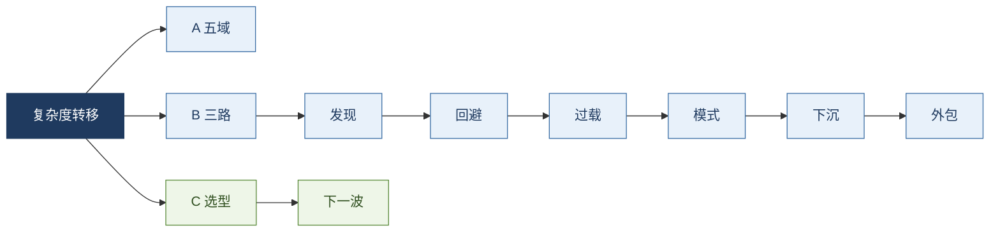
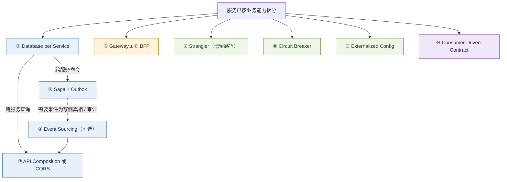
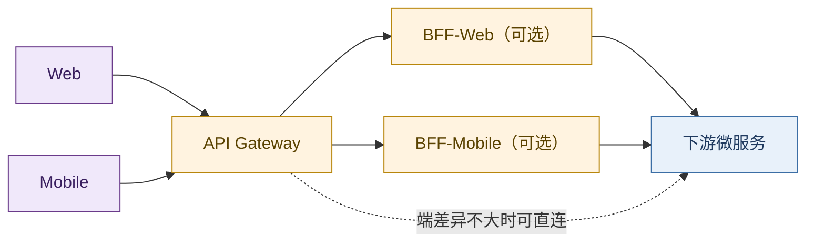
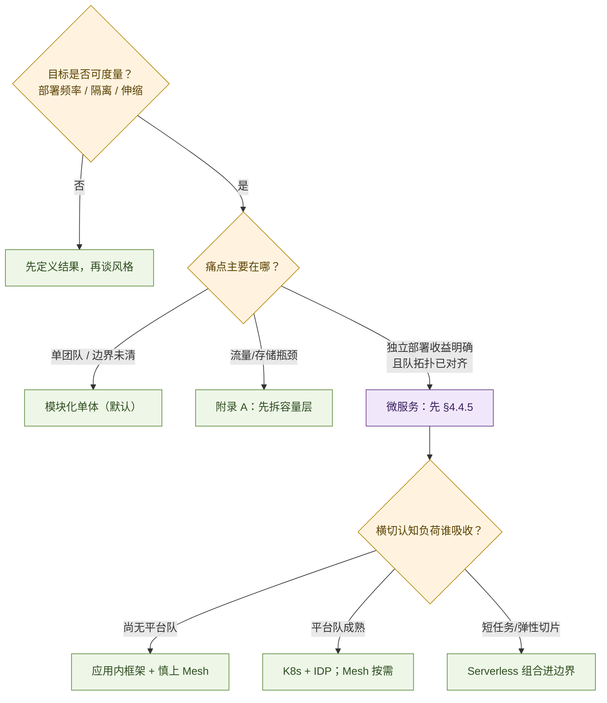

# 服务架构演进：复杂度的代际转移

> 以《凤凰架构》第一章为骨架，补可核验材料与选型对策。中心问题只有一个：  
> **架构为何换代？复杂度去了哪里？当下怎么选、下一波往哪移？**

**结论：**

> **演进不是消灭复杂度，而是选择「把哪一类复杂度交给谁」。**  
> 每一代移走旧痛点，同时换上新痛点。好的演进，是让当前最痛的那一类离开业务开发者日常视野——下沉基础设施、外包云厂商，或沉淀为模式语言。

一般原理见 [43](../40-paradigm/43-entropy-complex-systems-philosophy.md)。正文对齐 Fowler / Richardson / Azure / CNCF。[^fenix][^richardson-ms][^fowler-ms]

**三条分论（后文按此推进）：**

| | 一句话 | 落点 |
| - | ------ | ---- |
| **A** | 五域恒定：代际只换「谁承担」，不换问题本身 | §1.2 |
| **B** | 转移三路：下沉平台 / 外包厂商 / 沉淀模式 | §2–§6 |
| **C** | 选型有法则：先定位痛点与组织约束，再选风格 | §4.4.5、§7–§8 |

> **与行业水位对照（写什么 / 不冒充什么）：**  
> 对齐处 — Fowler / Richardson 模式因果、Newman「微服务是最后手段」、CNCF 云原生定义、Team Topologies「平台降认知负荷」、Gartner 平台工程预测。  
> 补强处 — 组织拓扑与 Conway 约束进选型（§4.3、§7）；Mesh 采用降温的调查事实进展望（§8.2）；隔离粒度补 AWS cell-based（§8.3）。  
> 不作处 — 不宣称六代必须线性经历；不把 Ambient / AI 写成已统一的「下一标准」。

**怎么读：** 因何换代 → §1–§6｜拆开怎么做 → §4.4｜怎么选 → §7｜下一波 → §8｜容量拆法 → 附录 A。  
「后微服务」为《凤凰架构》用语；行业多称云原生 / 平台工程。六代是**问题转移的谱系**，现场常并存，不是必修课表。

**关键词：** 复杂度转移；五域恒定；微服务最后手段；平台工程；Ambient Mesh；cell-based；选型决策

---

## 目录

1. [原始分布式：发现复杂度](#1-原始分布式时代发现复杂度)
2. [单体：回避网络](#2-单体系统时代回避网络)
3. [SOA：规范过载](#3-soa-时代规范过载)
4. [微服务：模式语言](#4-微服务时代应用层自理与模式语言)
5. [后微服务：治理下沉](#5-后微服务时代治理下沉)
6. [无服务：运维外包](#6-无服务时代运维外包)
7. [综合：转移表与选型](#7-综合转移表与选型决策框架)
8. [展望：下一波](#8-展望下一波复杂度往哪移)
9. [附录 A：容量演进路径](#9-附录-a大型网站架构的实践演进路径)
10. [附录 B：技术谱系](#10-附录-b关键技术谱系简表)
11. [参考文献](#11-参考文献)

---

## 1. 原始分布式时代：发现复杂度

> **本节：** 建立分论 A——摊开远程五域；后文各代只回答「交给谁」。

通常以为服务架构从单体开始、为逃离「大泥球」才分布式。历史上相反：对分布式的探索在 20 世纪 70 年代就已开始。

那时单机算力极其有限：16 位处理器、主频往往不到 5 MHz，单机直接卡住了软件能做到的规模上限。人们不得不寻找多台计算机协作支撑同一套软件的方案。这一阶段的中间成果影响深远，例如：

- 惠普 / Apollo 的 **NCA**（Network Computing Architecture）可视作远程服务调用的早期雏形；
- 卡内基·梅隆大学的 **AFS**（Andrew File System）是分布式文件系统的重要早期实践；
- MIT 的 **Kerberos** 为分布式认证与访问控制奠定了基础，至今仍影响 Windows、macOS 等系统的登录与认证。

### 1.1 「透明调用」的理想

UNIX 风格预设：远程调用应尽可能透明，开发者不必关心目标在本地还是远程。

> Worse is Better：保持接口与实现的简单性，往往比准确性、一致性、完整性更优先。[^gabriel]

本地调用默认对端存在、延迟可忽略、失败模式有限、信任共享；穿越网络后几乎全部失效——即「分布式计算八大谬误」。[^fallacies] 于是摊开必须显式处理的问题域；后续 SOA / 微服务 / Mesh 反复回访的，是同一张地图。

### 1.2 远程调用摊开的问题域

> **先看表，再选读细节。** 五域是全文地图；后文微服务熔断、Mesh、Saga 都是在回访同一张表。

| 问题域 | 核心问题 | 典型机制（跨时代） |
| ------ | -------- | ------------------ |
| **定位与调度** | 实例动态、流量如何分配 | 服务发现、负载均衡、健康检查 |
| **故障与韧性** | 延迟、假死、分区、级联失败 | 超时、重试/幂等、熔断、隔离、降级 |
| **表示与传输** | 过程语义如何变成字节流 | 序列化、RPC/消息协议、连接与多路复用 |
| **安全与权限** | 跨主机的身份与机密 | 认证、授权、传输加密 |
| **正确性** | 多机下的一致与重复 | 一致性模型、事务/Saga、去重与补偿 |

**（1）定位与调度** — 本地靠符号链接；远程须先回答「实例此刻可达的地址」。地址因上下线、多副本而动态，于是有服务发现与负载均衡。手段可在客户端库，也可下沉到 DNS / 反代 / 控制平面——问题本身从这一时代起就存在。

**（2）故障与韧性** — 丢包、假死、分区迫使显式约定：超时、重试预算与幂等、熔断、隔离 / 舱壁、降级。网络分区与 CAP 取舍见 [22](./22-distributed-consistency-treatise.md)。微服务断路器、Mesh 超时重试，都在回访本域。

**（3）表示与传输** — 远程只能传可序列化字节：编码、消息边界、同步 RPC 或异步消息、连接多路复用。「HTTP 慢还是 RPC 快」多落在这一层组合差（见 [28](./28-http-rpc-microservice-communication-treatise.md)）。

**（4）安全与权限** — 网络撕开信任边界：传输加密（TLS）、认证、授权。Kerberos 是早期经典；现代 mTLS / 零信任 / 网关鉴权仍在同一域叠代。

**（5）正确性** — 多机下的一致、冲突与重复：强一致换延迟与可用；放宽则把复杂度推给补偿与幂等。微服务拆库后以 Saga / 事件 / CQRS 再成主战场（§4.4；[22](./22-distributed-consistency-treatise.md)）。

这些探索催生了 RPC、DFS。1984 年 Birrell & Nelson 发表 *Implementing Remote Procedure Calls*；[^birrell-rpc] 同期 Sun 推动 ONC RPC / XDR。[^sun-rpc]

> **教训：** 某个功能能够分布式，并不意味着它就应该分布式。强行透明远程，只会把五域代价全部吞进系统。

### 1.3 本节收束

> **移走：** 试图用透明调用屏蔽网络（失败）。**换上：** 对五域的真实认识。**分论 A：** 五域成为跨时代地图；后文只改承担方。

硬件起飞后，行业务实收缩：既然屏蔽不了，就先别分布式——进入 §2。

---

## 2. 单体系统时代：回避网络

> **本节：** 分论 B 第一条路——进程内回避五域；证明「移走 ≠ 消灭」。

硬件提升后，应用收回单一进程（或少量进程）。这不是倒退，而是当时约束下的最优解之一。

须区分规模：小型单体常划算；批判对象是大型单体（发布与协作耦合恶化）。中间态是**模块化单体**：进程内保持模块边界，推迟网络拆分，直到组织或负载证明必要。[^fowler-ms]

> **行业共识（2020s）：** Sam Newman 将微服务称为 **architecture of last resort**——默认应从（模块化）单体出发，只有独立部署、团队自治或监管隔离等收益明确压过分布式代价时才拆。[^newman-last][^newman-book] 模块化单体是当代默认选项，不是「还没来得及微服务」的过渡羞辱。

### 2.1 缺陷：缺乏自治与隔离

进程内调用高效，故障域却连成一片：一处缺陷可拖垮整进程；局部变更迫使整体发布；多人易争用同一代码库。「尽量不出错」在规模上升后会被「出错是常态」打穿。

### 2.2 本节收束

| | |
| - | - |
| **移走** | 五域网络代价 |
| **换上** | 规模复杂度：维护、协作、单故障域 |
| **分论 B** | 回避是转移；规模痛点催生再分布式（§3–§4） |

---

## 3. SOA 时代：规范过载

> **本节：** 分论 B 的反面教材——「大一统规范」覆盖五域，技术可行、实践过载。

Gartner 于 **1996** 提出 SOA 表述。[^gartner-soa] 其后 SOAP / WSDL / UDDI 与 WS-\* 成为企业集成主流；约 2006 年 OSOA 推进 SCA、SDO。[^osoa]

### 3.1 野心与过载

SOA 试图同时回答服务识别、业务拆解与集成标准化：合同是 SOAP / WSDL / WS-\*，管道是 ESB，再叠 BPM / SCA / SDO——五域大多有对应规范。

失败不在「没解决问题」，而在**解决成本超过多数团队吸收能力**。微服务的直接反题：**smart endpoints and dumb pipes**——智能回端点，管道变笨（§4）。[^fenix]

### 3.2 本节收束

> **移走：** 点对点集成混乱。**换上：** 过重协议栈与中心化 ESB。**分论 B：** 转移路径选错也会失败；为 §4 轻管道提供反题。

---

## 4. 微服务时代：应用层自理与模式语言

> **本节：** 分论 B「沉淀模式语言」主战场；§4.4.5 同时服务分论 C。

2014 年 Lewis & Fowler：将应用建成一组小型服务，独立进程、轻量通信（常为 HTTP API）、按业务能力组织、可独立部署。[^fowler-ms]

> **关键词：** smart endpoints and dumb pipes——智能留在端点，管道保持简单。

工作定义：**按业务能力垂直切分、可独立部署的进程集合**，以 REST / gRPC 或消息通信；边界在进程外，不依赖智能总线。

### 4.1 容错设计与「凤凰」含义

不再假定服务始终稳定，而以熔断、隔离、降级应对故障。可靠系统可由会失败的服务组成；局部可重启，整体尽量可用。

### 4.2 自由的代价

卸下 SOA 规范后，发现 / 均衡 / 协议 / 容错回到应用侧，且选型爆炸：

| 问题 | 常见选项（示例） |
| ---- | ---------------- |
| 远程调用 | Dubbo、gRPC、Thrift、Finagle……（见 [28](./28-http-rpc-microservice-communication-treatise.md)） |
| 服务发现 | Eureka、Consul、Nacos、ZooKeeper、etcd…… |
| 配置 / 熔断 | Spring Cloud、自研或厂商方案 |

复杂度变成**基础设施选型与集成**。下一问：能否保留自治、又不把全部横切写进业务库？→ §5。此前，业界先用**设计模式语言**钉住高频问题（分论 B 第三路）。

### 4.3 特征、收益、代价与适用边界

| | |
| - | - |
| **特征** | 按业务垂直切分；独立进程与部署；进程外边界；轻量网络通信 |
| **收益** | 团队 / 发布并行；增量演进；细粒度伸缩；缩小单服务认知负荷 |
| **代价** | 活动部件暴增；复杂度迁到运维与拓扑；分布式固有难题（见 [22](./22-distributed-consistency-treatise.md)） |
| **宜用** | 多团队且边界已清晰；独立部署 / 独立伸缩 / 监管隔离的收益可度量 |
| **慎用** | 小体量、单团队、领域边界尚不清；把「微服务」当默认正确 |

> **组织前提（行业常漏、却决定成败）：** Conway 定律——系统结构镜像通信结构。微服务适合**已能按业务能力划队、且队间交互可契约化**的组织；队未齐就拆进程，得到的是分布式大泥球。Team Topologies 进一步指出：流对齐团队的认知负荷有上限，横切能力应交给平台队以 **X-as-a-Service** 吸收，而不是让每个业务队自建一套治理。[^conway][^team-topologies]  
> **暗线：** 移走「单体协作与发布耦合」→ 换上「分布式数据、边缘、韧性 + 运维认知负荷」。下列模式是技术侧标准应答。[^richardson-ms]

### 4.4 常用设计模式（按问题簇）

按**问题出现顺序**写，不按名词平铺：数据边界 → 跨服务写 → 跨服务读 → 可选事件写模型 → 边缘 → 迁移 / 韧性 → 契约。每步：**因 → 模式 → 代价**。[^richardson-ms][^ms-patterns]

#### 4.4.1 数据所有权与一致性

单体里，一笔「下单」可以在同一数据库事务中改订单表、库存表、客户额度——ACID 由引擎保证。服务拆开之后，若仍让所有服务读写**同一套表**，独立发布立刻落空：改 schema 要协调所有团队，运行时还形成隐性耦合。于是出现数据簇的第一刀。

**（1）因：自治要求数据边界 → Database per Service**

每个服务私有持久化数据，仅通过自身 API 暴露；他服务不得直连库表。隔离可以是逻辑的（独立表 / schema / 库），不必物理上一服务一数据库实例。[^richardson-db] 收益是设计期与运行期解耦：一服务的库变更不迫使他服务改代码；也可按域选型存储（检索用搜索引擎、关系用 OLTP、图用图库）。

| | 内容 |
| - | ---- |
| **代价** | 跨服务事务与跨服务 join 不再「免费」；从单体库拆分本身是高风险设计 |
| **宜用** | 多团队、需独立演进的中大型系统 |
| **慎用** | 小体量、单团队；强共享报表且尚未具备事件 / 组合查询基础 |
| **反模式** | Shared Database：短期省事，长期在数据层抵消微服务目标[^richardson-db] |

**（2）因：跨服务命令无法再用 2PC → Saga（常配 Outbox）**

Database per Service 之后，一笔业务命令往往要改多个服务的数据（例如：创建订单 → 预留信用 → 确认订单）。传统答案是分布式事务（两阶段提交）。在微服务中它通常不可取：造成运行期耦合；许多 NoSQL 不支持；高伸缩下协调代价过高。[^richardson-saga]

**Saga** 把该命令实现为**本地事务序列**：每步只在一个服务内提交，再通过消息推进下一步；若某步因业务规则失败，则对已完成步骤执行**补偿事务**（显式撤销，而非数据库自动回滚）。协调有两路：[^richardson-saga]

| 方式 | 机制 | 特点 |
| ---- | ---- | ---- |
| **协同（Choreography）** | 各服务发布 / 订阅领域事件，无中心指挥 | 去中心；服务增多后链路难追踪 |
| **编排（Orchestration）** | 协调器发命令、收应答，决定下一步 | 流程集中可见；协调器本身成为关键组件 |

概念可追溯至 1987 年 Garcia-Molina 与 Salem 的长事务研究；[^garcia-saga] 微服务语境强调的是**用消息协调的最终一致**，而非恢复单库 ACID。

还有一个常被忽略的前提：每一步必须**原子地**「更新本地库 + 发出消息」。若先提交再发消息，进程可能在中间崩溃，导致事件丢失；反之可能发出事件而事务回滚。标准补救是 **Transactional Outbox**（同事务写入 outbox 表，再异步投递到 broker）；Event Sourcing 则是把「存状态」与「发事件」合成同一次追加。[^richardson-outbox][^richardson-es]

| | 内容 |
| - | ---- |
| **代价** | 缺隔离性（无 ACID 的 I），并发 Saga 可能读到中间态，需幂等与业务对策；参与方增多则调试困难 |
| **宜用** | 跨服务写路径；事件驱动或存储不支持 2PC |
| **慎用** | 单库事务已足够；服务间存在难解循环依赖 |

**（3）因：跨服务查询不能再 SQL join → API Composition，不足则 CQRS**

拆库之后，「某地区客户及其最近订单」一类查询无法用一条 SQL 完成。第一条出路是 **API Composition**：查询端（或网关）分别调用客户服务与订单服务，在内存中组装。实现简单，但延迟与可用性受最慢、最不稳的下游约束，且难以支撑复杂过滤与高 QPS。[^richardson-db]

当组合不够用时，采用 **CQRS（命令查询职责分离）**：写模型仍落在各服务的写库；另建面向查询的**只读物化视图**（读库），由订阅领域事件异步更新。读侧可选搜索引擎、文档库或读扩展的关系库，与写侧独立伸缩；视图相对写库通常是**最终一致**。[^richardson-cqrs] 简易 CQRS 也可仅在同一库内拆分读写模型，完整形才引入双存储。

| | 内容 |
| - | ---- |
| **代价** | 复制延迟；读写模型重复；误用（一切查询都上 CQRS）会显著抬高复杂度 |
| **宜用** | 读多写少、查询形态多样、或写侧已是事件源 |
| **慎用** | 读写负载接近、领域简单、API Composition 已够用 |

**（4）因：既要可靠发事件、又要变更史 → Event Sourcing（可选，而非默认）**

Saga 与领域事件并不强制 Event Sourcing。许多系统用传统 CRUD 表 + Outbox 即可可靠发事件。当领域需要**完整变更史、任意时点回溯**，或希望「追加事件」同时完成持久化与发布时，才引入 **Event Sourcing**：实体状态存为不可变事件序列，当前态由重放（或快照 + 重放）得到；事件存储本身可兼作订阅源。[^richardson-es][^kafka-29]

其直接后果是：事件存储不适合随意查询，**几乎必然配 CQRS 读模型**。学习曲线、事件模式演进与重复投递处理，是主要代价。它解决的是写侧事实与审计问题，**不是** 2PC 的万能替代，也不是 Saga 的前置条件。

> **数据簇顺序（务必按此想）：**  
> 拆服务 → Database per Service → 写：Saga ± Outbox → 读：API Composition →（不够）CQRS →（需事件真相/审计）Event Sourcing + CQRS  
> 详见 [22](./22-distributed-consistency-treatise.md)、[29](./29-kafka-event-streaming-treatise.md)。

#### 4.4.2 客户端接入与边缘

服务变多之后，浏览器或 App 若直连数十个下游，会出现三件事：聊天式往返过多、每个客户端重复实现安全与发现、后端 API 演进直接打断前端。边缘簇回答的是**谁代表后端面对客户端**。

**（5）因：入口与横切需要集中 → API Gateway**

网关位于客户端与服务之间：路由、请求聚合（一次客户端调用扇出到多服务再合并）、SSL 终结、认证鉴权、限流、日志等。Azure 将其拆解为 Gateway Routing / Aggregation / Offloading 三类能力。[^ms-gateway] 它降低前端与后端的耦合，但引入额外跳数，并可能成为单点——须独立扩容与多活，不能「只部署一个」。

与 L4/L7 代理、VIP 入口的层次关系见 [21a](./21a-haproxy-nginx-envoy-treatise.md)：网关解决的是**应用入口与横切**，不等于集群入口的全部故事。

**（6）因：多端需求冲突 → BFF（按端可选）**

Web 与移动端在屏、带宽、交互步骤上不同，硬塞进同一套「通用后端 API」会使接口在臃肿与两端都不合适之间摇摆。**Backend for Frontend**（Sam Newman）主张为每类前端提供专用后端适配：裁剪字段、聚合下游、适配端侧约束；**不应承载核心领域规则**，否则会演变成第二套单体。[^ms-bff]

| | Gateway | BFF |
| - | ------- | --- |
| **主责** | 统一入口与横切治理 | 特定端的 API 形态与聚合 |
| **数量** | 通常企业级少量入口 | 可按 Web / iOS / Android 等增殖 |
| **关系** | 常位于最外层 | 常位于网关之后；端差异不大时可省略 |

#### 4.4.3 演进、韧性与运行配置

**（7）因：不能停机换心 → Strangler Fig**

已上线的大型单体无法「冻结业务、一次切完」。Fowler 的 **Strangler Fig（绞杀榕）** 要求：在客户端与遗留系统之间置入 Facade（常由网关扮演），将请求逐步从单体导向新服务；新功能只进微服务；迁移完成后退役单体并最终可拆除 Facade。[^fowler-strangler][^ms-strangler]

难点往往不在路由，而在过渡期的**数据**：双写、共享库、一致性窗口。若无法拦截进入遗留系统的流量，该模式难以成立。小单体更适合一次性替换，不必上绞杀过程。

**（8）因：同步调用链上的持续故障 → Circuit Breaker**

§4.1 接受「服务会失败」。同步链路上，对瞬时抖动可**有限重试**；若下游已持续失败，重试只会占满线程、放大故障。**断路器**作为调用代理，统计近期失败并在三态间切换：[^ms-breaker]

| 状态 | 行为 |
| ---- | ---- |
| **关闭** | 正常转发；失败达阈则打开 |
| **打开** | 立即失败；超时后进入半开 |
| **半开** | 放行探测流量；成功则关闭，失败则再次打开 |

半开态的意义是避免恢复中的服务被流量冲垮。纯事件驱动、几乎无同步下游时，断路器收益有限；后微服务时代，同类策略常下沉到 Sidecar / Mesh（§5.2），但**问题域不变**。

**（9）因：多环境与密钥不能进镜像 → Externalized Configuration**

服务数量上升后，「配置写死在制品里」会迫使每次改数据库地址或密钥都重建镜像，并把生产凭据带进仓库。十二要素应用要求配置与代码分离，经环境变量或配置 / 密钥服务在运行时注入。[^ms-config] 后微服务中，部分配置进一步落到 ConfigMap / Secret，但仍属同一原则：构建一次，多环境注入。

#### 4.4.4 协作与契约质量

**（10）因：多团队并行改接口 → Consumer-Driven Contract**

服务由不同团队交付时，消费方用 Test Double 做集成测试速度快，但无法发现提供方的破坏性变更；端到端测试又能慢又脆。**消费端驱动的契约测试**由消费方写下「我如何调用、期望何种响应 / 消息」；提供方将其纳入自动化测试，变更在 CI 即被抓住。[^fowler-contract][^pact] 它支撑自治，但契约本身若与真实流量脱节，仍可能漏检——契约质量与生产流量样本需要维护。

单团队、接口极少变动时，不必强上完整契约体系。

#### 4.4.5 模式咬合与选型顺序

1. **能否不拆** — 优先模块化单体（§2）  
2. **拆则先定数据边界** — Database per Service；默认拒绝 Shared Database  
3. **跨服务写** — Saga ± Outbox；慎用 2PC  
4. **跨服务读** — 先 API Composition，不足再 CQRS  
5. **事件为写侧真相 / 强审计** — 再上 Event Sourcing（并配 CQRS）  
6. **多端接入** — Gateway；端差异大再加 BFF  
7. **遗留迁移** — Strangler Fig + 可拦截入口  
8. **同步链韧性** — 瞬时：重试+幂等；持续失败：Circuit Breaker（可下沉 Mesh）  
9. **多环境** — Externalized Configuration  
10. **多团队接口** — Consumer-Driven Contract  

> **误用：** 未定数据边界就上 CQRS；无 Outbox 的假事件驱动；BFF 写成领域层；用断路器代替超时与幂等。  
> **收束：** 模式是转移复杂度的工具，不是银弹。

#### 4.4.6 本节收束

> **移走：** 单体发布耦合、SOA 重管道。**换上：** 分布式数据 / 边缘 / 韧性 / 契约 + 治理库选型爆炸。**未完成：** 发现 / mTLS / 部分熔断仍常在业务库 → §5。

---

## 5. 后微服务时代：治理下沉

> **本节：** 分论 B「下沉基础设施」。横切可平台化；**数据正确性不下沉**。

§4.2 留下一问：发现、均衡、TLS、部分熔断，是否必须写在业务框架库里？K8s 成为主流编排后，平台开始承接 §1.2 若干域的默认实现。

### 5.1 Kubernetes 与「下沉」

2016 年 K8s 入驻 CNCF；2017 年末 Docker 支持 K8s、AWS 推出 EKS——编排格局趋于明朗。[^k8s-2017][^cncf-k8s]

| §1.2 / §4 | 应用内 | 平台侧 |
| --------- | ------ | ------ |
| 定位与调度 | 客户端发现 + Ribbon 类 | Service、CoreDNS、Ingress / Gateway API |
| 配置 | 文件 / 配置中心客户端 | ConfigMap / Secret |
| 入口与 TLS | 进程内或独立网关 | Ingress、证书控制器、外置 Gateway |
| 发布与自愈 | 脚本与人工 | Deployment、探针、滚动更新 |

> **要点：** 「后微服务」= 应用 + 基础设施合力（行业多称云原生 / 平台工程）。[^post-ms][^cncf-definition]  
> Database per Service / Saga / CQRS **不因上了 K8s 而消失**——平台不下沉业务事务边界。

### 5.2 Service Mesh：更细的治理粒度

K8s 默认抽象多在 Pod / Service 级，难做「同服务不同接口」的差异化策略。Service Mesh 用 Sidecar（或等价数据面）劫持东西向流量：超时、重试、熔断、mTLS、可观测——把 Circuit Breaker 等**标准化下沉**。[^service-mesh]

代价：控制平面、数据面资源、平台运维。CNCF 调查显示 Mesh 生产采用在 2023→2024 有所回落——Sidecar 税与运维门槛是主因，也是 Ambient / eBPF 要再转移的痛点（§8.2）。**Mesh 是可选下沉，不是后微服务必修课。**

### 5.3 本节收束

> **移走：** 每业务队自建治理库。**换上：** 平台 YAML / 控制平面 / SRE 负荷。**仍留应用侧：** 数据正确性（§4.4）。**残余 →** §6 外包、§8 平台产品化。

透明度来自平台合同，而非假装网络可靠。

---

## 6. 无服务时代：运维外包

> **本节：** 分论 B「外包云厂商」。与微服务是可组合，不是单线取代。

Serverless：**尽量不让业务开发者感知服务器、集群与容量规划**。

### 6.1 愿景

- **FaaS**：短生命周期业务逻辑  
- **BaaS**：托管库、对象存储、身份、消息等  

部署与弹性交云厂商。Berkeley 2019 报告类比为：少碰「寄存器」，多写业务表达。[^berkeley-serverless]

### 6.2 本节收束

冷启动、无状态 / 短任务偏向；长连接与强尾延迟需单独评估。

> **移走：** 容量规划与部分运维。**换上：** 厂商边界、运行时限制、锁定与账单。**分论 C：** 与微服务数据边界组合使用，勿口号式取代。

---

## 7. 综合：转移表与选型决策框架

### 7.1 六代转移总表

| 时代 | 核心问题 | 应对 | 复杂度去向 | 分论 |
| ---- | -------- | ---- | ---------- | ---- |
| 原始分布式 | 透明化掩盖网络 | RPC / DFS | 暴露五域 | A |
| 单体 | 规模下维护与协作 | 单进程 | 换上规模耦合 | B |
| SOA | 通信与治理 | 规范 + ESB | 过重协议与流程 | B（反） |
| 微服务 | 同上，拒重规范 | 轻协议 + 模式簇 | 选型、数据、边缘、韧性 | B+C |
| 后微服务 | 应用层治理过重 | K8s + Mesh | 平台 / YAML / SRE | B |
| 无服务 | 运维与资源 | FaaS + BaaS | 云厂商与成本模型 | B |

> **回证中心论点：** 每一代都在把最痛的复杂度移出业务日常视野——没有消灭，只是转移。  
> **并存提醒：** 表是谱系，不是通关顺序；同一组织可同时有模块化单体核心、若干微服务、托管 Serverless 切片与平台层。

### 7.2 选型决策框架

不要先问「该上微服务吗」，按**痛点 × 组织**决策（分论 C；对齐 Newman / Forrester「光谱而非二元」[^forrester-spectrum]）：

**五条硬规则：**

1. **先定可度量结果** — 部署频率、故障爆破半径、团队吞吐等；风格是手段。[^newman-last]  
2. **先定痛点落域** — §1.2 哪一域？若只是规模耦合，勿用分布式药方。  
3. **能不拆就不拆** — 默认模块化单体；拆则队拓扑与数据边界同时成立，再走 §4.4.5。  
4. **平台只接横切与认知负荷** — 发现 / 证书 / 发布 / 黄金路径；**不接**业务事务与领域边界。K8s ≠ 一致性免费。[^team-topologies]  
5. **Serverless / Mesh 皆可选切片** — 不是风格取代；Mesh 尤其按需（见 §8.2 采用降温事实）。

已上微服务 + K8s 时，下一步通常是平台产品化（§8.1），不是再发明框架。容量拆法 → 附录 A；年代锚点 → 附录 B。

---

## 8. 展望：下一波复杂度往哪移

新痛点已换位：流对齐团队的**认知负荷**、Sidecar 税、平台可运营性、AI 算力与推理流量。仍服从中心论点——再次选择承担方。下列判断附可核验数据；**趋势 ≠ 已统一标准**。

### 8.1 平台工程与 IDP（组织解，不是又一代协议）

若平台仍是「文档 + 工单 + 裸集群」，负担只是换科室。Team Topologies 的核心主张：平台的主价值是降低流对齐团队的**外在认知负荷**，并按内部产品经营（自助、可用性、合用），而非强制标准化。[^team-topologies] Gartner：到 **2026** 年约 **80%** 大型软件工程组织将建平台团队（2022 约 45%）。[^gartner-pe] CNCF 侧强调 IDP（如 Backstage）与「K8s 是地基、不是完整平台」。[^cncf-trends-2024][^cncf-pe-2025]

> **移走 / 换上：** 每业务队消化全套云原生工具链 → 平台产品管理、SLO、团队交互模式（协作 → X-as-a-Service）。  
> **行业水位：** 平台工程已主流化，但多数组织仍处早期；成熟度不足时硬推 Mesh / 多云只会再转移一次混乱。

### 8.2 Mesh 降温与 Ambient / eBPF（对「下沉过猛」的纠偏）

CNCF Annual Survey **2024**：Service Mesh 生产采用约 **42%**，低于 2023 的约 **50%**；「近期无计划使用」上升——主因是复杂度、成本、性能与运维专长门槛。[^cncf-survey-2024] 这不是 Mesh 死亡，而是行业对 **Sidecar 全家桶默认上** 的降温。

Istio Ambient Mode 于 **v1.24（2024-11）** GA：节点级 ztunnel 做 L4（含 mTLS），按需 Waypoint 做 L7——把「默认每 Pod 一代理」拆成可增量采用。[^istio-ambient-ga] eBPF 数据面（如 Cilium）并行把网络 / 可观测 / 部分策略推进内核（见 [24a](./24a-cilium-ebpf-dataplane-treatise.md)）。

> **移走 / 换上：** Sidecar 税与「Mesh 必上」教条 → 共享 L4 + 按需 L7 / 内核专长。五域不变。  
> **选型含义：** 无明确的 mTLS / L7 策略 / 多集群流量需求时，不必为「云原生齐全」上 Mesh。

### 8.3 可组合边界与 cell-based（隔离不一定等于微服务）

模块化单体重回默认（Newman / Gartner / Forrester 光谱论）。[^newman-last][^gartner-mod-mono][^forrester-spectrum] 默认可组合：进程内模块 + 必要时服务边界 + Serverless 切片。

另一条常被忽略的隔离轴是 **cell-based architecture**（舱壁 / 蜂窝）：按分区键把工作负载复制为互不共享状态的 cell，单 cell 故障或坏发布只影响一部分流量——AWS Well-Architected 将其作为限制爆破半径的实践，**不必**为隔离而拆成细粒度微服务。[^aws-cell] 适合超高可用、多租户或「不能全站一起挂」的关键面；代价是冗余与路由层复杂度，不是中小系统默认项。

> **移走 / 换上：** 「隔离 = 必须微服务」的简化 → 模块纪律 / 服务边界 / cell 分区按目标选用。

### 8.4 AI 工作负载与智能运维（缺口在平台成熟度）

CNCF 材料显示大量组织已在 K8s 上跑 GenAI，但 AI 工作负载的发布节奏与平台成熟度仍显著落后于「innovator」档——瓶颈常在调度、异构算力、推理流量治理与组织能力，而非再发明一种服务风格（见 [23](./23-kubernetes-control-plane-doctrine.md)）。[^cncf-survey-2025] 平台叙事从 YAML 自助走向智能辅助时，复杂度从人工机械段转到**模型可靠性、策略边界与人机交接**（见 [41](../40-paradigm/41-ai-engineering-paradigm.md)、[42](../40-paradigm/42-agentic-sre-operations-playbook.md)）。

> **移走 / 换上：** 部分机械值班 → 模型与策略治理。控制仍是搬运；AI 不自动取消 §4.4 数据边界。

### 8.5 收束

| 抓手 | 移走 | 换上 | 仍在 | 证据水位 |
| ---- | ---- | ---- | ---- | -------- |
| 平台工程 / IDP | 工具链与认知过载 | 平台产品与团队交互 | 领域边界、数据正确性 | Gartner 预测 + Team Topologies |
| Ambient / eBPF | Sidecar 税、Mesh 教条 | 共享 L4 + 按需 L7 / 内核 | 故障与安全域 | CNCF Survey 降温 + Ambient GA |
| 可组合 + cell | 「隔离=微服务」 | 模块 / 服务 / cell 分档 | 再拆分与路由代价 | Newman + AWS WA |
| AI 平台与运维 | 部分机械操作 | 模型与策略治理 | 责任与端到端正确性 | CNCF AI-on-K8s 成熟度差 |

> **一句话：** 下一波不是口号接力，而是把平台**产品化**、把 Mesh **按需轻量化**、把隔离**与目标对齐**（含 cell），并让 AI 参与运维搬运——五域地图、三路转移与组织约束仍然够用。

---

## 9. 附录 A：大型网站架构的实践演进路径

> **另一条轴：** 容量驱动——瓶颈在哪一层，就拆哪一层（与风格演进互补）。

1. **初始单体** — 应用 / 库 / 文件同机，很快撞单机上限  
2. **应用与数据分离** — 按 CPU / 磁盘 / 容量分机选型  
3. **缓存** — 热点进内存，缓解读压  
4. **应用服务器集群** — 横向扩展 + 负载均衡  
5. **数据库读写分离** — 写主读从  
6. **反向代理与 CDN** — 静态就近缓存  
7. **分布式文件 / 库** — 业务分库通常优先于过早上分布式库  
8. **NoSQL 与搜索** — 补特定查询与检索  
9. **业务拆分** — 按产品线 / 领域降协作与发布耦合  
10. **分布式服务化** — 抽共享服务，汇合主文 SOA / 微服务叙事

---

## 10. 附录 B：关键技术谱系简表

名词年代锚点（非完整编年）：

| 时间 | 事件 | 与本文的关系 |
| ------ | ------ | -------------- |
| 1969–1970s | UNIX 在贝尔实验室诞生并传播 | 「简单组合」影响后续分布式愿景 |
| 1984 | Birrell & Nelson RPC；Sun NFS / ONC RPC | 远程调用成为一等公民 |
| 1987 | Garcia-Molina & Salem《Sagas》 | 长事务 / 补偿；微服务 Saga 源头 |
| 1989–1990s | OMG CORBA；其后 Java EE / 中间件 | 应用层互联标准化尝试 |
| 1994–1997 | 分布式计算八大谬误 | 批判「透明远程」幻觉 |
| 1996 | Gartner 提出 SOA 表述 | SOA 概念起点 |
| 1999–2000s | SOAP / WSDL 等 Web 服务栈 | SOA 工程化底座 |
| 2004 | Fowler Strangler Fig | 遗留增量替换 |
| 2006 | Fowler Consumer-Driven Contracts | 多团队接口契约 |
| 2014 | Lewis & Fowler《Microservices》；其后 Richardson 模式语言 | 微服务定义与数据 / 协作模式 |
| 2016–2017 | K8s 入驻 CNCF；Mesh 术语走红 | 云原生 / 平台下沉拐点 |
| 2019 | Berkeley Serverless 技术报告 | 无服务作为云编程模型表述 |
| 2019 | Skelton & Pais《Team Topologies》 | 平台降认知负荷；§8.1 |
| 2023 | AWS Well-Architected cell-based 指南 | §8.3：隔离 ≠ 必须微服务 |
| 2023–2026 | 平台工程 / IDP 主流化（Gartner 2026≈80%） | §8.1 |
| 2024 | CNCF Survey：Mesh 生产采用约 42%（低于 2023 的 50%） | §8.2：下沉过猛的纠偏 |
| 2024-11 | Istio Ambient Mode GA（v1.24） | §8.2：Sidecar 税再转移 |
| 2024– | eBPF 数据面与 AI-on-K8s 成熟度差 | §8.2–§8.4；本库 23 / 24a |

关于厂商叙事（CORBA → EJB → SOA → Spring / Cloud Foundry → CNCF / K8s → Serverless）确有商业竞争与标准话语权的成分，但**「云原生」本身并非某一家的私有商标**：CNCF 将其界定为在现代动态环境（如公有云、私有云、混合云）中构建和运行可弹性扩展应用的方法，并强调容器、服务网格、微服务、不可变基础设施与声明式 API 等技术集合[^cncf-definition]。理解演进时，宜区分「工程问题」与「厂商叙事」。

---

## 11. 参考文献

[^gabriel]: Richard P. Gabriel, *Lisp: Good News, Bad News, How to Win Big*（含对 “Worse is Better” 的经典讨论）。相关整理亦见于《凤凰架构》对 UNIX 设计哲学的引用说明。  
[^birrell-rpc]: Andrew D. Birrell, Bruce Jay Nelson, “Implementing Remote Procedure Calls,” *ACM Transactions on Computer Systems*, 1984. <https://doi.org/10.1145/2080.357392>  
[^sun-rpc]: Sun Microsystems, NFS / ONC RPC 与 XDR 相关规范与实现（约 1984–1985）；行业史回顾可参考后续 NFS 技术史材料。  
[^fallacies]: L. Peter Deutsch et al., “The Eight Fallacies of Distributed Computing,” Sun Microsystems（Deutsch 1994 年提出前七条，James Gosling 约 1997 年补充第八条）。概述见 <https://en.wikipedia.org/wiki/Fallacies_of_distributed_computing>  
[^gartner-soa]: W. Roy Schulte, Yefim V. Natis, Gartner research note on “Service Oriented” Architectures, 12 April 1996.  
[^osoa]: Open SOA Collaboration（OSOA）关于 SCA / SDO 等规范的产业协作（约 2005–2007），其后相关工作进入 OASIS 等标准化路径。  
[^fowler-ms]: James Lewis, Martin Fowler, “Microservices,” 25 March 2014. <https://martinfowler.com/articles/microservices.html>  
[^k8s-2017]: 2017 年 Docker 宣布产品支持 Kubernetes；AWS 于 2017 年 11 月宣布 Amazon EKS——常被用作编排格局明朗化的行业节点。  
[^cncf-k8s]: Cloud Native Computing Foundation, Kubernetes project page（2016 年接受为托管项目，2018 年 Graduated）. <https://www.cncf.io/projects/kubernetes/>  
[^post-ms]: 周志明，《凤凰架构：构建可靠的大型分布式系统》「后微服务时代」：<https://icyfenix.cn/architecture/architect-history/post-microservices.html>  
[^service-mesh]: William Morgan / Buoyant 对 Service Mesh 的定义与 Linkerd 实践；Istio 项目（2017）与 Envoy 数据面。综述见 Phil Calçado, “Pattern: Service Mesh,” 2017. <https://philcalcado.com/2017/08/03/pattern_service_mesh.html>  
[^berkeley-serverless]: Eric Jonas et al., “Cloud Programming Simplified: A Berkeley View on Serverless Computing,” EECS-2019-3, UC Berkeley, 2019. <https://www2.eecs.berkeley.edu/Pubs/TechRpts/2019/EECS-2019-3.html>  
[^cncf-definition]: CNCF, “Cloud Native Definition.” <https://github.com/cncf/toc/blob/main/DEFINITION.md>  
[^fenix]: 周志明，《凤凰架构：构建可靠的大型分布式系统》，在线版：<https://icyfenix.cn/>（架构演进各章：原始分布式 / 单体 / SOA / 微服务 / 后微服务 / 无服务）。  
[^richardson-ms]: Chris Richardson, *Microservices Patterns* / microservices.io pattern language. <https://microservices.io/patterns/>  
[^richardson-db]: Chris Richardson, “Pattern: Database per service.” <https://microservices.io/patterns/data/database-per-service.html>  
[^richardson-es]: Chris Richardson, “Pattern: Event sourcing.” <https://microservices.io/patterns/data/event-sourcing.html>  
[^richardson-cqrs]: Chris Richardson, “Pattern: CQRS.” <https://microservices.io/patterns/data/cqrs.html>  
[^richardson-saga]: Chris Richardson, “Pattern: Saga.” <https://microservices.io/patterns/data/saga.html>  
[^garcia-saga]: Hector Garcia-Molina, Kenneth Salem, “Sagas,” *ACM SIGMOD*, 1987.  
[^richardson-outbox]: Chris Richardson, “Pattern: Transactional outbox.” <https://microservices.io/patterns/data/transactional-outbox.html>  
[^ms-patterns]: Microsoft Azure Architecture Center, “Design patterns for microservices.” <https://learn.microsoft.com/azure/architecture/microservices/design/patterns>  
[^ms-gateway]: Microsoft Azure Architecture Center, “API gateways for microservices.” <https://learn.microsoft.com/azure/architecture/microservices/design/gateway>  
[^ms-bff]: Sam Newman, “Backends for Frontends”; Microsoft Azure, “Backends for Frontends pattern.” <https://learn.microsoft.com/azure/architecture/patterns/backends-for-frontends>  
[^fowler-strangler]: Martin Fowler, “StranglerFigApplication,” 2004. <https://martinfowler.com/bliki/StranglerFigApplication.html>  
[^ms-strangler]: Microsoft Azure Architecture Center, “Strangler Fig pattern.” <https://learn.microsoft.com/azure/architecture/patterns/strangler-fig>  
[^ms-breaker]: Microsoft Azure Architecture Center, “Circuit Breaker pattern.” <https://learn.microsoft.com/azure/architecture/patterns/circuit-breaker>  
[^ms-config]: Adam Wiggins, *The Twelve-Factor App*, “Config.” <https://12factor.net/config>；配置下沉亦见 Kubernetes ConfigMap / Secret（§5）。  
[^fowler-contract]: Martin Fowler, “Consumer-Driven Contracts,” 2006. <https://martinfowler.com/articles/consumerDrivenContracts.html>  
[^pact]: Pact foundation, consumer-driven contract testing. <https://docs.pact.io/>  
[^kafka-29]: 本库 [29](./29-kafka-event-streaming-treatise.md)：事件日志作为跨服务传播与多订阅底座。  
[^gartner-pe]: Gartner, Platform Engineering topic page：到 2026 年约 80% 大型软件工程组织将建立平台工程团队（2022 年约 45%）。<https://www.gartner.com/en/infrastructure-and-it-operations-leaders/topics/platform-engineering>  
[^cncf-trends-2024]: CNCF, “Emerging trends in the cloud native ecosystem,” 19 Nov 2024（IDP / Backstage、平台工程、eBPF 相关可持续性与可观测等）。<https://www.cncf.io/blog/2024/11/19/emerging-trends-in-the-cloud-native-ecosystem/>  
[^cncf-pe-2025]: CNCF, “From YAML to Intelligence: The Evolution of Platform Engineering,” 22 Jul 2025（IDP 作为平台工程核心交付物）。<https://www.cncf.io/blog/2025/07/22/from-yaml-to-intelligence-the-evolution-of-platform-engineering/>  
[^istio-ambient-ga]: CNCF / Istio, “Fast, secure, and simple: Istio’s Ambient Mode reaches General Availability in v1.24,” 7 Nov 2024。<https://www.cncf.io/blog/2024/11/07/fast-secure-and-simple-istios-ambient-mode-reaches-general-availability-in-v1-24/>  
[^gartner-mod-mono]: Gartner, “The Best Approach to Balancing Microservices and Monoliths”（模块化单体作为微服务增殖后的再平衡选项，2024）。<https://www.gartner.com/en/documents/5752615>  
[^newman-last]: Sam Newman 多次将微服务表述为 “architecture of last resort / not the default”；参见 InfoQ 访谈与公开演讲整理，例如 <https://www.infoq.com/podcasts/microservices-benefits-supersede-caveats/>  
[^newman-book]: Sam Newman, *Building Microservices*, 2nd ed., O’Reilly, 2021. <https://samnewman.io/books/building_microservices_2nd_edition/>  
[^conway]: Melvin E. Conway, “How Do Committees Invent?” *Datamation*, 1968（Conway’s Law）。  
[^team-topologies]: Matthew Skelton, Manuel Pais, *Team Topologies*, IT Revolution, 2019；Fowler 摘要：<https://martinfowler.com/bliki/TeamTopologies.html>  
[^forrester-spectrum]: Forrester, monoliths vs microservices as a spectrum（非二元对决）— 见 “Beyond The Architecture Cage Match” 等公开论述。<https://www.forrester.com/blogs/beyond-the-architecture-cage-match-the-microservices-vs-monoliths-battle-is-hurting-your-business/>  
[^cncf-survey-2024]: CNCF Annual Survey 2024：Service Mesh 生产采用约 42%（2023 约 50%）。报告 PDF：<https://www.cncf.io/wp-content/uploads/2025/04/cncf_annual_survey24_031225a.pdf>  
[^cncf-survey-2025]: CNCF Annual Survey 2025：云原生成熟度与 AI / Mesh 采用相关；innovator 更可能生产使用 Mesh 等高级能力。<https://www.cncf.io/wp-content/uploads/2026/01/CNCF_Annual_Survey_Report_final.pdf>  
[^aws-cell]: AWS Well-Architected, “Reducing the Scope of Impact with Cell-Based Architecture,” 2023；REL bulkhead / cell 实践。<https://docs.aws.amazon.com/wellarchitected/latest/reducing-scope-of-impact-with-cell-based-architecture/reducing-the-scope-of-impact-with-cell-based-architecture.html>

### 延伸阅读

- 周志明，《凤凰架构》演进各章；Sam Newman,《Building Microservices》(2nd)；Chris Richardson,《Microservices Patterns》  
- Skelton & Pais,《Team Topologies》；AWS Well-Architected cell-based 指南；CNCF Annual Survey 2024/2025  
- 本库 [22](./22-distributed-consistency-treatise.md) / [28](./28-http-rpc-microservice-communication-treatise.md) / [29](./29-kafka-event-streaming-treatise.md) / [21a](./21a-haproxy-nginx-envoy-treatise.md) / [23](./23-kubernetes-control-plane-doctrine.md) / [24a](./24a-cilium-ebpf-dataplane-treatise.md)  
- 本库 [43](../40-paradigm/43-entropy-complex-systems-philosophy.md) / [41](../40-paradigm/41-ai-engineering-paradigm.md) / [42](../40-paradigm/42-agentic-sre-operations-playbook.md)

**声明：** 代际地图与决策顺序，非中间件手册；展望附调查与厂商材料，不作时间表承诺。冲突时以 Fowler / Newman / Richardson / Azure / CNCF / AWS WA / 你方约束为准。

---
