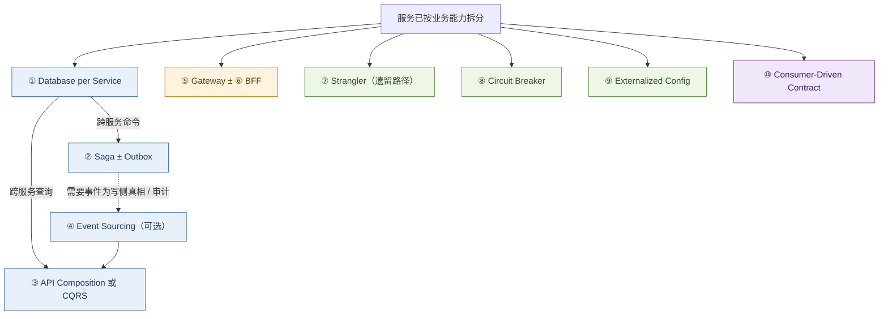
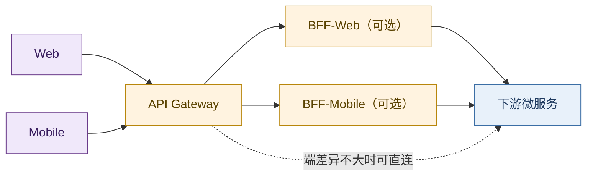

# 服务架构演进：复杂度的代际转移

> 后端工程知识常随故障与选型零散积累：一致性、编排、缓存、声明式平台各懂一截，却难形成代际关系。本文是对周志明《凤凰架构》第一章的读后整理，并补充可核验材料、时间线与微服务模式簇。脉络为原始分布式 → 单体 → SOA → 微服务 → 后微服务 → 无服务；暗线是：**复杂度不会消失，只会转移。**

每一代风格因上一代解决不了的具体问题而生。理解这条暗线，比记住任何一张架构图更有用。

**结论：**

> **好的架构演进，不是消灭复杂度，而是把当前最痛的那种复杂度移出开发者日常视野——有时下沉到基础设施，有时交给云厂商，有时沉淀为可复用模式。**

同一原理的一般说法见 [43 熵与复杂系统](../40-paradigm/43-entropy-complex-systems-philosophy.md)：控制是搬运，有序是局部现象。本文是它在服务架构代际上的专名。

## 摘要

服务架构从原始分布式、单体、SOA、微服务、后微服务到无服务，每一代因上一代解决不了的具体问题而生。暗线是：**复杂度不会消失，只会转移**——下沉到基础设施、外包给云厂商，或沉淀为模式语言。§1.2 给出远程调用的五类问题域（后续时代反复回访）；§4 在 Fowler 定义与 Richardson 模式语言上展开数据 / 边缘 / 演进韧性 / 契约四簇；§5–§6 说明治理如何下沉到 Kubernetes / Mesh，以及 Serverless 如何改写运维边界。正文以《凤凰架构》演进骨架为线索，史实与模式定义对齐可核验一手材料。[^fenix][^richardson-ms][^fowler-ms]

**关键词：** 服务架构；复杂度转移；微服务；设计模式；Database per Service；Saga；CQRS；API Gateway；Service Mesh；Serverless

### 读法与边界

| 轴 | 本文提供什么 | 本文不提供什么 |
| -- | ------------ | -------------- |
| **思想史** | 六代风格因何出现、复杂度去向 | 某一云厂商的产品选型手册 |
| **问题域** | §1.2 五域作为跨时代地图 | 协议 / 一致性的形式化证明（见 [16a](../10-chronicle/16a-tcp-ip-illustrated-treatise.md)、[22](./22-distributed-consistency-treatise.md)） |
| **模式** | §4.4 因果顺序与适用边界 | 逐模式的代码实现与中间件配置 |
| **容量路径** | 附录 A 流量驱动的拆分步骤 | 与思想史一一年代对应的编年 |

「后微服务」为《凤凰架构》用语，指治理下沉到编排与网格；行业更常称云原生 / 平台工程。文中保留该词以便与原书对照，并在 §5 给出 CNCF 语境。

---

## 目录

- [摘要](#摘要)
    - [读法与边界](#读法与边界)
1. [原始分布式时代](#1-原始分布式时代)
    - [1.1 「透明调用」的理想](#11-透明调用的理想)
    - [1.2 远程调用摊开的问题域](#12-远程调用摊开的问题域)
    - [1.3 这一代面对的复杂度](#13-这一代面对的复杂度)
2. [单体系统时代](#2-单体系统时代)
    - [2.1 缺陷：缺乏自治与隔离](#21-缺陷缺乏自治与隔离)
    - [2.2 这一代面对的复杂度](#22-这一代面对的复杂度)
3. [SOA 时代](#3-soa-时代)
    - [3.1 野心与过载](#31-野心与过载)
    - [3.2 这一代面对的复杂度](#32-这一代面对的复杂度)
4. [微服务时代](#4-微服务时代)
    - [4.1 容错设计与「凤凰」含义](#41-容错设计与凤凰含义)
    - [4.2 自由的代价](#42-自由的代价)
    - [4.3 特征、收益、代价与适用边界](#43-特征收益代价与适用边界)
    - [4.4 常用设计模式（按问题簇）](#44-常用设计模式按问题簇)
5. [后微服务时代](#5-后微服务时代)
    - [5.1 Kubernetes 与「下沉」](#51-kubernetes-与下沉)
    - [5.2 Service Mesh：更细的治理粒度](#52-service-mesh更细的治理粒度)
    - [5.3 这一代面对的复杂度](#53-这一代面对的复杂度)
6. [无服务时代](#6-无服务时代)
    - [6.1 愿景](#61-愿景)
    - [6.2 局限与复杂度形态](#62-局限与复杂度形态)
7. [总结：复杂度如何转移](#7-总结复杂度如何转移)
8. [附录 A：大型网站架构的实践演进路径](#8-附录-a大型网站架构的实践演进路径)
9. [附录 B：关键技术谱系简表](#9-附录-b关键技术谱系简表)
10. [参考文献](#10-参考文献)

下图为六代服务架构的演进主线：每一代移走当时最痛的复杂度，而非消灭复杂度。

---

## 1. 原始分布式时代

通常我们会认为：服务架构从单体开始，为了逃离「大泥球」才搞分布式。历史上恰恰相反——对分布式的探索在 20 世纪 70 年代就已开始。

那时单机算力极其有限：16 位处理器、主频往往不到 5 MHz，单机直接卡住了软件能做到的规模上限。人们不得不寻找多台计算机协作支撑同一套软件的方案。这一阶段的中间成果影响深远，例如：

- 惠普 / Apollo 的 **NCA**（Network Computing Architecture）可视作远程服务调用的早期雏形；
- 卡内基·梅隆大学的 **AFS**（Andrew File System）是分布式文件系统的重要早期实践；
- MIT 的 **Kerberos** 为分布式认证与访问控制奠定了基础，至今仍影响 Windows、macOS 等系统的登录与认证。

### 1.1 「透明调用」的理想

受 UNIX 设计风格影响，当时有一个重要预设：**分布式环境中的服务调用、资源访问应尽可能透明**，开发者不必关心目标在本地还是远程。

> 保持接口与实现的简单性，比系统的任何其他属性——包括准确性、一致性和完整性——都来得更加重要。  
> —— Richard P. Gabriel 所概括的「Worse is Better」取向（与 UNIX / Lisp 共同体对「简单优先」的讨论相关）[^gabriel]

理想很美，但本地调用与远程调用的合同不同。进程内调用默认：对端存在、延迟可忽略、失败模式有限、地址空间与信任边界共享。一旦穿越网络，这些默认几乎全部失效——后来被 L. Peter Deutsch 等人概括为「分布式计算的八大谬误」：网络可靠、延迟为零、带宽无限、网络安全、拓扑不变、管理者唯一、传输代价为零、网络同质……长期运行中几乎无一成立。[^fallacies]

于是「透明远程」一碰到工程现实，就会摊开一整组必须显式处理的问题域。它们不是清单点缀，而是后续 SOA、微服务、Service Mesh 反复回访的同一张地图。

### 1.2 远程调用摊开的问题域

**（1）定位与调度：谁在哪里、流量如何分配**

本地调用靠符号与链接器；远程则须先回答「实例此刻可达的地址是什么」。主机上下线、多副本、故障摘除，使地址成为动态事实，于是出现**服务发现**（注册、健康检查、订阅变更）。多个健康实例并存时，还须**负载均衡**（轮询、加权、会话亲和、基于延迟或错误率的策略），并处理部分节点过载而整体仍「看似可用」的假象。发现与均衡既可做在客户端库，也可下沉到 DNS、反向代理或后来的控制平面——手段在变，问题本身从原始分布式时代起就已存在。

**（2）故障与韧性：超时、分区、以及故障的传播**

网络会丢包、乱序、延迟尖刺；对端可能假死（进程在、端口开，但不推进）。调用方若无限等待，线程与连接会被拖死；若盲目重试，可放大瞬时故障成雪崩。因此必须显式约定：**超时**、重试预算与幂等、**熔断**（持续失败时快速失败）、**隔离 / 舱壁**（限制故障爆破半径）、**降级**（返回次优但可用结果）。更棘手的是**网络分区**：集群在连通性上裂开，各分区各自为政——这与后文 CAP / 一致性取舍直接相连（见 [22](./22-distributed-consistency-treatise.md)）。微服务时代的断路器、后微服务时代的 Mesh 超时与重试策略，都是在回应同一问题域。

**（3）表示与传输：字节如何承载过程语义**

本地调用传递的是内存中的类型与引用；远程只能传递**可序列化的字节**。于是要约定：数据如何编码（XDR、ASN.1、后来的 JSON / Protobuf 等）、消息边界如何切分、同步 RPC 还是异步消息、是否多路复用连接。协议选择同时约束延迟、吞吐、演进兼容与跨语言能力——「HTTP 慢还是 RPC 快」一类争论，本质往往落在这一层的组合差，而非口号（见 [28](./28-http-rpc-microservice-communication-treatise.md)）。早期 ONC RPC / XDR、后来的 gRPC，都是在为「过程语义如何安全地越过机器边界」提供合同。

**（4）安全与权限：信任边界被网络撕开**

同一进程内，模块间常默认互相信任。远程则引入新主体：链路可能被窃听或篡改，调用者身份需证明，授权需跨机器执行。于是有**传输加密**（今日多为 TLS）、**认证**（票据、证书、令牌）与**授权**（能力、角色、策略）。MIT **Kerberos** 正是这一时代对「分布式认证」的经典回答；现代 mTLS、零信任与网关鉴权，仍在同一问题域上叠代，而非全新发明。

**（5）正确性：多副本下的一致与排序**

本地事务可以依赖单机锁与单一时钟；多机则面对副本发散、时钟偏移、并发更新冲突。需要约定：读写是否要看到同一真相、冲突如何检测与合并、失败重试是否导致重复下单——即**分布式一致性与事务边界**问题。强一致往往以延迟与可用为代价；放宽一致则把复杂度推给业务补偿与幂等设计。原始分布式时代已碰到这一问题的雏形；微服务拆库之后，它以 Saga、事件与 CQRS 等形式再次成为主战场（§4.4；[22](./22-distributed-consistency-treatise.md)）。

上述五域可收束为下表（便于检索，细节见上）：

| 问题域 | 核心问题 | 典型机制（跨时代） |
| ------ | -------- | ------------------ |
| **定位与调度** | 实例动态、流量如何分配 | 服务发现、负载均衡、健康检查 |
| **故障与韧性** | 延迟、假死、分区、级联失败 | 超时、重试/幂等、熔断、隔离、降级 |
| **表示与传输** | 过程语义如何变成字节流 | 序列化、RPC/消息协议、连接与多路复用 |
| **安全与权限** | 跨主机的身份与机密 | 认证、授权、传输加密 |
| **正确性** | 多机下的一致与重复 | 一致性模型、事务/Saga、去重与补偿 |

这些探索催生了 **RPC**、**DFS** 等概念。1984 年，Xerox PARC 的 Andrew Birrell 与 Bruce Nelson 发表经典论文 *Implementing Remote Procedure Calls*；[^birrell-rpc] 同期 Sun 围绕 NFS 推动了务实的 ONC RPC / XDR 实现。[^sun-rpc] 行业同时得到一条长期有效的教训：

> **某个功能能够进行分布式，并不意味着它就应该进行分布式。** 强行追求透明的远程语义，只会把上述五域的代价全部吞进系统。

### 1.3 这一代面对的复杂度

原始分布式时代的故事，是一次**发现复杂度**的过程：探索者试图用「透明调用」把分布式复杂度屏蔽掉，让开发者像写本地程序一样写分布式程序。现实证明，§1.2 所列问题域无法假装不存在。这次探索的意义，不在于产出了多少可长期运行的透明系统，而在于让行业认清了分布式复杂度的真实面貌——后续每一代架构，都是在选择**把哪一域的复杂度留给谁**。

于是当硬件性能随摩尔定律起飞后，人们做了一个务实的选择：**既然分布式的复杂度屏蔽不了，那就先别分布式了。**

---

## 2. 单体系统时代

硬件性能随摩尔定律提升后，行业做了务实收缩：把应用收回**单一进程（或少量进程）**，用进程内调用回避 §1.2 的网络五域。这不是倒退，而是在当时约束下的最优解之一。

须区分规模。**小型单体**易于开发、测试与部署，模块间无 IPC 开销，团队规模与机器规模匹配时，引入微服务常增加净成本。批判对象通常是**大型单体**：代码与发布耦合随组织扩大而恶化。业界亦强调中间态——**模块化单体（modular monolith）**：进程内保持清晰模块边界与依赖规则，推迟分布式拆分，直到组织或负载证明网络边界必要。[^fowler-ms]

### 2.1 缺陷：缺乏自治与隔离

进程内调用简单高效，故障域却连成一片：一处缺陷可拖垮整进程；局部变更往往迫使整体发布；多人协作易在同一代码库争用。设计哲学若停留在「尽量让每一部分不出错」，规模上升后会被「出错是常态」打穿——这也是后续微服务强调隔离与重生的前提。

### 2.2 这一代面对的复杂度

单体回避的是分布式复杂度；换来的是**规模复杂度**：

| 维度 | 表现 |
| ---- | ---- |
| **可维护性** | 局部改动牵动整体发布与回归 |
| **团队协作** | 共享代码库上的争用与协调成本 |
| **可靠性** | 单故障域；缺乏进程级爆破半径控制 |

规模较小时上述问题不尖锐；一旦组织与流量同时上升，又缺乏模块级纪律，系统会再次走向分布式——但这次带着 §1.2 已认清的代价意识。

---

## 3. SOA 时代

在微服务之前，业界走过一段雄心勃勃的弯路——**SOA**（Service-Oriented Architecture）。

Gartner 分析师 W. Roy Schulte 与 Yefim V. Natis 在 **1996 年** 的研究报告中提出「service-oriented architecture」这一表述[^gartner-soa]。其后 SOAP / WSDL / UDDI 与一长串 WS-\* 规范，在 IBM、Oracle、SAP 等厂商推动下成为企业集成的主流叙事；2006 年前后，OSOA 等产业协作进一步推进 SCA、SDO 等规范[^osoa]。

### 3.1 野心与过载

SOA 试图同时回答技术与组织两层问题：服务如何识别与编排、业务如何拆解、集成如何标准化。工程上以 SOAP / WSDL / UDDI 与 WS-\* 族为合同，以 **ESB** 为智能管道，并叠加 BPM、SCA、SDO 等企业栈——从覆盖面看，§1.2 的发现、传输、安全、编排大多有对应规范。

失败不在「没有解决问题」，而在**解决成本超过多数团队的吸收能力**：规范层叠、工具链重、专家依赖高。两点通信也往往被迫进入完整仪式（契约、注册、总线策略）。《凤凰架构》将其与 EJB 并置：规范一旦脱离可落地的多数实践，便难以持续。[^fenix] 微服务对此的直接反题，正是 **smart endpoints and dumb pipes**——智能回端点，管道变笨（§4）。

### 3.2 这一代面对的复杂度

SOA 面对的仍是分布式通信与治理；手段却是**大一统规范 + 中心化智能管道**。复杂度从「各自为政的集成」转移到「过重的协议与组织流程」。技术可行，实践过载。此后数十年，应用与架构复杂度的距离被拉大；微服务带着对这段历史的自省出现：保留服务化，拒绝重管道。

---

## 4. 微服务时代

2014 年，James Lewis 与 Martin Fowler 给出了影响广泛的微服务定义：将单一应用构建为一组小型服务，各自运行在独立进程中，通过轻量机制（常为 HTTP 资源 API）通信，围绕业务能力组织，并可独立部署。[^fowler-ms]

关键词是 **smart endpoints and dumb pipes（强终端、弱管道）**——智能留在端点，管道保持简单。服务更像经典 UNIX 过滤器：接收请求、施加逻辑、产生响应；编排依赖 REST 式协议或轻量消息，而非 WS-Choreography、BPEL 或中心化 ESB。[^fowler-ms]

工作定义可再压成一句：**按业务能力垂直切分、可独立部署的进程集合，彼此以轻量同步（如 REST、gRPC）或异步消息通信。** 与模块化单体或经典 SOA 的关键差别在于：边界在进程之外，通信走网络，且不依赖智能通信总线。

### 4.1 容错设计与「凤凰」含义

微服务强调容错设计——这是「凤凰」特性的关键。不再假定服务始终稳定，而以熔断、隔离、降级应对故障。**可靠系统可由会失败的服务组成**；局部可重启，整体尽量保持可用。

### 4.2 自由的代价

微服务卸下 SOA 的规范包袱后，分布式问题并未消失。服务发现、负载均衡、通信协议、容错等再次回到应用侧，且因「自由选型」而选项爆炸：

| 问题 | 常见选项（示例） |
| ---- | ---------------- |
| 远程调用 | Dubbo、gRPC、Thrift、Finagle……（组合差见 [28](./28-http-rpc-microservice-communication-treatise.md)） |
| 服务发现 | Eureka、Consul、Nacos、ZooKeeper、etcd…… |
| 配置 / 熔断等 | Spring Cloud、自研或厂商方案 |

此时的复杂度是**基础设施选型与集成**。框架可屏蔽部分细节，但决策仍集中在架构层。下一问随之出现：能否既保留微服务的自治，又不在应用代码中自行解决全部横切问题？——这通向 §5。在此之前，业界先用一套**设计模式语言**把高频横切问题钉住。

### 4.3 特征、收益、代价与适用边界

| 维度 | 要点 |
| ---- | ---- |
| **特征** | 按业务 / 领域垂直切分；独立进程与独立部署；进程外边界；轻量网络通信（RPC 或消息） |
| **收益** | 团队与发布可并行扩展；增量演进；契合容器、DevOps、云；可按服务细粒度伸缩；缩小单服务认知负荷 |
| **代价** | 活动部件数量级上升；复杂度从代码迁到运维与拓扑；网络调用激增；安全与端到端设计更难；引入分布式系统固有难题（见 [22](./22-distributed-consistency-treatise.md)） |
| **宜用** | 大规模 Web / 多团队企业系统；长期演进收益高于短期交付成本；具备可设计分布式边界的架构能力 |
| **慎用** | 小体量、单团队、短期验证；尚无清晰领域边界时过早拆分 |

> **与全文暗线的关系：** 微服务移走的是「单体协作与发布耦合」；换上来的是「分布式数据、边缘接入与运行时韧性」。下列模式正是对这批换上来的复杂度的标准应答——多数亦可用于非微服务语境，此处按微服务语境陈述。[^richardson-ms]

### 4.4 常用设计模式（按问题簇）

微服务移走了单体的发布与协作耦合，同时把 §1.2 的问题域重新推回台前——尤其是**数据正确性**与**跨进程通信**。Chris Richardson 的模式语言把高频应答整理成可组合的词汇；[^richardson-ms] Azure 架构中心亦有并列目录（Bulkhead、Sidecar、Anti-Corruption Layer 等此处不展开）。[^ms-patterns]

本节不按「十个名词」平铺，而按**拆分之后问题如何依次出现**叙述：数据边界 → 跨服务写 → 跨服务读 → 可选的事件写模型 → 边缘接入 → 遗留迁移与运行时韧性 → 多团队契约。每一步先写**因**，再写**模式**，最后写**代价**。

#### 4.4.1 数据所有权与一致性

单体里，一笔「下单」可以在同一数据库事务中改订单表、库存表、客户额度——ACID 由引擎保证。服务拆开之后，若仍让所有服务读写**同一套表**，独立发布立刻落空：改 schema 要协调所有团队，运行时还形成隐性耦合。于是出现数据簇的第一刀。

**（1）因：自治要求数据边界 → Database per Service**

每个服务私有持久化数据，仅通过自身 API 暴露；他服务不得直连库表。隔离可以是逻辑的（独立表 / schema / 库），不必物理上一服务一数据库实例。[^richardson-db] 收益是设计期与运行期解耦：一服务的库变更不迫使他服务改代码；也可按域选型存储（检索用搜索引擎、关系用 OLTP、图用图库）。

| | 内容 |
| - | ---- |
| **代价** | 跨服务事务与跨服务 join 不再「免费」；从单体库拆分本身是高风险设计 |
| **宜用** | 多团队、需独立演进的中大型系统 |
| **慎用** | 小体量、单团队；强共享报表且尚未具备事件 / 组合查询基础 |
| **反模式** | Shared Database：短期省事，长期在数据层抵消微服务目标[^richardson-db] |

**（2）因：跨服务命令无法再用 2PC → Saga（常配 Outbox）**

Database per Service 之后，一笔业务命令往往要改多个服务的数据（例如：创建订单 → 预留信用 → 确认订单）。传统答案是分布式事务（两阶段提交）。在微服务中它通常不可取：造成运行期耦合；许多 NoSQL 不支持；高伸缩下协调代价过高。[^richardson-saga]

**Saga** 把该命令实现为**本地事务序列**：每步只在一个服务内提交，再通过消息推进下一步；若某步因业务规则失败，则对已完成步骤执行**补偿事务**（显式撤销，而非数据库自动回滚）。协调有两路：[^richardson-saga]

| 方式 | 机制 | 特点 |
| ---- | ---- | ---- |
| **协同（Choreography）** | 各服务发布 / 订阅领域事件，无中心指挥 | 去中心；服务增多后链路难追踪 |
| **编排（Orchestration）** | 协调器发命令、收应答，决定下一步 | 流程集中可见；协调器本身成为关键组件 |

概念可追溯至 1987 年 Garcia-Molina 与 Salem 的长事务研究；[^garcia-saga] 微服务语境强调的是**用消息协调的最终一致**，而非恢复单库 ACID。

还有一个常被忽略的前提：每一步必须**原子地**「更新本地库 + 发出消息」。若先提交再发消息，进程可能在中间崩溃，导致事件丢失；反之可能发出事件而事务回滚。标准补救是 **Transactional Outbox**（同事务写入 outbox 表，再异步投递到 broker）；Event Sourcing 则是把「存状态」与「发事件」合成同一次追加。[^richardson-outbox][^richardson-es]

| | 内容 |
| - | ---- |
| **代价** | 缺隔离性（无 ACID 的 I），并发 Saga 可能读到中间态，需幂等与业务对策；参与方增多则调试困难 |
| **宜用** | 跨服务写路径；事件驱动或存储不支持 2PC |
| **慎用** | 单库事务已足够；服务间存在难解循环依赖 |

**（3）因：跨服务查询不能再 SQL join → API Composition，不足则 CQRS**

拆库之后，「某地区客户及其最近订单」一类查询无法用一条 SQL 完成。第一条出路是 **API Composition**：查询端（或网关）分别调用客户服务与订单服务，在内存中组装。实现简单，但延迟与可用性受最慢、最不稳的下游约束，且难以支撑复杂过滤与高 QPS。[^richardson-db]

当组合不够用时，采用 **CQRS（命令查询职责分离）**：写模型仍落在各服务的写库；另建面向查询的**只读物化视图**（读库），由订阅领域事件异步更新。读侧可选搜索引擎、文档库或读扩展的关系库，与写侧独立伸缩；视图相对写库通常是**最终一致**。[^richardson-cqrs] 简易 CQRS 也可仅在同一库内拆分读写模型，完整形才引入双存储。

| | 内容 |
| - | ---- |
| **代价** | 复制延迟；读写模型重复；误用（一切查询都上 CQRS）会显著抬高复杂度 |
| **宜用** | 读多写少、查询形态多样、或写侧已是事件源 |
| **慎用** | 读写负载接近、领域简单、API Composition 已够用 |

**（4）因：既要可靠发事件、又要变更史 → Event Sourcing（可选，而非默认）**

Saga 与领域事件并不强制 Event Sourcing。许多系统用传统 CRUD 表 + Outbox 即可可靠发事件。当领域需要**完整变更史、任意时点回溯**，或希望「追加事件」同时完成持久化与发布时，才引入 **Event Sourcing**：实体状态存为不可变事件序列，当前态由重放（或快照 + 重放）得到；事件存储本身可兼作订阅源。[^richardson-es][^kafka-29]

其直接后果是：事件存储不适合随意查询，**几乎必然配 CQRS 读模型**。学习曲线、事件模式演进与重复投递处理，是主要代价。它解决的是写侧事实与审计问题，**不是** 2PC 的万能替代，也不是 Saga 的前置条件。

> **数据簇因果（务必按此顺序想）：**  
> 拆服务 → **Database per Service**（否则自治假象）→ 跨服务**写**用 **Saga ± Outbox** → 跨服务**读**先 **API Composition**，不够再 **CQRS** → 仅当需要事件为写侧真相 / 强审计时上 **Event Sourcing**（并回到 CQRS）。  
> 一致性代价的一般讨论见 [22](./22-distributed-consistency-treatise.md)；事件日志产品形态见 [29](./29-kafka-event-streaming-treatise.md)。

#### 4.4.2 客户端接入与边缘

服务变多之后，浏览器或 App 若直连数十个下游，会出现三件事：聊天式往返过多、每个客户端重复实现安全与发现、后端 API 演进直接打断前端。边缘簇回答的是**谁代表后端面对客户端**。

**（5）因：入口与横切需要集中 → API Gateway**

网关位于客户端与服务之间：路由、请求聚合（一次客户端调用扇出到多服务再合并）、SSL 终结、认证鉴权、限流、日志等。Azure 将其拆解为 Gateway Routing / Aggregation / Offloading 三类能力。[^ms-gateway] 它降低前端与后端的耦合，但引入额外跳数，并可能成为单点——须独立扩容与多活，不能「只部署一个」。

与 L4/L7 代理、VIP 入口的层次关系见 [21a](./21a-haproxy-nginx-envoy-treatise.md)：网关解决的是**应用入口与横切**，不等于集群入口的全部故事。

**（6）因：多端需求冲突 → BFF（按端可选）**

Web 与移动端在屏、带宽、交互步骤上不同，硬塞进同一套「通用后端 API」会使接口在臃肿与两端都不合适之间摇摆。**Backend for Frontend**（Sam Newman）主张为每类前端提供专用后端适配：裁剪字段、聚合下游、适配端侧约束；**不应承载核心领域规则**，否则会演变成第二套单体。[^ms-bff]

| | Gateway | BFF |
| - | ------- | --- |
| **主责** | 统一入口与横切治理 | 特定端的 API 形态与聚合 |
| **数量** | 通常企业级少量入口 | 可按 Web / iOS / Android 等增殖 |
| **关系** | 常位于最外层 | 常位于网关之后；端差异不大时可省略 |

#### 4.4.3 演进、韧性与运行配置

**（7）因：不能停机换心 → Strangler Fig**

已上线的大型单体无法「冻结业务、一次切完」。Fowler 的 **Strangler Fig（绞杀榕）** 要求：在客户端与遗留系统之间置入 Facade（常由网关扮演），将请求逐步从单体导向新服务；新功能只进微服务；迁移完成后退役单体并最终可拆除 Facade。[^fowler-strangler][^ms-strangler]

难点往往不在路由，而在过渡期的**数据**：双写、共享库、一致性窗口。若无法拦截进入遗留系统的流量，该模式难以成立。小单体更适合一次性替换，不必上绞杀过程。

**（8）因：同步调用链上的持续故障 → Circuit Breaker**

§4.1 接受「服务会失败」。同步链路上，对瞬时抖动可**有限重试**；若下游已持续失败，重试只会占满线程、放大故障。**断路器**作为调用代理，统计近期失败并在三态间切换：[^ms-breaker]

| 状态 | 行为 |
| ---- | ---- |
| **关闭** | 正常转发；失败达阈则打开 |
| **打开** | 立即失败；超时后进入半开 |
| **半开** | 放行探测流量；成功则关闭，失败则再次打开 |

半开态的意义是避免恢复中的服务被流量冲垮。纯事件驱动、几乎无同步下游时，断路器收益有限；后微服务时代，同类策略常下沉到 Sidecar / Mesh（§5.2），但**问题域不变**。

**（9）因：多环境与密钥不能进镜像 → Externalized Configuration**

服务数量上升后，「配置写死在制品里」会迫使每次改数据库地址或密钥都重建镜像，并把生产凭据带进仓库。十二要素应用要求配置与代码分离，经环境变量或配置 / 密钥服务在运行时注入。[^ms-config] 后微服务中，部分配置进一步落到 ConfigMap / Secret，但仍属同一原则：构建一次，多环境注入。

#### 4.4.4 协作与契约质量

**（10）因：多团队并行改接口 → Consumer-Driven Contract**

服务由不同团队交付时，消费方用 Test Double 做集成测试速度快，但无法发现提供方的破坏性变更；端到端测试又能慢又脆。**消费端驱动的契约测试**由消费方写下「我如何调用、期望何种响应 / 消息」；提供方将其纳入自动化测试，变更在 CI 即被抓住。[^fowler-contract][^pact] 它支撑自治，但契约本身若与真实流量脱节，仍可能漏检——契约质量与生产流量样本需要维护。

单团队、接口极少变动时，不必强上完整契约体系。

#### 4.4.5 模式咬合与选型顺序

把上文因果收成决策顺序（与复杂度转移一致）：

1. **能否不拆** — 小系统优先模块化单体（§2）。  
2. **拆则先定数据边界** — Database per Service；拒绝 Shared Database 作为默认。  
3. **跨服务写** — Saga；用 Outbox（或 Event Sourcing）保证「存库 + 发消息」原子；慎用 2PC。  
4. **跨服务读** — 先 API Composition；不足再 CQRS。  
5. **事件为写侧真相 / 强审计** — 再引入 Event Sourcing，并配 CQRS。  
6. **多端接入** — API Gateway；端差异显著再加 BFF（BFF ≠ 网关替代）。  
7. **遗留在线迁移** — Strangler Fig + 可拦截入口。  
8. **同步链韧性** — 瞬时用重试 + 幂等；持续失败用 Circuit Breaker（可下沉 Mesh）。  
9. **多环境** — Externalized Configuration。  
10. **多团队接口** — Consumer-Driven Contract。

误用典型：未定数据边界就上 CQRS；无 Outbox 的「假事件驱动」；把 BFF 写成领域层；用断路器代替超时与幂等设计。模式放大复杂度，而非降低——与全文判断一致：**模式是转移复杂度的工具，不是银弹。**

若既要保留上述自治，又想把发现、治理、部分韧性从应用库移走——见 §5。

---

## 5. 后微服务时代

§4.2 留下一问：发现、负载均衡、传输安全、部分熔断，**是否必须写在业务进程的框架库里**？硬件与基础设施侧早有对应物（LB、DNS、TLS）；微服务初期把它们做成客户端库，多半因为当时基础设施跟不上软件变更节奏。

容器与编排改变了供给：当 Kubernetes 成为主流编排平面后，虚拟化基础设施可以像软件一样声明与调度，开始承接 §1.2 中若干问题域的**默认实现**。

### 5.1 Kubernetes 与「下沉」

2016 年 Kubernetes 成为 CNCF 首个托管项目；至 **2017 年末**，Docker 宣布支持 Kubernetes、AWS 推出 EKS，行业叙事上常视之为编排格局明朗化的节点。[^k8s-2017][^cncf-k8s]

原在 Spring Cloud 等库中实现的能力，可部分映射到平台原语：

| §1.2 / §4 问题 | 应用内常见做法 | 平台侧常见落点 |
| -------------- | -------------- | -------------- |
| 定位与调度 | 客户端发现 + Ribbon 类均衡 | Service / Endpoints、CoreDNS、Ingress / Gateway API |
| 配置 | 本地文件与配置中心客户端 | ConfigMap / Secret；外挂配置服务 |
| 入口与 TLS | 进程内或独立网关 | Ingress、证书控制器、外置 API Gateway |
| 发布与自愈 | 脚本与人工 | Deployment、探针、滚动更新 |

《凤凰架构》称此阶段为「后微服务」：目标仍是服务化，手段变为**应用 + 基础设施合力**；公开话语更常说云原生 / 平台工程。[^post-ms][^cncf-definition] **数据簇模式（Database per Service、Saga、CQRS）并不因上了 K8s 而消失**——平台不下沉业务事务边界。

### 5.2 Service Mesh：更细的治理粒度

Kubernetes 的默认抽象多在 **Pod / Service** 级，对「同一服务上不同接口的差异化策略」控制力有限。例如：服务 A 调 B 的 B1 / B2，B2 持续 500——切断整条到 B 的流量会误伤 B1。

**服务网格（Service Mesh）** 用 Sidecar（或等价数据面）劫持东西向流量，在业务几乎无改的前提下提供超时、重试、熔断、mTLS、可观测等——相当于把 §4.4 的 Circuit Breaker 与部分安全 / 传输关注点**标准化下沉**。Linkerd 推动术语流行；2017 年 Istio（数据面常基于 Envoy）加速采用。[^service-mesh] 代价转移到控制平面、数据面资源与平台团队的运维复杂度。

### 5.3 这一代面对的复杂度

后微服务移走的是「每个业务团队自建一套治理库」；换来的是平台 YAML、控制平面与 SRE 负荷。§1.2 的透明调用理想以另一种形式接近：透明度来自**平台合同**，而非假装网络可靠。业务域的数据一致性与领域边界，仍留在应用架构（§4.4）。

---

## 6. 无服务时代

若微服务是「显式分布式服务」路线的推进，无服务（Serverless）则另辟路径：**尽量不让业务开发者感知服务器、集群与容量规划**。

### 6.1 愿景

常见二分：**FaaS**（函数即服务）承载短生命周期业务逻辑；**BaaS**（后端即服务）提供托管数据库、对象存储、身份、消息等。部署、弹性与部分运维交云厂商。UC Berkeley 2019 年报告 *Cloud Programming Simplified* 将其类比为从汇编到高级语言——少碰「寄存器」（机器与集群细节），多写业务表达。[^berkeley-serverless]

### 6.2 局限与复杂度形态

按量计费与缩扩至零常带来**冷启动**；执行模型偏无状态、短任务、事件触发。长连接、精细状态机、强延迟尾部敏感的系统，需单独评估是否适合纯 FaaS。开发者视角里，§1.2 的发现与部分运维被厂商吞掉；换来的复杂度是**厂商边界与成本模型**：运行时限制、观察性深度、锁定与账单结构。

与微服务的关系宜视为**可组合**：用微服务划分业务边界与数据所有权，用 Serverless / 托管服务承载适合的技术能力——而非「无服务取代微服务」的单线叙事。

---

## 7. 总结：复杂度如何转移

| 时代 | 核心问题 | 应对方式 | 复杂度去向 |
| ------ | ---------- | ---------- | ------------ |
| 原始分布式 | 网络不确定性被「透明化」掩盖 | RPC / DFS 等探索 | 暴露出来，行业认清代价 |
| 单体 | 规模下的维护、协作、可靠性 | 退回单进程 | 无分布式，但隔离能力缺失 |
| SOA | 分布式通信与治理 | 统一规范 + ESB | 转移到过重的协议与组织流程 |
| 微服务 | 同上，但拒斥重规范 | 轻协议 + 应用内治理库 + 设计模式簇（§4.4） | 转移到选型、集成与分布式数据 / 边缘问题 |
| 后微服务 | 应用层治理负担过重 | K8s + Mesh 下沉 | 转移到平台 / YAML / SRE；部分模式实现下沉 |
| 无服务 | 运维与资源管理 | FaaS + BaaS | 转移到云厂商与成本模型 |

> **一句话**：每一代架构都在做同一件事：把当前最痛的那种复杂度移出开发者日常视野——下沉到基础设施、外包给云厂商，或沉淀为模式语言。复杂度没有被消灭，只是转移。

对照使用：查「因何换代」读 §1–§6；查「拆开之后怎么做」读 §4.4；查「流量逼出来的拆法」读附录 A；查「名词钉在哪一年」读附录 B。

---

## 8. 附录 A：大型网站架构的实践演进路径

上面主线是「架构风格」的思想史。工程现场还有另一条常见叙事：一个网站如何随流量与数据增长，**一步步**拆开单体。以下整理自业界广泛流传的大型网站演进步骤（与《大型网站技术架构》等材料同构），可作为容量驱动视角的补充。

1. **初始单体**  
   应用、数据库、文件同机部署。简单，但很快撞上单机性能与资源上限。

2. **应用与数据分离**  
   应用服务器、数据库服务器、文件服务器分机；按 CPU / 磁盘 / 容量各自选型。

3. **缓存**  
   热点数据进内存（本地缓存或分布式缓存），缓解数据库读压力（常见「二八」访问分布）。

4. **应用服务器集群**  
   横向扩展应用层，配合负载均衡提升并发吞吐。

5. **数据库读写分离**  
   主从复制：写主读从，分担读流量。

6. **反向代理与 CDN**  
   靠近用户缓存静态资源，降低跨地域延迟与源站压力。

7. **分布式文件与分布式数据库**  
   存储与数据量继续膨胀时再引入；业务库拆分（分库）通常优先于过早上分布式数据库。

8. **NoSQL 与搜索引擎**  
   补齐特定查询、检索与扩展场景。

9. **业务拆分**  
   按产品线 / 领域拆成多系统，降低协作与发布耦合。

10. **分布式服务化**  
    将通用能力抽成共享服务，供各业务应用调用——与主文中的 SOA / 微服务叙事汇合。

这条路径强调的是：**瓶颈出现在哪一层，就拆哪一层**；它与「风格演进」并不矛盾，而是同一复杂度转移在容量维度上的展开。

---

## 9. 附录 B：关键技术谱系简表

便于把名词钉在时间线上（仅列与本文相关的锚点，非完整编年史）：

| 时间 | 事件 | 与本文的关系 |
| ------ | ------ | -------------- |
| 1969–1970s | UNIX 在贝尔实验室诞生并传播 | 「简单组合」影响后续分布式愿景 |
| 1984 | Birrell & Nelson RPC；Sun NFS / ONC RPC | 远程调用成为一等公民 |
| 1987 | Garcia-Molina & Salem《Sagas》 | 长事务 / 补偿；微服务 Saga 源头 |
| 1989–1990s | OMG CORBA；其后 Java EE / 中间件 | 应用层互联标准化尝试 |
| 1994–1997 | 分布式计算八大谬误 | 批判「透明远程」幻觉 |
| 1996 | Gartner 提出 SOA 表述 | SOA 概念起点 |
| 1999–2000s | SOAP / WSDL 等 Web 服务栈 | SOA 工程化底座 |
| 2004 | Fowler Strangler Fig | 遗留增量替换 |
| 2006 | Fowler Consumer-Driven Contracts | 多团队接口契约 |
| 2014 | Lewis & Fowler《Microservices》；其后 Richardson 模式语言 | 微服务定义与数据 / 协作模式 |
| 2016–2017 | K8s 入驻 CNCF；Mesh 术语走红 | 云原生 / 平台下沉拐点 |
| 2019 | Berkeley Serverless 技术报告 | 无服务作为云编程模型表述 |

关于厂商叙事（CORBA → EJB → SOA → Spring / Cloud Foundry → CNCF / K8s → Serverless）确有商业竞争与标准话语权的成分，但**「云原生」本身并非某一家的私有商标**：CNCF 将其界定为在现代动态环境（如公有云、私有云、混合云）中构建和运行可弹性扩展应用的方法，并强调容器、服务网格、微服务、不可变基础设施与声明式 API 等技术集合[^cncf-definition]。理解演进时，宜区分「工程问题」与「厂商叙事」。

---

## 10. 参考文献

[^gabriel]: Richard P. Gabriel, *Lisp: Good News, Bad News, How to Win Big*（含对 “Worse is Better” 的经典讨论）。相关整理亦见于《凤凰架构》对 UNIX 设计哲学的引用说明。  
[^birrell-rpc]: Andrew D. Birrell, Bruce Jay Nelson, “Implementing Remote Procedure Calls,” *ACM Transactions on Computer Systems*, 1984. <https://doi.org/10.1145/2080.357392>  
[^sun-rpc]: Sun Microsystems, NFS / ONC RPC 与 XDR 相关规范与实现（约 1984–1985）；行业史回顾可参考后续 NFS 技术史材料。  
[^fallacies]: L. Peter Deutsch et al., “The Eight Fallacies of Distributed Computing,” Sun Microsystems（Deutsch 1994 年提出前七条，James Gosling 约 1997 年补充第八条）。概述见 <https://en.wikipedia.org/wiki/Fallacies_of_distributed_computing>  
[^gartner-soa]: W. Roy Schulte, Yefim V. Natis, Gartner research note on “Service Oriented” Architectures, 12 April 1996.  
[^osoa]: Open SOA Collaboration（OSOA）关于 SCA / SDO 等规范的产业协作（约 2005–2007），其后相关工作进入 OASIS 等标准化路径。  
[^fowler-ms]: James Lewis, Martin Fowler, “Microservices,” 25 March 2014. <https://martinfowler.com/articles/microservices.html>  
[^k8s-2017]: 2017 年 Docker 宣布产品支持 Kubernetes；AWS 于 2017 年 11 月宣布 Amazon EKS——常被用作编排格局明朗化的行业节点。  
[^cncf-k8s]: Cloud Native Computing Foundation, Kubernetes project page（2016 年接受为托管项目，2018 年 Graduated）. <https://www.cncf.io/projects/kubernetes/>  
[^post-ms]: 周志明，《凤凰架构：构建可靠的大型分布式系统》「后微服务时代」：<https://icyfenix.cn/architecture/architect-history/post-microservices.html>  
[^service-mesh]: William Morgan / Buoyant 对 Service Mesh 的定义与 Linkerd 实践；Istio 项目（2017）与 Envoy 数据面。综述见 Phil Calçado, “Pattern: Service Mesh,” 2017. <https://philcalcado.com/2017/08/03/pattern_service_mesh.html>  
[^berkeley-serverless]: Eric Jonas et al., “Cloud Programming Simplified: A Berkeley View on Serverless Computing,” EECS-2019-3, UC Berkeley, 2019. <https://www2.eecs.berkeley.edu/Pubs/TechRpts/2019/EECS-2019-3.html>  
[^cncf-definition]: CNCF, “Cloud Native Definition.” <https://github.com/cncf/toc/blob/main/DEFINITION.md>  
[^fenix]: 周志明，《凤凰架构：构建可靠的大型分布式系统》，在线版：<https://icyfenix.cn/>（架构演进各章：原始分布式 / 单体 / SOA / 微服务 / 后微服务 / 无服务）。  
[^richardson-ms]: Chris Richardson, *Microservices Patterns* / microservices.io pattern language. <https://microservices.io/patterns/>  
[^richardson-db]: Chris Richardson, “Pattern: Database per service.” <https://microservices.io/patterns/data/database-per-service.html>  
[^richardson-es]: Chris Richardson, “Pattern: Event sourcing.” <https://microservices.io/patterns/data/event-sourcing.html>  
[^richardson-cqrs]: Chris Richardson, “Pattern: CQRS.” <https://microservices.io/patterns/data/cqrs.html>  
[^richardson-saga]: Chris Richardson, “Pattern: Saga.” <https://microservices.io/patterns/data/saga.html>  
[^garcia-saga]: Hector Garcia-Molina, Kenneth Salem, “Sagas,” *ACM SIGMOD*, 1987.  
[^richardson-outbox]: Chris Richardson, “Pattern: Transactional outbox.” <https://microservices.io/patterns/data/transactional-outbox.html>  
[^ms-patterns]: Microsoft Azure Architecture Center, “Design patterns for microservices.” <https://learn.microsoft.com/azure/architecture/microservices/design/patterns>  
[^ms-gateway]: Microsoft Azure Architecture Center, “API gateways for microservices.” <https://learn.microsoft.com/azure/architecture/microservices/design/gateway>  
[^ms-bff]: Sam Newman, “Backends for Frontends”; Microsoft Azure, “Backends for Frontends pattern.” <https://learn.microsoft.com/azure/architecture/patterns/backends-for-frontends>  
[^fowler-strangler]: Martin Fowler, “StranglerFigApplication,” 2004. <https://martinfowler.com/bliki/StranglerFigApplication.html>  
[^ms-strangler]: Microsoft Azure Architecture Center, “Strangler Fig pattern.” <https://learn.microsoft.com/azure/architecture/patterns/strangler-fig>  
[^ms-breaker]: Microsoft Azure Architecture Center, “Circuit Breaker pattern.” <https://learn.microsoft.com/azure/architecture/patterns/circuit-breaker>  
[^ms-config]: Adam Wiggins, *The Twelve-Factor App*, “Config.” <https://12factor.net/config>；配置下沉亦见 Kubernetes ConfigMap / Secret（§5）。  
[^fowler-contract]: Martin Fowler, “Consumer-Driven Contracts,” 2006. <https://martinfowler.com/articles/consumerDrivenContracts.html>  
[^pact]: Pact foundation, consumer-driven contract testing. <https://docs.pact.io/>  
[^kafka-29]: 本库 [29](./29-kafka-event-streaming-treatise.md)：事件日志作为跨服务传播与多订阅底座。

### 延伸阅读

- 原始分布式：<https://icyfenix.cn/architecture/architect-history/primitive-distribution.html>  
- 微服务：<https://icyfenix.cn/architecture/architect-history/microservices.html>  
- 李智慧，《大型网站技术架构：核心原理与案例分析》（附录 A 路径的常见出处之一）  
- Chris Richardson, *Microservices Patterns*（数据模式与协作模式的系统化叙述）  
- 本库 [22](./22-distributed-consistency-treatise.md) / [28](./28-http-rpc-microservice-communication-treatise.md) / [29](./29-kafka-event-streaming-treatise.md) / [21a](./21a-haproxy-nginx-envoy-treatise.md)  
- 本库 [43 熵与复杂系统](../40-paradigm/43-entropy-complex-systems-philosophy.md)：复杂度转移的一般语法（熵、搬运、散热、进化）

**声明：** 本文是服务架构**代际与模式地图**，用于建立因果与词汇，不是某一中间件的操作手册。模式适用性随组织与负载而变；冲突时以 Fowler / Richardson / Azure 架构中心、CNCF 定义与你方约束为准。「后微服务」用语见 §5 与《凤凰架构》。

---
