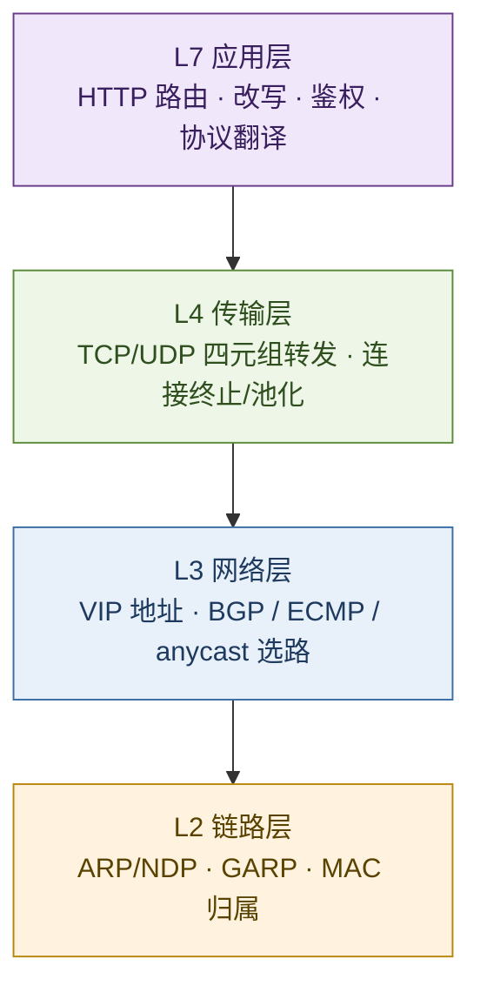
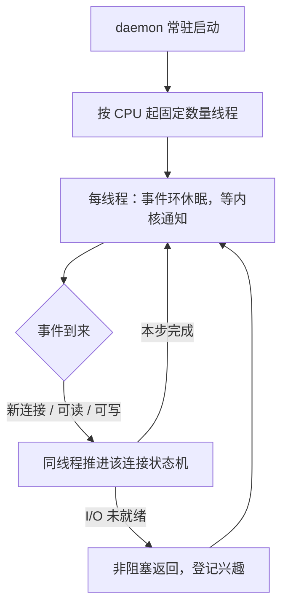
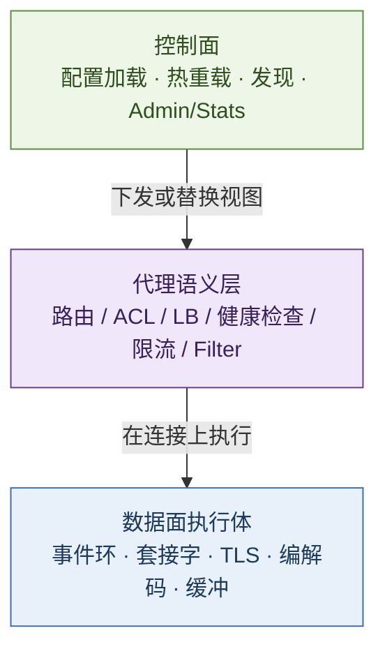
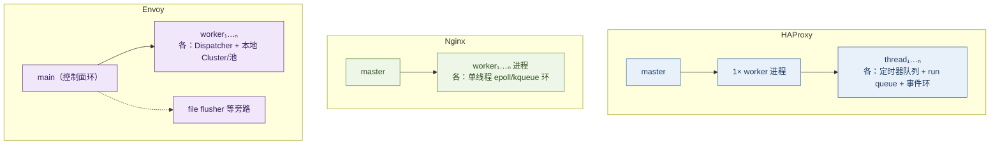
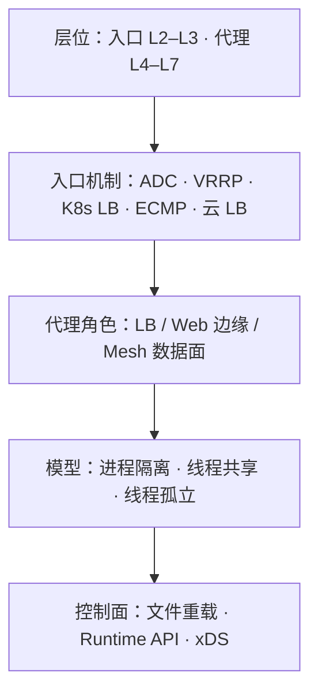

# HAProxy · Nginx · Envoy：代理三杰的架构对照

> 同属「反向代理 / 负载均衡」品类，三者主问题不同：HAProxy 以**连接级亲和的负载均衡**为中心；Nginx 以**事件驱动的通用边缘服务器**为中心；Envoy 以**可动态编排的云原生数据面**为中心。性能差距常被夸大；分叉在**进程模型、状态共享与控制面合同**。三者工作在 **L4–L7**；前方 VIP / 入口机制工作在 **L2–L3**（或云 L4/L7）。
>
> 可与 [21](./21-service-architecture-evolution.md)（服务形态）、[16](../10-chronicle/16-http-protocol-chronicle.md)（HTTP/QUIC）、[28](./28-http-rpc-microservice-communication-treatise.md)（东西向）、[23](./23-kubernetes-control-plane-doctrine.md) / [24](./24-calico-l3-dataplane-treatise.md)（集群网络）对照。本文写 **L4–L7 代理数据面**；§1.3 定层位，§9 专论多节点 **VIP / 统一入口（L2–L3）**。

先给一个直接答案：

> **三者均为事件驱动、非阻塞 I/O；分叉在共享域与控制面，而非功能清单。** 层位上：HAProxy / Nginx / Envoy 工作在 **L4–L7**（用户态套接字代理）；其前方的 VIP / 入口机制工作在 **L2–L3**（地址归属与选路），可选叠加 **L4**（如 IPVS、云 NLB）。共同原则：拒绝一连接一线程、热路径非阻塞、连接亲和、控制面与数据面分离。选型顺序：角色 → **工作层** → VIP 机制 → 共享域 → 延迟。

**20-architecture 位置：** [21](./21-service-architecture-evolution.md) 写服务形态演进；本文写**代理层**与其前方的 **VIP / 统一入口层**。

## 摘要

HAProxy（约 2000 年代）、Nginx（2004）、Envoy（2016，Lyft → CNCF）同属软件代理，分属三条设计路径。HAProxy 官方概括为 *multi-threaded, event-driven, non-blocking daemon*（§3）。三者主战场在 **传输层至应用层（L4–L7）**；多节点统一入口则多在 **链路层 / 网络层（L2–L3）** 解决地址归属与选路（§1.3、§9）。共同原则为事件驱动、连接亲和、热路径非阻塞；分叉在**共享域**。入口机制按层位分类：ADC（L2–L7 一体）、VRRP/CARP（L2–L3）、K8s `LoadBalancer` 实现（L2 ARP 或 L3 BGP）、BGP ECMP / anycast（L3）、云托管 LB（L4 或 L7）。代理层处理「包到达之后」；入口层决定「包先到哪台机器」。截至 2026-10，HAProxy 最新 LTS 为 **3.4**。

**关键词：** HAProxy；Nginx；Envoy；L2；L3；L4；L7；VIP；VRRP；ECMP；anycast；Keepalived；MetalLB；kube-vip；PureLB；F5；Kemp；Citrix；ADC；云 LB；xDS

---

## 目录

- [摘要](#摘要)
1. [读法与边界](#1-读法与边界)
    - [1.1 术语对照](#11-术语对照)
    - [1.2 边界](#12-边界)
    - [1.3 网络层位：谁在哪一层工作](#13-网络层位谁在哪一层工作)
2. [目的与角色](#2-目的与角色)
3. [官方四词：daemon · non-blocking · event-driven · multi-threaded](#3-官方四词daemon--non-blocking--event-driven--multi-threaded)
    - [3.1 总纲](#31-总纲)
    - [3.2 daemon：守护进程](#32-daemon守护进程)
    - [3.3 non-blocking：非阻塞](#33-non-blocking非阻塞)
    - [3.4 event-driven：事件驱动](#34-event-driven事件驱动)
    - [3.5 multi-threaded：多线程](#35-multi-threaded多线程)
    - [3.6 合起来：一条工作流](#36-合起来一条工作流)
    - [3.7 为何特别适合负载均衡](#37-为何特别适合负载均衡)
4. [设计原则与分层架构](#4-设计原则与分层架构)
    - [4.1 四条共同原则](#41-四条共同原则)
    - [4.2 分层：控制面 · 数据面 · 代理语义](#42-分层控制面--数据面--代理语义)
    - [4.3 原则如何落成三条路径](#43-原则如何落成三条路径)
5. [底层并发与网络模型](#5-底层并发与网络模型)
    - [5.1 执行体总览](#51-执行体总览)
    - [5.2 HAProxy：每线程一调度器](#52-haproxy每线程一调度器)
    - [5.3 Nginx：每进程一事件环](#53-nginx每进程一事件环)
    - [5.4 Envoy：main + siloed workers](#54-envoymain--siloed-workers)
    - [5.5 网络路径：accept → 处理 → 上游](#55-网络路径accept--处理--上游)
    - [5.6 状态共享合同：锁什么、不锁什么](#56-状态共享合同锁什么不锁什么)
6. [配置模型与控制面](#6-配置模型与控制面)
7. [能力矩阵](#7-能力矩阵)
8. [HAProxy：多线程如何收官](#8-haproxy多线程如何收官)
9. [多节点统一入口：谁持 VIP](#9-多节点统一入口谁持-vip)
    - [9.1 两层问题，勿混为一谈](#91-两层问题勿混为一谈)
    - [9.2 五种机制（先机制，后产品）](#92-五种机制先机制后产品)
    - [9.3 ADC 一体：F5 · Kemp · Citrix 等](#93-adc-一体f5--kemp--citrix-等)
    - [9.4 浮动 VIP：VRRP / Keepalived 族](#94-浮动-vipvrrp--keepalived-族)
    - [9.5 K8s 兑现 LoadBalancer：MetalLB · kube-vip · PureLB](#95-k8s-兑现-loadbalancermetallb--kube-vip--purelb)
    - [9.6 路由面：BGP ECMP / anycast](#96-路由面bgp-ecmp--anycast)
    - [9.7 云托管入口](#97-云托管入口)
    - [9.8 典型叠法与选型](#98-典型叠法与选型)
10. [选型启发式](#10-选型启发式)
11. [收束](#11-收束)
12. [本章要点](#12-本章要点)
13. [参考文献](#13-参考文献)

---

## 1. 读法与边界

全文按五条轴读：

| 轴 | 问题 |
| -- | ---- |
| **网络层位** | 工作在 L2 / L3 / L4 / L7 的哪一层？入口与代理是否同层？（§1.3） |
| **角色** | 边缘 LB、通用 Web 边缘，还是 Mesh / 可编程数据面？ |
| **并发模型** | 多进程、多线程，或「线程内事件环 + 跨线程最小共享」？ |
| **控制面** | 文件热重载、Runtime API，还是 xDS / 外部编排？ |
| **入口地址** | 多节点时谁持 VIP、如何切换或分摊？（§9） |

### 1.1 术语对照

| 术语 | 一句话 |
| ---- | ------ |
| **反向代理** | 对外暴露统一入口，向后转发至一组上游（用户态，L4–L7） |
| **L2** | 链路层：MAC、ARP/NDP、GARP；决定「帧交给哪块网卡」 |
| **L3** | 网络层：IP 路由、BGP、anycast / ECMP；决定「包交给哪下一跳」 |
| **L4** | 传输层：按 TCP/UDP 四元组转发或终止连接，不解析应用语义 |
| **L7** | 应用层：按 HTTP/gRPC 等语义路由、改写、鉴权、协议翻译 |
| **连接亲和（connection affinity）** | 一条连接（及其上多路流）终身由同一执行上下文处理 |
| **daemon** | 脱离终端、常驻后台的服务进程（见 §3.2） |
| **非阻塞（non-blocking）** | I/O 未就绪时不挂起执行体；登记兴趣后去干别的（见 §3.3） |
| **事件驱动** | 由内核就绪通知驱动推进，而非忙等轮询（见 §3.4） |
| **事件环** | `epoll` / `kqueue` / `libevent` 等驱动的非阻塞调度循环 |
| **SO_REUSEPORT** | 多 socket 同绑一端口，内核把新连接分给不同监听者 |
| **xDS** | Envoy 的动态发现 API 族（LDS/CDS/RDS/EDS 等） |
| **stick-table** | HAProxy 可跨连接记忆的键值表（会话粘滞、限流计数等） |
| **Filter chain** | Envoy 上按监听器挂接的过滤器流水线 |
| **VIP** | Virtual IP：客户端与上游路由器看到的统一入口地址（L3 地址；常借 L2 通告归属） |
| **VRRP / CARP** | 虚拟路由器冗余：在 L2/L3 选举持有浮动 VIP 的节点 |
| **ADC** | Application Delivery Controller：常把 L2–L3 VIP HA 与 L4–L7 转发收成一体 |
| **ECMP / anycast** | L3：多下一跳等价路径 / 多点通告同一前缀 |
| **MetalLB / kube-vip / PureLB** | 为 K8s 兑现外部 IP：L2（ARP/NDP）或 L3（BGP）通告 |

读法：层位见 **§1.3**；官方四词见 **§3**；单机并发见 §4–§5；多节点入口见 **§9**。勿将 L2/L3 的 VIP 漂移与 L4/L7 的代理进程模型混为一谈。

### 1.2 边界

1. **不做绝对性能排名。** 吞吐随协议、TLS、报文与核数变化；正文给架构因果与量级方向。  
2. **以开源主线为默认口径。** 商业发行版（Nginx Plus、HAProxy Enterprise 等）能力另注。  
3. **Istio / Linkerd / Kong 属编排与产品层**；本文拆其下常见数据面（Envoy）与两类经典代理。  
4. **版本以官网维护表为准。** HAProxy 3.x：偶号 LTS（约 5 年）、奇号短期稳定；叙事锚于 3.0 多线程默认化；2026-10 最新 LTS 为 3.4。  
5. **§9 论入口机制与代表实现**，非某一 ADC 策略语言或 CRD 全集；GSLB / 全球 DNS 另册。  
6. **层号取产业惯用 TCP/IP 口径**（L2 链路、L3 网络、L4 传输、L7 应用），非严格 OSI 七层对照表。

### 1.3 网络层位：谁在哪一层工作

> **总纲：入口层多在 L2–L3 决定「包到哪台机」；代理层在 L4–L7 决定「请求如何处理」。二者正交，常叠放，不可互相替代。**

**代理三杰（数据面本体）——主工作层为 L4–L7：**

| | **HAProxy** | **Nginx** | **Envoy** |
| - | ----------- | --------- | --------- |
| **主工作层** | **L4**（TCP/UDP mode）与 **L7**（HTTP 等） | **L7**（`http`）为主；**L4**（`stream`）可用 | **L4 / L7**（Listener → Filter）；Mesh 中二者皆常见 |
| **不做什么** | 不选举浮动 VIP；不做 ARP/BGP 通告 | 同左 | 同左；透明代理等 L3 邻接能力属部署形态，非 VIP HA |
| **TLS 位置** | 常在代理上终结（逻辑上跨 L4–L7） | 同左；亦可作纯 L4 透传 | 同左 |

**入口 / VIP 机制——主工作层为 L2–L3（部分产品叠 L4）：**

| # | 机制 | 主工作层 | 层上做什么 | 其后通常仍需 |
| - | ---- | -------- | ---------- | ------------ |
| 1 | **ADC 一体** | **L2–L7**（同箱） | VIP HA（L2/L3）+ 池与策略转发（L4–L7） | 可直接终结，或仅 L4 再挂软件代理 |
| 2 | **VRRP / Keepalived 族** | **L2–L3**；可选 **L4**（IPVS） | 选举 Master、VIP 绑定网卡；可选内核四元组转发 | HAProxy / Nginx 等 L4–L7 代理 |
| 3 | **K8s LoadBalancer 实现** | **L2**（ARP/NDP）或 **L3**（BGP） | 分配并通告外部 IP | Ingress / Gateway / 节点代理（L4–L7） |
| 4 | **BGP ECMP / anycast** | **L3** | 多机通告同一前缀，路由器哈希分流入 | 各节点上的 L4–L7 代理或 ADC |
| 5 | **云托管 LB** | **L4**（NLB 类）或 **L7**（ALB 类） | 云控制面持前端 IP 并分发 | 后端实例上的代理 / 应用；客户侧通常不自管 VRRP |

叠放读法（自下而上）：

1. **L2/L3**：包（或帧）落到哪台机器——VRRP、ARP 通告、BGP ECMP、部分云 LB 前端。  
2. **L4**：是否按四元组转发/终止——IPVS、云 NLB、代理的 TCP/UDP 模式。  
3. **L7**：是否按应用语义决策——代理 HTTP 模式、云 ALB、ADC 七层策略。

> **边界：** 增大 `nbthread` / `worker_processes` 只提高 **L4–L7 单机**吞吐，不产生 VIP，也不替代 L2/L3 入口合同。

---

## 2. 目的与角色

| | **HAProxy** | **Nginx** | **Envoy** |
| - | ----------- | --------- | --------- |
| **主工作层** | **L4 + L7** | **L7** 为主，兼 **L4** | **L4 + L7**（动态控制面） |
| **原初目的** | 可靠、可观测的 TCP/HTTP **负载均衡** | 高并发 **Web 服务器**（后扩反代/缓存） | **云原生数据面**：统一 L4/L7，可动态配置 |
| **今日主战场** | 边缘 / 内部 LB、四七层入口、粘滞与健康检查 | 静态与边缘、反代、TLS 终结、API 网关底座 | Sidecar / 网关、服务网格、多协议过滤 |
| **成功判据** | 连接公平、故障切流、状态一致、重载不停机 | 延迟稳定、缓存命中、配置简单、生态模块 | 热更新配置、可观测、策略可组合、与控制面解耦 |
| **不该被简化成** | 「只会四层转发」 | 「只会静态站」 | 「只会 Mesh」 |

分工：**HAProxy** 精于 L4/L7 均衡与会话状态；**Nginx** 精于 L7 边缘内容与连接密度；**Envoy** 精于 L4/L7 动态发现与过滤器可编程。均不承担 L2/L3 VIP 选举（见 §1.3、§9）。

---

## 3. 官方四词：daemon · non-blocking · event-driven · multi-threaded

HAProxy 管理文档概括为：*a multi-threaded, event-driven, non-blocking daemon*。[^haproxy-mgmt] 四词描述运行形态，而非营销口号。Nginx、Envoy 在事件驱动与非阻塞上同构；差别在多核载体（进程 vs 线程）与状态共享（§5）。

### 3.1 总纲

> **以与 CPU 核数同阶的少量工作线程，按「就绪才推进、未就绪不空等」服务海量连接，并以守护进程常驻。**

| 词 | 解决的问题 | 常见误读 |
| -- | ---------- | -------- |
| **daemon** | 部署与存活形态 | 误解为「不占 CPU」；实为不绑定控制终端 |
| **non-blocking** | 等待 I/O 时执行体做什么 | 误解为「从不等待」；等待交给内核，执行体处理其他就绪连接 |
| **event-driven** | 何时继续推进连接 | 误解为「另派线程处理事件」；实为**同一线程**跑环并处理 |
| **multi-threaded** | 如何利用多核 | 误解为「一连接一线程」；实为**固定少量**线程各跑一环 |

### 3.2 daemon：守护进程

| | 说明 |
| - | ---- |
| **含义** | 与控制终端分离，通常由 init/systemd（或容器主进程）拉起并长期驻留 |
| **工程含义** | 常驻网络服务，而非执行完毕即退出的 CLI |
| **在 HAProxy** | worker（及 master-worker 下的 master）以服务形态运行；软重载时新旧进程可短暂并存[^haproxy-mgmt] |

### 3.3 non-blocking：非阻塞

先对照**阻塞模型**（一连接一执行体）：

| 阶段 | 阻塞做法 | 代价 |
| ---- | -------- | ---- |
| 等客户端请求 | 执行体阻塞在 `read` | 连接空闲仍占一个执行体 |
| 等上游响应 | 同上 | 并发连接数 ≈ 执行体数 |
| 长连接挂起 | 执行体被占满 | 万级并发即内存与调度崩溃 |

**非阻塞**：套接字设为非阻塞；`read`/`write` 暂时不可用时立即返回，向内核登记对该 fd 的兴趣，执行体转向其他已就绪连接。代理大量时间本在等待对端——非阻塞把「等待」从占用执行体，变成占用轻量连接对象。[^aosa-nginx]

> 直观对照：执行体数远小于同时打开的连接数；就绪才推进，未就绪不空占。

### 3.4 event-driven：事件驱动

非阻塞解决「不等」；**事件驱动**解决「何时再来」。

| 概念 | 说明 |
| ---- | ---- |
| **事件** | 新连接可 accept、fd 可读/可写、定时器到期、信号等 |
| **事件环（event loop）** | 线程反复：向内核询问就绪集合 → 逐个推进对应连接的状态机 → 再休眠等待 |
| **与内核的接口** | Linux 上常见 `epoll`；BSD 系 `kqueue`；Envoy 经 `libevent` 等封装[^envoy-thread] |

**要点：** 处理发生在**跑该环的同一线程**内，而非事件到达后再创建线程——后者退化为「一连接一执行体」。

事件驱动提供就绪信号；非阻塞保证单次系统调用不长期占用线程。二者配合使用。

### 3.5 multi-threaded：多线程

| | 正确读法 | 错误读法 |
| - | -------- | -------- |
| **线程数** | 默认约等于进程被允许使用的 CPU 数（`nbthread` / 亲和可调）[^haproxy-mgmt] | 随连接数增长 |
| **每线程内部** | 独立事件环 + 非阻塞 I/O，托管一批连接 | 线程内再「一连接一子线程」 |
| **连接归属** | 一条连接终身由 accept 到它的那一线程处理 | 请求级乱跳线程 |

单线程事件驱动无法充分利用多核；多线程将「每核一环」并行展开。HAProxy 选用线程而非多进程，是为 stick-table、peers、统计等**共享内存语义**更便宜——代价是共享点须细锁（§5.2、§5.6）。Nginx 以**多进程**达到同一「每核一环」效果，共享域更小。[^nginx-inside]

### 3.6 合起来：一条工作流

1. 以 daemon 拉起；线程数与核数同阶。  
2. 每线程跑自己的事件环，托管一批连接。  
3. 读下游、写上游、读上游、写回客户端——每步仅在 fd 就绪时推进。  
4. 未就绪则回到环上；空闲长连接只保留连接状态，不独占执行体。

### 3.7 为何特别适合负载均衡

| LB 场景特征 | 阻塞模型的困境 | 四词模型的应对 |
| ----------- | -------------- | -------------- |
| 连接数极大、大量空闲长连接 | 执行体数被连接数绑死 | 空闲只留连接对象；执行体数 ≈ 核数 |
| 代理计算轻，时间花在等待 | 执行体大量时间睡眠占槽 | 等待交给内核；CPU 用于拷贝与协议处理 |
| 需利用多核 | 单环仅用一核 | 多线程（或 Nginx 多进程）每核一环 |

> **小结：** daemon 定部署形态；non-blocking 定等待策略；event-driven 定调度信号；multi-threaded 定多核并行。§4–§5 展开三者差异。

---

## 4. 设计原则与分层架构

先立**共同原则**，再拆**分层**，最后对照三条路径的取舍——重接口合同，而非产品名清单。

### 4.1 四条共同原则

| # | 原则 | 含义 | 违反时的代价 |
| - | ---- | ---- | ------------ |
| 1 | **拒绝一连接一线程** | 用事件多路复用在少量执行体上挂成千上万连接 | 上下文切换与内存把机器拖死（经典 Apache 式瓶颈）[^aosa-nginx] |
| 2 | **热路径非阻塞** | 环内只做「就绪则推进」；长 CPU / 阻塞盘必须外置或有界线程池 | 同环内其他连接被饿死[^cf-event] |
| 3 | **连接亲和** | 一条下游连接（及其上 H2/H3 多路流）终身留在同一执行体 | 若跨线程搬连接，协议状态与缓冲几乎处处要锁 |
| 4 | **控制面与数据面分离** | 配配置、发现、统计刷新不走高 QPS 包路径 | 热更新与排障和转发抢同一条环 |

三者都遵守 1–3；第 4 条落实方式不同——Nginx/HAProxy 偏「文件 + 进程/API」，Envoy 把控制面做成 **xDS 一等公民**。

### 4.2 分层：控制面 · 数据面 · 代理语义

把「架构」拆成三层，后续网络模型才有落点：

| 层 | HAProxy | Nginx | Envoy |
| -- | ------- | ----- | ----- |
| **控制面** | master 管重载；Runtime API；peers 同步 stick | master 读配置、fork worker；信号重载 | **main 线程**：xDS、stats flush、`/admin`；不处理业务流量[^envoy-thread] |
| **代理语义** | `frontend` 决策 → `backend` 池 / 算法 / check | `server`/`location` → `upstream`；缓存与静态同源 | Listener → Filter chain → Router → Cluster / 端点 |
| **数据面** | worker 内 N 线程，每线程独立调度器 | N 个单线程 worker 进程 | N 个 worker，各有 `Event::Dispatcher`（libevent 系） |

读图要点：**控制面改表；语义层据表决策；数据面在本执行体事件环内搬字节。**

### 4.3 原则如何落成三条路径

| 设计押注 | HAProxy | Nginx | Envoy |
| -------- | ------- | ----- | ----- |
| **多核利用** | 同进程多线程，共享地址空间 | 多进程，地址空间隔离 | 同进程多线程，热数据 **siloed** |
| **跨连接状态** | 须共享（stick-table、peers）→ **细锁 + 分片** | 尽量不共享；缓存等用共享内存 | 热路径不共享；配置经 **线程局部存储（TLS）槽** 下发[^envoy-thread] |
| **配置合同** | 文件稳定 + Runtime 改运行时对象 | 文件稳定；动态多依赖生态 | 静态 bootstrap + **xDS 热路径** |
| **可编程** | ACL / Lua / SPOE | 模块 / Lua（OpenResty）/ njs | C++ / Wasm Filter、ext_proc |
| **可观测** | stats 体系成熟 | stub_status；完整能力多在 Plus/生态 | metrics、tracing、access log 为一等公民 |

> **边界：** 原则相同，**共享域大小**不同。共享域越大，跨连接语义越强，锁与 NUMA 越敏感；共享域越小，扩展越线性，粘滞与全局限流需另设计。

---

## 5. 底层并发与网络模型

### 5.1 执行体总览

| | HAProxy | Nginx | Envoy |
| - | ------- | ----- | ----- |
| **OS 可见** | 常为 1 个 worker 进程（重载时短暂双进程）[^haproxy-mgmt] | 1 master + N worker | 1 进程 |
| **承载流量的执行体** | 线程 | 进程 | 线程（worker） |
| **调参旋钮** | `nbthread` / CPU 亲和 / thread-groups | `worker_processes`（常 `auto`） | `--concurrency` |
| **事件设施** | 每线程自有调度（epoll 等）[^haproxy-mt] | 每 worker：`ngx_process_events_and_timers` | 每线程：`Event::Dispatcher` |

### 5.2 HAProxy：每线程一调度器

官方多线程模型的关键选择：**非「1 个调度线程 + N 个工作线程」，而是每线程自带完整调度器**——接近昔日多进程用法，但共享地址空间。[^haproxy-mt]

| 机制 | 细节 |
| ---- | ---- |
| **亲和** | task / fd / applet 同时只被一线程处理；**同一 session 上的实体亲和于 accept 该连接的线程** |
| **全局实体** | listener、peers、health check、DNS 等无会话亲和，但同一时刻仍只被一线程处理 |
| **后端连接池** | 可复用连接通常仅对同线程会话可见——以局部性换少锁[^haproxy-mt] |
| **锁** | 剩余共享点用 progressive lock（plock）等；stick-table 等分片降争用 |
| **thread-groups** | 2.7+：按 CPU 局部性分组，收缩共享域，降低跨 NUMA 延迟[^haproxy-perf] |

管理文档：默认每许可 CPU 一线程；**单连接由单线程服务**；充分利用多核通常需要并发连接数至少与线程数同阶。[^haproxy-mgmt]

### 5.3 Nginx：每进程一事件环

AOSA / 官方「Inside NGINX」模型：master 做特权与配置；**worker 才处理连接**；推荐 **一核一 worker**。[^aosa-nginx][^nginx-inside]

| 机制 | 细节 |
| ---- | ---- |
| **环内结构** | 等 I/O → 处理 posted accept/事件 → 定时器；协作式推进，无抢占 |
| **accept 争用（历史）** | 多 worker 抢同一 listen fd 会惊群；曾用 `accept_mutex` 轮流 accept |
| **当代默认** | `accept_mutex` 默认 **off**（有 `EPOLLEXCLUSIVE` 或 `reuseport` 时本就不需要）[^nginx-accept] |
| **reuseport** | `listen … reuseport`：每 worker 一个监听套接字，**内核**分连接，减用户态锁[^nginx-reuseport] |
| **阻塞卸载** | 读盘等可走有界 **thread pool**，完成后再回 worker 环[^cf-event] |
| **进程间** | 请求路径基本无锁；限流/缓存计数等靠共享内存，一致性语义弱于单表强一致 |

### 5.4 Envoy：main + siloed workers

| 线程 | 职责 |
| ---- | ---- |
| **Main** | xDS、集群管理协调、stats 刷出、admin、信号；**不处理高流量**[^envoy-thread] |
| **Worker × N** | 监听、accept、Filter、转发；`--concurrency` 控制，常 = 硬件线程数 |
| **旁路** | access log 的 file flusher；DNS/`getaddrinfo`、部分异步文件 I/O 等专用池，避免堵 worker |

Worker 侧要点：

1. **连接终身亲和于 accept 到的那个 worker**；热路径按单线程写法，几乎不锁。[^envoy-thread]  
2. **默认所有 worker 都 listen**；新连接由内核分；长连接稀少（如 Mesh 出口少量 H2）时可开 **listener connection balancer** 做强制均衡。  
3. **线程局部存储（TLS）槽**：main 解析配置后 `post` 至各 worker；worker O(1) 读本地集群视图，热路径无需全局锁。[^envoy-thread]（TLS = Thread Local Storage，非传输层安全。）  
4. **Siloed 后果**：每 worker 自有 upstream 池与 LB 游标；稳态下每上游可约有 worker 数条 H2 连接；RR 表观不均属模型特性。[^envoy-rr]

### 5.5 网络路径：accept → 处理 → 上游

将网络模型落在同一请求链的各站：

| 站 | HAProxy | Nginx | Envoy |
| -- | ------- | ----- | ----- |
| **① Accept** | 线程共享监听；连接交某线程后**终身亲和** | 共享 listen +（可选）mutex，或 **reuseport** 每 worker 一 socket | 各 worker listen；内核分发；可选强制 balancer |
| **② 下游** | 同线程：TCP/HTTP 模式、ACL、stick 查询 | 同进程：`http`/`stream` 阶段、rewrite、access | 同 worker：Listener filter → HTTP/TCP 连接管理 → Filter chain |
| **③ 上游** | backend 算法 + 健康状态；池连接常**线程内复用** | `upstream` 选 peer；进程内池化 | Cluster LB + **本 worker 连接池**；健康/outlier 视图经线程局部槽可见 |
| **④ 回程** | 不换线程 | 不换进程 | 不换 worker |

**层位落点：** ①–④ 均发生在代理进程的 **L4–L7** 路径上——前提是 L2/L3 已把包送到本机（§1.3）。站 ② 决定 L4 还是 L7：L4 主要搬字节；L7 解析方法/头/`:authority` 并做路由与协议翻译（如 H3→H1）。**执行体边界不变**，变化的是站内工作量。

UDP/QUIC：无连接语义时，常以五元组哈希将会话亲和到同一执行体（Envoy UDP 依赖 `SO_REUSEPORT` 一致性）；HAProxy 的 QUIC accept 亦做线程均衡。[^envoy-life][^haproxy-quic]

### 5.6 状态共享合同：锁什么、不锁什么

| 状态种类 | HAProxy | Nginx | Envoy |
| -------- | ------- | ----- | ----- |
| **单连接协议状态** | 线程私有 | 进程私有 | worker 私有 |
| **上游连接池** | 偏线程可见 | 进程内 | **每 worker 一份** |
| **LB 游标 / RR** | 共享结构 + 锁/原子（随算法） | 进程内 | **每 worker 一份** → 全局看起来不均[^envoy-rr] |
| **会话粘滞表** | stick-table **跨线程共享**（分片锁） | 弱/外置/Plus | 有限；常靠上游亲和或外置 |
| **配置/集群成员** | 重载换进程或 Runtime 改；线程见一致内存 | 重载换 worker 代际 | main 下发 → worker 线程局部槽 |
| **统计** | 可共享；3.0+ 可跨重载落盘 | 每 worker + 共享内存聚合 | worker 计数 → main 汇总 flush |

> **边界：**  
> - HAProxy：多线程默认可用；连接不跨线程，共享点极窄。  
> - Nginx：以多进程利用多核；进程隔离，请求路径少共享。  
> - Envoy RR 表观不均属 siloed 模型特性；应调节 `--concurrency` 与 connection balancer，而非先怀疑算法。

---

## 6. 配置模型与控制面

| | HAProxy | Nginx | Envoy |
| - | ------- | ----- | ----- |
| **静态骨架** | `global` / `defaults` / `frontend` / `backend` | `events` / `http` / `upstream` / `server` | Bootstrap + Listener / Cluster / Route |
| **热更新** | 软重载（新旧进程交接）；Runtime API 改权重、地图等 | `nginx -s reload`；多数变更需重载 | **xDS 热更新**为主；也可热重启 |
| **服务发现** | DNS、Runtime API、外部编排写文件 | DNS、变量 upstream；常靠外围 | EDS/CDS 原生；与 K8s / Mesh 控制面集成 |
| **治理动作** | ACL、stick、限流、健康检查内建扎实 | `limit_req`、反代头、缓存；复杂策略常靠模块/OpenResty | Outlier、重试、熔断、RBAC、JWT… Filter 组合 |

HAProxy：`frontend`/`backend` 配置模型长期稳定。Envoy：路由与集群成员可经 xDS 热更新，无需进程级重载。Nginx：文件配置稳定；动态能力多依赖生态扩展，而非统一官方控制面。

---

## 7. 能力矩阵

| 能力 | HAProxy | Nginx（开源） | Envoy |
| ---- | ------- | ------------- | ----- |
| **主工作层** | L4 + L7 | L7 为主；L4（stream） | L4 + L7 |
| TCP / UDP 代理（L4） | 强（LB 本业） | 有（stream）；定位次于 HTTP | 强（Listener 通用） |
| HTTP/1.1 · H2（L7） | 成熟 | 成熟 | 成熟 |
| HTTP/3 · QUIC（L7 / QUIC） | 2.5 引入，**2.8 起生产可用**；3.x 继续优化[^haproxy-quic] | 视构建与发行版 | 一等公民（上下游能力随版本） |
| 主动健康检查 / 高级 LB | 核心能力 | 基础 upstream；高级多在 Plus / 生态 | 健康检查、outlier、多种 LB |
| 会话粘滞 | stick-table | 有限 / 模块或 Plus | 有；常与 Mesh 身份策略叠加 |
| 静态文件 / 缓存（L7 内容） | 非主业 | **主业之一** | 非主业 |
| 动态配置 | Runtime API 强；非 xDS 原生 | 文件重载为主 | **xDS 原生** |
| L2/L3 VIP 选举 | 无（Enterprise 可附 VRRP） | 无（Plus 可附 keepalived） | 无 |
| 服务网格数据面 | 可作入口；非典型 sidecar | 少作 sidecar | **常见事实标准** |

协议翻译常见：如 HAProxy **前端 H3、后端 H1/H2**，无需后端同步升级协议。[^haproxy-quic]

---

## 8. HAProxy：多线程如何收官

多线程并非 3.0 才出现，而是分步默认化；3.0 标志协议栈与共享结构对线程模型达到可长期默认的成熟度。

| 节点 | 版本 / 年 | 事实 |
| ---- | --------- | ---- |
| 实验 | **1.8**（2017） | `nbthread`；master-worker；官方仍标实验[^haproxy-mt] |
| 默认 | **2.0**（2019） | 未写 `nbthread`/`nbproc` 时，线程数≈进程可跑 CPU；亲和/`taskset` 即可调核[^haproxy-20] |
| 弃多进程 | **2.4**（2021） | `nbproc` 废弃并与线程互斥；劝迁 `nbthread`[^haproxy-nbproc] |
| 超多核 | **2.7+** | thread-groups：按拓扑分组，单组线程上限（历史上 64）服务超多核 |
| 收官 | **3.0**（2024-05） | stick-table 多树头分片（官方称约 80 线程上 ~6×）；stats 可跨重载持久；`crt-store`；H2/H3 防护与运维面补强[^haproxy-30] |

版本选型（官方政策）：**偶号 LTS、奇号短期稳定**。2026-10 时最新 LTS 为 **3.4**；3.0 仍在 LTS 维护窗内。生产宜跟踪当前 LTS；奇号适合验证新特性。[^haproxy-eol]

与 §3、§5.2 同一内核：**多线程、事件驱动、非阻塞；默认每许可 CPU 一线程；连接单线程服务。**[^haproxy-mgmt] 3.0 运维侧补强：热重载前 `dump stats-file` + 对象 `guid` 可延续计数；`nbthread` / thread-groups 收束到 `global`。[^haproxy-30]

---

## 9. 多节点统一入口：谁持 VIP

§3–§8 讨论单机 **L4–L7** 如何利用多核。多节点另有三问（多在 **L2–L3**）：**对外地址是什么？如何漂移？能否多节点同时进流量？**

HAProxy / Nginx / Envoy **默认不提供 L2/L3 VIP 选举**（商业发行版可附 VRRP）。[^haproxy-as][^f5-nginx-mig] 统一入口是独立合同；宜**先定工作层与机制，再选产品**。F5、Kemp、Keepalived、MetalLB 等为常见实例，非穷尽列表。层位总图见 **§1.3**。

### 9.1 两层问题，勿混为一谈

| 层 | 网络层位 | 回答 | 代表（非穷尽） |
| -- | -------- | ---- | -------------- |
| **入口层** | 主 **L2–L3**（云 LB 可为 L4/L7） | 对外地址归谁；单活还是多下一跳 | ADC；VRRP 族；MetalLB / kube-vip / PureLB；BGP ECMP；云 LB |
| **代理层** | **L4–L7** | 解析、路由、粘滞、TLS、观测 | HAProxy、Nginx、Envoy；ADC 内置代理 |

**peers / stick 同步 ≠ VIP。** 前者是 L4–L7 会话状态同步；后者是 L2–L3 决定包先落到哪台机。

### 9.2 五种机制（先机制，后产品）

| # | 机制 | 主工作层 | 地址如何呈现 | 流量形态（典型） | 代表实现 |
| - | ---- | -------- | ------------ | ---------------- | -------- |
| 1 | **ADC 一体** | **L2–L7** | 设备 HA 持浮动 VIP；池与健康检查同箱 | 多为 Active/Standby；策略面强 | F5 BIG-IP、Kemp LoadMaster、Citrix ADC（NetScaler）等[^f5-nginx-mig][^kemp-ha][^citrix-ha] |
| 2 | **浮动 VIP（VRRP/CARP 族）** | **L2–L3**（+ 可选 L4 IPVS） | 选举 Master，VIP 绑定其网卡 | **单活**入口；可叠加 IPVS | Keepalived；HAProxy Enterprise VRRP；NGINX Plus `nginx-ha-keepalived`[^keepalived][^haproxy-as][^f5-nginx-mig] |
| 3 | **K8s LoadBalancer 实现** | **L2** 或 **L3** | 分配外部 IP，并以 ARP/NDP 或 BGP 通告 | L2 偏单节点进流；BGP 可多下一跳 | MetalLB、kube-vip、PureLB；云上为 CCM + 云 LB[^metallb][^kube-vip][^purelb] |
| 4 | **路由面 ECMP / anycast** | **L3** | 多机通告同一前缀；路由器哈希选路 | **多机同时进流量**；失败则撤路由 | MetalLB/kube-vip BGP；主机 BGP + FRR；数据中心 anycast[^metallb-bgp][^rfc7938][^cf-maglev] |
| 5 | **云托管 LB** | **L4**（NLB）/ **L7**（ALB） | 控制面持前端 IP；多区后端探测 | 多 AZ 分发；客户侧通常不自管 VRRP | AWS NLB/ALB、GCP/Azure LB 等 |

读表要点：**1–2** 在 L2–L3 保证单一地址高可用；**3** 用 L2 或 L3 将地址合同接入 K8s API；**4** 纯 L3 多下一跳；**5** 由云在 L4 或 L7 托管入口。

### 9.3 ADC 一体：F5 · Kemp · Citrix 等

共同合同：把 **VIP（L2/L3 HA）+ 服务池 + 健康检查 + L4–L7 转发** 收成一台逻辑 ADC；可直接终结业务，也可只做 L4、后面再挂软件代理。

| | F5 BIG-IP | Kemp LoadMaster | Citrix ADC / NetScaler |
| - | --------- | --------------- | ---------------------- |
| **层位** | L2–L7 同箱（策略深度随许可） | 同左 | 同左 |
| **VIP** | Virtual Server | Virtual Service；HA 用 Shared IP[^kemp-ha] | VIP 在 HA 中为 floating；NSIP/SNIP 等可节点私有（含 INC）[^citrix-ha] |
| **HA** | Active/Standby 设备对，VIP 随 Active | Active/Standby；Shared IP 仅 Active 关联 | Primary/Secondary；同二层靠 GARP 等；**云上常需云 LB 前端**（无传统 L2 浮动）[^citrix-azure] |
| **适用** | 企业运维面、多租户、合规一体 | 中小规模 ADC，部署较轻 | ADC 路径；桌面与应用网关生态常见 |

迁出 ADC 时常见拆分：**L2/L3 入口 HA → VRRP 族或云 LB**；**L4–L7 → HAProxy / Nginx / Envoy**。[^f5-nginx-mig]

### 9.4 浮动 VIP：VRRP / Keepalived 族

| 组件 | 工作层 | 角色 |
| ---- | ------ | ---- |
| **Keepalived** | **L2–L3**（VRRP）；可选 **L4**（LVS/IPVS） | VIP 选举与绑定；可选内核四元组转发；可 `track_script` 联动代理[^keepalived] |
| **HAProxy Enterprise VRRP** | **L2–L3** | Active/Standby；实现源自 Keepalived[^haproxy-as] |
| **NGINX Plus HA** | **L2–L3** | `nginx-ha-keepalived`：浮动 VIP 由 VRRP 管理[^f5-nginx-mig] |

要点：VRRP/CARP 保证 **L3 地址在 L2/L3 上的单活归属**。多机同时进流量需机制 4 或 5，不能由增大 `nbthread` 替代。

### 9.5 K8s 兑现 LoadBalancer：MetalLB · kube-vip · PureLB

裸金属（及部分非云 IaaS）上，上游不提供 `LoadBalancer` 控制器时，需集群内实现：**分配 L3 地址 + 用 L2 或 L3 让集群外可达。**[^metallb]

| | MetalLB | kube-vip | PureLB |
| - | ------- | -------- | ------ |
| **定位** | 裸金属 LB；发行版与 OpenShift 广泛采用[^metallb] | 控制面 VIP 与 Service LB；ARP / BGP / 路由表等[^kube-vip] | 以 Linux 网络栈挂地址，可选 BGP；支持 `LoadBalancerClass` 并存[^purelb] |
| **L2 / ARP** | 单节点通告；实质偏 **failover**[^metallb-l2] | Leader 发 GARP；可按 Service 分散选举[^kube-vip] | Local 地址挂接口；GARP 可配 |
| **L3 / BGP** | 多节点通告 → 路由器 ECMP[^metallb-bgp] | 多节点通告，由路由器分摊[^kube-vip-bgp] | 集成 goBGP 等通告 remote 地址[^purelb] |
| **补充** | FRR-K8s 等后端 | 控制面可用 **L4 IPVS** 均衡 API[^kube-vip] | NetBox IPAM、双栈等 |

均工作在 **L2/L3（或可选 L4）**，**不能**替代 HAProxy/Envoy 的 L7 语义；其后仍接 Ingress / Gateway / 独立代理。与 Calico 等 BGP 并存时须规划 AS 与通告边界（见 [24](./24-calico-l3-dataplane-treatise.md)）。

### 9.6 路由面：BGP ECMP / anycast

多机在 **L3** 通告**同一服务前缀**且路由器启用 **ECMP** 时，入口由「单机持 VIP」变为网络层分摊。RFC 7938 将 anycast + ECMP 列为数据中心水平扩展负载均衡的路径之一；[^rfc7938] 产业实践常见 BGP 通告服务 IP，再以一致哈希在 LB 间调度。[^cf-maglev]

| 要点 | 说明 |
| ---- | ---- |
| **工作层** | 纯 **L3**；不解析 TCP/HTTP |
| **与 MetalLB / kube-vip BGP** | 同一 L3 机制在 Kubernetes 边界上的产品化 |
| **与 VRRP** | VRRP：L2/L3 单活归属；ECMP：L3 多下一跳并存 |
| **有状态注意** | 纯 L3 ECMP 对长连接不友好时，需上层 L4/L7 一致哈希，或健康失败即 withdraw[^nvidia-anycast] |

### 9.7 云托管入口

| 形态 | 工作层 | 合同 |
| ---- | ------ | ---- |
| **云 NLB 类** | **L4** | 前端 IP 由云控制面持有；按四元组分发 |
| **云 ALB / 应用型 LB** | **L7** | 按 HTTP 等语义分发；同一「统一入口」问题，接口为云 API |
| **云上 ADC** | L4–L7 + 云前端 | 通常无客户侧 L2 GARP；需 **云 LB + 健康探测** 判定 Active[^citrix-azure] |
| **托管 K8s** | 视云 LB 产品 | `type=LoadBalancer` 由云 CCM 接线，一般无需 MetalLB |

### 9.8 典型叠法与选型

| 场景 | 常见叠法（层位） | 机制 |
| ---- | ---------------- | ---- |
| 机房双机软件代理 | L2/L3 VRRP → L4–L7 HAProxy/Nginx | 2 → 代理层 |
| 厂商一体交付 | ADC 同箱 L2–L7（或 ADC 仅 L4 + 软件 L7） | 1 |
| 裸金属 K8s 外部 IP | L2/L3 LoadBalancer 实现 → L7 Ingress/Gateway | 3（BGP 则叠加 4） |
| 多机同时接入口流量 | L3 BGP ECMP / anycast（或云 L4 NLB） | 4 或 5 |
| 公有云 | 云 L4/L7 LB → 节点代理 / Ingress；云上 ADC 常前置云 LB | 5（可叠加 1） |
| 控制面 HA（kube-apiserver） | L2/L3（kube-vip 等）持 API VIP | 3 |
| 网格东西向 | 通常无需南北向 VIP；ClusterIP / sidecar（L4–L7） | — |

反模式：

1. **多实例 L4–L7 代理 ≠ 统一入口**——缺少 L2–L3（或云 LB）机制 1–5 之一。  
2. **L2/ARP 通告 ≠ 多节点负载均衡**——多为单点进流。[^metallb-l2]  
3. **peers ≠ VIP**；**Ingress（L7）≠ LoadBalancer 实现（L2/L3）**。  
4. **跨二层域使用 VRRP 组播**——应改单播 peer，或改用 L3 机制 4/5。  
5. **云上假定 GARP（L2）浮动 VIP**——应按云 LB 健康探测模型设计。[^citrix-azure]

---

## 10. 选型启发式

| 场景 | 层位 | 更常优先 | 原因 |
| ---- | ---- | -------- | ---- |
| 高并发 TCP/HTTP 纯 LB，粘滞与健康检查重 | L4–L7 | **HAProxy** | LB 语义与 stick/peers 一体 |
| 静态、缓存、TLS 边缘、内容反代 | L7 | **Nginx** | Web 服务器血统与模块生态 |
| K8s / Mesh，需 xDS 与多协议 Filter | L4–L7 | **Envoy** | 动态控制面与可观测为一等公民 |
| 浮动 VIP 且代理已定 | L2–L3 → L4–L7 | **VRRP 族** + 上表代理 | 机制 2（§9） |
| 裸金属 K8s 外部 IP | L2 或 L3 | **MetalLB / kube-vip / PureLB** | 机制 3；多下一跳用 BGP |
| 一体 ADC / 强合规运维面 | L2–L7 | **F5 / Kemp / Citrix** 等 | 机制 1 |
| 多机同时接入口 | L3 或云 L4 | **BGP ECMP** 或 **云 NLB** | 机制 4 或 5 |
| 边缘反代 + 轻量脚本 | L7 | Nginx 或 HAProxy | 视团队存量与监控习惯 |
| 极多核且强依赖跨连接共享状态 | L4–L7 | HAProxy（+ thread-groups）或外置状态 | Envoy silo / Nginx 多进程需另设计共享 |

反模式：

1. **以 QPS 数字替代角色与层位定义**——先明确南北向/东西向、L4 还是 L7、VIP 在哪一层。  
2. **将 Envoy 多 worker 下 RR 不均视为故障**——先理解 siloed 模型。[^envoy-rr]  
3. **在 Nginx worker 内执行长 CPU**——协作式事件环会被拖死。[^cf-event]  
4. **仍按 `nbproc` 思路调 HAProxy**——当代接口合同是线程与 CPU 亲和。  
5. **混淆 L2/L3 入口与 L4/L7 代理**——见 §1.3、§9.1。

---

## 11. 收束

入口层与代理层正交，且工作在不同网络层：先按 §1.3 定层位，再按 §9.2 选机制与产品。比较「谁取代谁」之前，须分清讨论的是 **L2/L3 地址归属**还是 **L4/L7 请求处理**。

---

## 12. 本章要点

1. **层位：** 代理三杰主战场为 **L4–L7**；VIP / 统一入口主战场为 **L2–L3**（云 LB 可为 L4/L7）；二者正交。  
2. 官方四词：daemon、non-blocking、event-driven、multi-threaded——**不是**一连接一线程。  
3. 事件在跑环的同一线程内处理；非阻塞与事件驱动配合使用。  
4. 代理三分叉：Nginx 进程隔离；HAProxy 线程细锁共享；Envoy siloed + xDS。  
5. 多节点入口：先定五种机制及其工作层（ADC L2–L7 / VRRP L2–L3 / K8s LB 的 L2 或 L3 / ECMP L3 / 云 L4·L7），产品为实例。  
6. L2/ARP 偏单点进流；多下一跳靠 L3 BGP ECMP 或云 LB；云上 ADC 常需云 LB 前端。  
7. peers ≠ VIP；LoadBalancer 实现（L2/L3）≠ L7 网关；多实例代理 ≠ 统一入口。  
8. 选型顺序：角色 → **工作层** → VIP 机制 → 共享域 → 延迟。

---

## 13. 参考文献

[^aosa-nginx]: O. Garrett et al., *The Architecture of Open Source Applications*, Vol. 2, ch. “nginx”. https://aosabook.org/en/v2/nginx.html 。事件驱动、worker 进程模型。

[^nginx-inside]: NGINX Inc., *Inside NGINX: How We Designed for Performance & Scale*. https://blog.nginx.org/blog/inside-nginx-how-we-designed-for-performance-scale 。master / worker / 每核一 worker。

[^nginx-accept]: nginx.org, *Core functionality* — `accept_mutex`（默认 off；与 EPOLLEXCLUSIVE / reuseport 的关系）. https://nginx.org/en/docs/ngx_core_module.html 。

[^nginx-reuseport]: F5/NGINX Blog, *Socket Sharding in NGINX Release 1.9.1*（`listen … reuseport`）. https://www.f5.com/company/blog/nginx/socket-sharding-nginx-release-1-9-1 。

[^cf-event]: Cloudflare Blog, *The problem with thread^W event loops*. https://blog.cloudflare.com/the-problem-with-event-loops/ 。事件环忌长任务；Nginx thread pool 背景。

[^haproxy-perf]: HAProxy Documentation, *Performance optimization for large systems*（thread groups 与 NUMA 局部性）. https://www.haproxy.com/documentation/haproxy-configuration-tutorials/performance/performance-tuning/ 。

[^haproxy-mgmt]: HAProxy Documentation, *Management Guide*（架构速览：多线程、事件驱动、每 CPU 一线程、连接单线程服务）. https://docs.haproxy.org/ 。

[^haproxy-mt]: HAProxy Technologies, *Multithreading in HAProxy*. https://www.haproxy.com/blog/multithreading-in-haproxy 。1.8 引入；实体/会话单线程处理。

[^haproxy-20]: HAProxy Technologies, *HAProxy 2.0 and Beyond*. https://www.haproxy.com/blog/haproxy-2-0-and-beyond 。默认按 CPU 设线程。

[^haproxy-nbproc]: HAProxy Configuration Manual（2.4+）, `nbproc` deprecated / exclusive with `nbthread`. https://docs.haproxy.org/2.4/configuration.html 。

[^haproxy-30]: N. Ramirez & A. Morris, *Announcing HAProxy 3.0*, 2024-05-29. https://www.haproxy.com/blog/announcing-haproxy-3-0 。crt-store、stats 持久、stick-table 分片约 6× 等。

[^haproxy-quic]: HAProxy 2.8 announce / tutorials：QUIC 生产可用；前端 H3 常见模式. https://www.haproxy.com/blog/announcing-haproxy-2-8 ；https://www.haproxy.com/documentation/haproxy-configuration-tutorials/protocol-support/http/ 。

[^haproxy-eol]: HAProxy 版本与 LTS 政策. https://www.haproxy.org/ ；https://endoflife.date/haproxy 。偶号 LTS；2026-10 最新 LTS 3.4。

[^envoy-thread]: Envoy documentation, *Threading model*；Matt Klein, *Envoy threading model*. https://www.envoyproxy.io/docs/envoy/latest/intro/arch_overview/intro/threading_model ；https://medium.com/envoyproxy/envoy-threading-model-a8d44b922310 。main / worker；连接终身单 worker。

[^envoy-rr]: Envoy FAQ, *Why doesn’t RR load balancing appear to be even?*. https://www.envoyproxy.io/docs/envoy/latest/faq/load_balancing/concurrency_lb 。Siloed LB 与连接池。

[^envoy-life]: Envoy documentation, *Life of a Request*. https://www.envoyproxy.io/docs/envoy/latest/intro/life_of_a_request 。Listener / Cluster；worker 并行。

[^haproxy-as]: HAProxy Technologies, *Configure two HAProxy Enterprise servers for active/standby clustering*（VRRP / Keepalived 血统）. https://www.haproxy.com/documentation/haproxy-enterprise/administration/high-availability/active-standby/ 。

[^keepalived]: Keepalived Project, *What is Keepalived?*（VRRP · LVS/IPVS · health check / BFD）. https://www.keepalived.org/ 。

[^kemp-ha]: Progress Kemp, *High Availability (HA) Configuration* / HA FAQ（Shared IP；CARP 类协议；同站点约束）. https://docs.progress.com/bundle/loadmaster-product-overview-progress-kemp-loadmaster-ltsf/page/High-Availability-HA-Configuration.html ；https://kemptechnologies.com/faq/high-availability 。

[^f5-nginx-mig]: F5/NGINX Docs, *Migrating Load Balancer Configuration from F5 BIG-IP LTM to F5 NGINX Plus*（浮动 VIP 与 HA 概念对照）. https://docs.nginx.com/nginx/deployment-guides/migrate-hardware-adc/f5-big-ip-configuration/ 。

[^metallb]: MetalLB, *Concepts*（外部 IP 分配与 ARP/NDP/BGP 通告）. https://metallb.io/concepts/ 。

[^metallb-l2]: MetalLB / OpenShift docs：Layer 2 模式为单节点通告，本质偏 failover 而非多节点 LB. https://metallb.io/concepts/ ；https://docs.redhat.com/en/documentation/openshift_container_platform/4.15/html/networking/load-balancing-with-metallb 。

[^metallb-bgp]: MetalLB, *MetalLB in BGP mode*（多下一跳与路由器 ECMP）. https://metallb.io/concepts/bgp/ 。

[^kube-vip]: kube-vip documentation（控制面 VIP 与 Service LoadBalancer；ARP / BGP / 路由表）. https://kube-vip.io/ ；https://kube-vip.io/docs/about/architecture/ 。

[^kube-vip-bgp]: kube-vip, *BGP* mode. https://kube-vip.io/docs/modes/bgp/ 。

[^purelb]: PureLB（Linux 网络栈挂地址；可选 BGP；`LoadBalancerClass`）. https://purelb.io/ ；https://github.com/purelb/purelb 。

[^citrix-ha]: Citrix / NetScaler docs, high availability（VIP floating；INC 下节点私有地址）. https://docs.netscaler.com/en-us/citrix-adc/current-release/system/high-availability-introduction/configuring-high-availability-nodes-different-subnets.html 。

[^citrix-azure]: Citrix, cloud HA 与 Azure LB floating IP（云上无传统 L2 GARP 浮动时的模型）. https://www.citrix.com/blogs/2021-05/citrix-tips-5-questions-about-deploying-citrix-adcs-in-azure 。

[^rfc7938]: P. Lapukhov et al., *Use of BGP for Routing in Large-Scale Data Centers*, RFC 7938, 2016（anycast + ECMP 作水平扩展 LB 层）. https://www.rfc-editor.org/rfc/rfc7938 。

[^cf-maglev]: Cloudflare Blog, *High Availability Load Balancers with Maglev*（BGP 通告 + ECMP + 一致哈希）. https://blog.cloudflare.com/high-availability-load-balancers-with-maglev/ 。

[^nvidia-anycast]: NVIDIA Networking KB, *Anycast Design Guide*（ECMP anycast 与 TCP 长连接失效注意）. https://docs.nvidia.com/networking-ethernet-software/knowledge-base/Network-Solutions/Anycast-Design-Guide/ 。

**声明：** 本文为架构对照，非安装手册或性能排行。§9 论述入口机制与代表实现，产品列表非穷尽；版本与云 API 以当期文档为准。HTTP 代际见 [16](../10-chronicle/16-http-protocol-chronicle.md)；服务形态见 [21](./21-service-architecture-evolution.md)。
