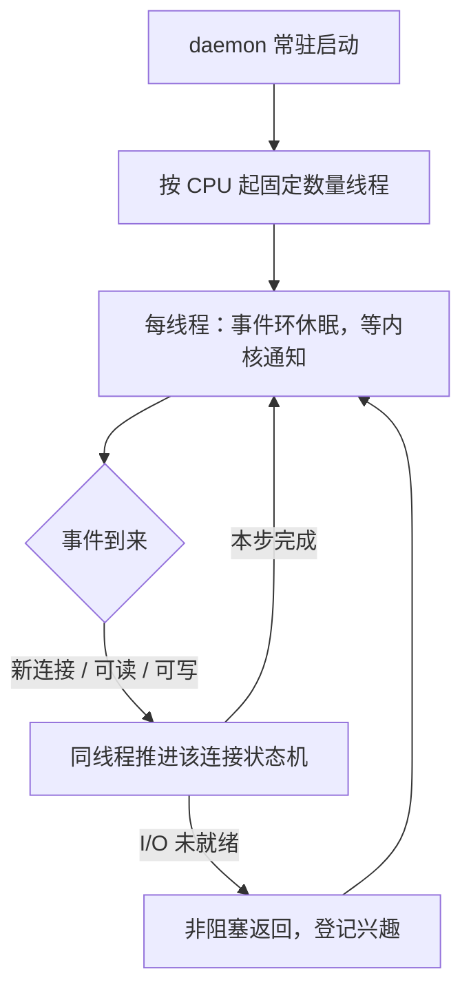
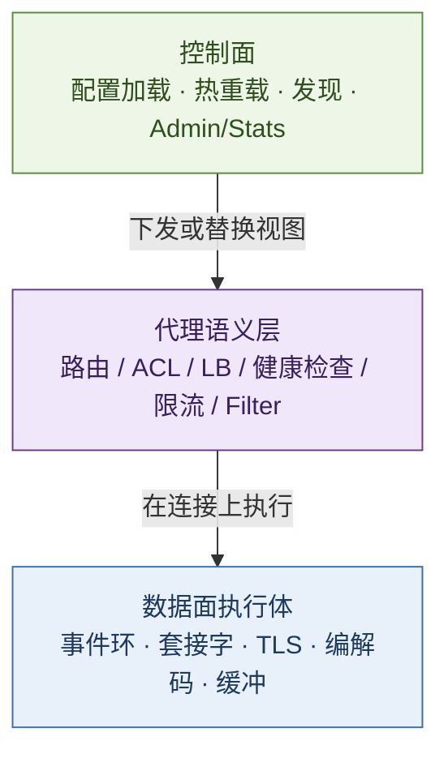
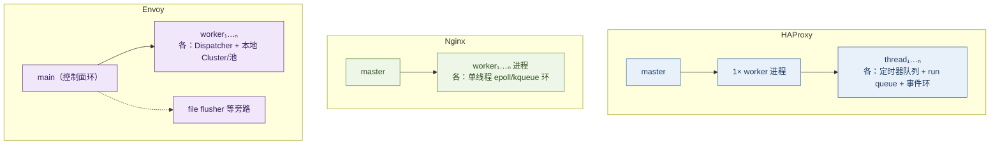
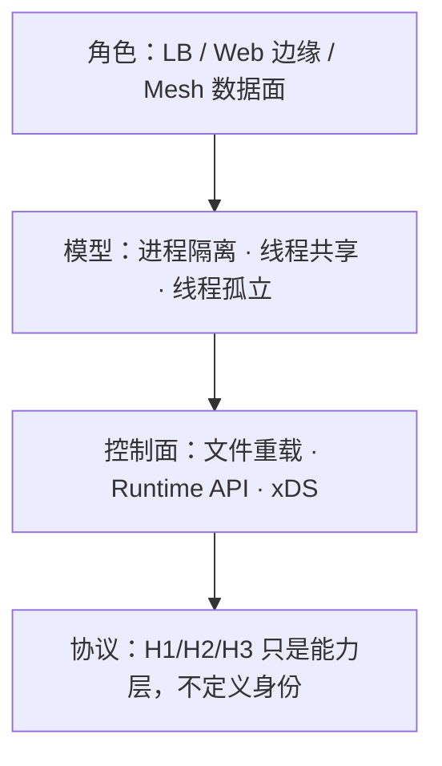

# HAProxy · Nginx · Envoy：代理三杰的架构对照

> 同叫「反向代理 / 负载均衡」，三者解决的主问题并不相同：HAProxy 以**连接级亲和的负载均衡**为中心；Nginx 以**事件驱动的通用边缘服务器**为中心；Envoy 以**可动态编排的云原生数据面**为中心。性能差距常被夸大；真正分叉的是**进程模型、状态共享方式与控制面合同**。
>
> 可与 [21](./21-service-architecture-evolution.md)（服务形态如何逼出网关层）、[16](../10-chronicle/16-http-protocol-chronicle.md)（HTTP/QUIC 代际）、[28](./28-http-rpc-microservice-communication-treatise.md)（东西向通信）对照：本文专写**入口与网格数据面的三条主流实现路径**。

先给一个直接答案：

> **三者都是事件驱动、非阻塞 I/O；架构分叉不在「会不会反代」，而在共享域与控制面。** 共同四原则：拒绝一连接一线程、热路径非阻塞、连接亲和、控制面与数据面分离。Nginx：master + **多进程单线程 worker**（`reuseport` 让内核分连接）。HAProxy：worker 内 **每线程一调度器**，session 钉线程，stick/peers 跨线程细锁共享。Envoy：**main（xDS）+ siloed workers**，池与 LB 游标不跨线程，配置经 Thread Local 下发。网络路径统一为 accept → 下游 → 上游 → 回程，执行体中途不换。选型先定角色与要不要跨连接共享状态，再谈延迟。
**20-architecture 位置：** [21](./21-service-architecture-evolution.md) 写服务形态演进；本文写演进中几乎必然出现的**代理层**——谁扛流量、谁持状态、谁接控制面。

## 摘要

HAProxy（2000 年代起）、Nginx（2004）、Envoy（2016，Lyft → CNCF）同属软件代理，却分属三条设计河床。官方句 *multi-threaded, event-driven, non-blocking daemon* 建议先按 §3 拆读：常驻服务、非阻塞等待、事件环调度、每核一工作线程——而非「一连接一线程」。共同原则是事件驱动、连接亲和、热路径非阻塞；分叉在**共享域**：Nginx 以多进程隔离换无锁；HAProxy 以「每线程一调度器 + 连接钉线程」换统一 stick/peers；Envoy 以 siloed worker + 线程本地配置视图换近线性扩展与 xDS 热更新。网络路径可统一读成 accept → 下游处理 → 上游池化转发 → 同执行体回程；L4/L7 只改变站内工作量，不改变执行体边界。截止 2026-10，HAProxy 最新 LTS 为 **3.4**。能力重叠于反代，**控制面与状态合同不可互换**。

**关键词：** HAProxy；Nginx；Envoy；daemon；非阻塞；事件驱动；多线程；负载均衡；反向代理；连接亲和；多进程；xDS；Thread Local；nbthread；SO_REUSEPORT；accept_mutex；HTTP/3；QUIC

---

## 目录

- [摘要](#摘要)
1. [读法与边界](#1-读法与边界)
2. [目的与角色](#2-目的与角色)
3. [官方四词：daemon · non-blocking · event-driven · multi-threaded](#3-官方四词daemon--non-blocking--event-driven--multi-threaded)
    - [3.1 总纲](#31-总纲)
    - [3.2 daemon：守护进程](#32-daemon守护进程)
    - [3.3 non-blocking：非阻塞](#33-non-blocking非阻塞)
    - [3.4 event-driven：事件驱动](#34-event-driven事件驱动)
    - [3.5 multi-threaded：多线程](#35-multi-threaded多线程)
    - [3.6 合起来：一条工作流](#36-合起来一条工作流)
    - [3.7 为何特别适合负载均衡](#37-为何特别适合负载均衡)
4. [设计原则与分层架构](#4-设计原则与分层架构)
    - [4.1 四条共同原则](#41-四条共同原则)
    - [4.2 分层：控制面 · 数据面 · 代理语义](#42-分层控制面--数据面--代理语义)
    - [4.3 原则如何落成三条河床](#43-原则如何落成三条河床)
5. [底层并发与网络模型](#5-底层并发与网络模型)
    - [5.1 一张总图：执行体长什么样](#51-一张总图执行体长什么样)
    - [5.2 HAProxy：每线程一调度器](#52-haproxy每线程一调度器)
    - [5.3 Nginx：每进程一事件环](#53-nginx每进程一事件环)
    - [5.4 Envoy：main + siloed workers](#54-envoymain--siloed-workers)
    - [5.5 网络路径：accept → 处理 → 上游](#55-网络路径accept--处理--上游)
    - [5.6 状态共享合同：锁什么、不锁什么](#56-状态共享合同锁什么不锁什么)
6. [配置模型与控制面](#6-配置模型与控制面)
7. [能力矩阵](#7-能力矩阵)
8. [HAProxy：多线程如何收官](#8-haproxy多线程如何收官)
9. [选型启发式](#9-选型启发式)
10. [收束](#10-收束)
11. [本章要点](#11-本章要点)
12. [参考文献](#12-参考文献)

---

## 1. 读法与边界

全文只钉三条轴：

| 轴 | 问题 |
| -- | ---- |
| **角色** | 边缘 LB、通用 Web 边缘、还是 Mesh / 可编程数据面？ |
| **并发模型** | 多进程、多线程、或「线程内事件环 + 跨线程最小共享」？ |
| **控制面** | 文件热重载、Runtime API，还是 xDS / 外部编排？ |

### 1.1 术语对照

| 术语 | 一句话 |
| ---- | ------ |
| **反向代理** | 对外暴露统一入口，向后转发至一组上游 |
| **L4 / L7** | 按传输层四元组转发 vs 按 HTTP 等应用语义路由 |
| **连接亲和（connection affinity）** | 一条连接（及其上多路流）终身由同一执行上下文处理 |
| **daemon** | 脱离终端、常驻后台的服务进程（见 §3.2） |
| **非阻塞（non-blocking）** | I/O 未就绪时不挂起执行体；登记兴趣后去干别的（见 §3.3） |
| **事件驱动** | 由内核就绪通知驱动推进，而非轮询「是否好了」（见 §3.4） |
| **事件环** | `epoll` / `kqueue` / `libevent` 等驱动的非阻塞调度循环 |
| **SO_REUSEPORT** | 多 socket 同绑一端口，内核把新连接分给不同监听者 |
| **xDS** | Envoy 的动态发现 API 族（LDS/CDS/RDS/EDS 等） |
| **stick-table** | HAProxy 可跨连接记忆的键值表（会话粘滞、限流计数等） |
| **Filter chain** | Envoy 上按监听器挂接的过滤器流水线 |

读法提示：若官方句 *multi-threaded, event-driven, non-blocking daemon* 仍像黑话，先读 **§3**，再进 §4–§5 的对照细节。

### 1.2 边界

1. **不做法庭式「谁最快」排名。** 吞吐随协议、TLS、报文大小、核数与特性开关剧变；正文给架构因果，不背某一博客的 QPS。  
2. **开源主线为准。** Nginx Plus、HAProxy Enterprise、商用 WAF 插件另册；能力差异在矩阵中点到为止。  
3. **Istio / Linkerd / Kong 等是编排与产品层**，本文只拆其下常见数据面之一（Envoy）与两类经典代理。  
4. **版本以官网维护表为准。** HAProxy 3.x：偶号 LTS（约 5 年）、奇号短期稳定；叙事锚在 3.0 多线程收官，并注明 2026-10 时最新 LTS 为 3.4。

---

## 2. 目的与角色

| | **HAProxy** | **Nginx** | **Envoy** |
| - | ----------- | --------- | --------- |
| **原初目的** | 可靠、可观测的 TCP/HTTP **负载均衡** | 高并发 **Web 服务器**（后扩反代/缓存） | **云原生数据面**：统一 L3/L4/L7，可动态配置 |
| **今日主战场** | 边缘 / 内部 LB、四七层入口、粘滞与健康检查 | 静态与边缘、反代、TLS 终结、API 网关底座 | Sidecar / 网关、服务网格、多协议过滤 |
| **成功判据** | 连接公平、故障切流、状态一致、重载不停机 | 延迟稳定、缓存命中、配置简单、生态模块 | 热更新配置、可观测、策略可组合、与控制面解耦 |
| **不该被简化成** | 「只会四层转发」 | 「只会静态站」 | 「只会 Mesh」 |

一句话分工：**HAProxy 把「均衡与会话状态」做透；Nginx 把「边缘内容与连接密度」做透；Envoy 把「动态发现与过滤器可编程」做透。**

---

## 3. 官方四词：daemon · non-blocking · event-driven · multi-threaded

HAProxy 管理文档开篇即称：*a multi-threaded, event-driven, non-blocking daemon*。[^haproxy-mgmt] 四词不是营销堆砌，而是对运行形态的压缩描述。Nginx、Envoy 在「事件驱动 + 非阻塞」上同构；差别主要在多核载体（进程 vs 线程）与状态共享（§5）。

### 3.1 总纲

> **用与 CPU 核数同阶的少量工作线程，以「就绪才推进、未就绪不空等」的方式同时服务海量连接，并作为后台服务常驻。**

| 词 | 解决的问题 | 常见误读 |
| -- | ---------- | -------- |
| **daemon** | 如何部署与存活 | 当成「不占 CPU」——错；只表示不绑终端 |
| **non-blocking** | 等待 I/O 时执行体做什么 | 当成「从不等待」——错；等待交给内核，执行体去干别的 |
| **event-driven** | 何时知道该继续干 | 当成「另派线程处理事件」——错；**同一线程**跑环并处理 |
| **multi-threaded** | 如何吃满多核 | 当成「一连接一线程」——错；是**固定少量**线程各跑一环 |

### 3.2 daemon：守护进程

| | 说明 |
| - | ---- |
| **含义** | 进程与控制终端分离，通常由 init/systemd（或容器主进程）拉起，长期驻留 |
| **运维直觉** | 等同于「常驻网络服务」，而非跑完即退出的 CLI |
| **在 HAProxy** | worker（及 master-worker 模式下的 master）以服务形态存在；软重载时新旧进程短暂并存属正常[^haproxy-mgmt] |

### 3.3 non-blocking：非阻塞

先对照**阻塞模型**（一连接一执行体）：

| 阶段 | 阻塞做法 | 代价 |
| ---- | -------- | ---- |
| 等客户端请求 | 执行体睡眠在 `read` | 连接空闲仍占一个工人 |
| 等上游响应 | 同上 | 并发 N ≈ 工人数 N |
| 长连接挂起 | 工人被占满 | 万级并发即内存与调度崩溃 |

**非阻塞**：套接字设为非阻塞；`read`/`write` 暂时不可用时立即返回，把「对该 fd 感兴趣」登记给内核，执行体转向其他已就绪连接。代理大部分时间本就在等对端——非阻塞把「等人」从占用工人改成占用一个轻量连接对象。[^aosa-nginx]

> 直觉（可选）：服务员不会在一桌旁干等到出菜；下单后去服务其他桌，出菜铃响再回来——工人数远小于同时开桌数。

### 3.4 event-driven：事件驱动

非阻塞解决「不等」；**事件驱动**解决「何时再来」。

| 概念 | 说明 |
| ---- | ---- |
| **事件** | 新连接可 accept、fd 可读/可写、定时器到期、信号等 |
| **事件环（event loop）** | 线程反复：向内核询问就绪集合 → 逐个推进对应连接的状态机 → 再休眠等待 |
| **与内核的接口** | Linux 上常见 `epoll`；BSD 系 `kqueue`；Envoy 经 `libevent` 等封装[^envoy-thread] |

**纠偏：** 环上的处理发生在**跑这个环的同一线程**内，并不是「事件到了再另开一个线程」。另开线程会回到一连接一工人的成本结构。

事件驱动与非阻塞是一对：前者提供就绪信号，后者保证处理时不把线程卡死在单次系统调用上。

### 3.5 multi-threaded：多线程

| | 正确读法 | 错误读法 |
| - | -------- | -------- |
| **线程数** | 默认约等于进程被允许使用的 CPU 数（`nbthread` / 亲和可调）[^haproxy-mgmt] | 随连接数增长 |
| **每线程内部** | 独立事件环 + 非阻塞 I/O，托管一批连接 | 线程内再「一连接一子线程」 |
| **连接归属** | 一条连接终身由 accept 到它的那一线程处理 | 请求级乱跳线程 |

单线程事件驱动吃不满多核；多线程把「每核一环」铺开。HAProxy 选线程而非多进程，是为了 stick-table、peers、统计等**共享内存语义**更便宜——代价是共享点必须细锁（§5.2、§5.6）。Nginx 用**多进程**达到同一「每核一环」效果，共享域更小。[^nginx-inside]

### 3.6 合起来：一条工作流

1. 以 daemon 拉起；线程数与核数同阶。  
2. 每线程跑自己的事件环，托管一批连接。  
3. 向下游读请求、向上游写、再读上游、写回客户端——每一步只在 fd 就绪时推进。  
4. 未就绪则回到环上；空闲长连接只占连接状态，不占「专用工人」。

### 3.7 为何特别适合负载均衡

| LB 场景特征 | 阻塞模型的困境 | 四词模型的应对 |
| ----------- | -------------- | -------------- |
| 连接数极大、大量空闲长连接 | 工人数被连接数绑死 | 空闲只留连接对象；工人数≈核数 |
| 代理自身计算轻，时间花在等待 | 工人大部分时间睡眠占槽 | 等待交给内核；CPU 用在真正拷贝与协议处理 |
| 需要吃满多核 | 单环只用一核 | 多线程（或 Nginx 多进程）每核一环 |

> **收一句：** daemon 定部署形态；non-blocking 定等待策略；event-driven 定调度信号；multi-threaded 定多核铺开方式。后文 §4–§5 是这四词在 HAProxy / Nginx / Envoy 上的展开，不是另一套理论。

---

## 4. 设计原则与分层架构

表格式对照容易只剩口号。先钉**共同原则**，再拆**分层**，最后看三条河床各自押哪一头。

### 4.1 四条共同原则

| # | 原则 | 含义 | 违反时的代价 |
| - | ---- | ---- | ------------ |
| 1 | **拒绝一连接一线程** | 用事件多路复用在少量执行体上挂成千上万连接 | 上下文切换与内存把机器拖死（经典 Apache 式瓶颈）[^aosa-nginx] |
| 2 | **热路径非阻塞** | 环内只做「就绪则推进」；长 CPU / 阻塞盘必须外置或有界线程池 | 同环内其他连接被饿死[^cf-event] |
| 3 | **连接亲和** | 一条下游连接（及其上 H2/H3 多路流）终身留在同一执行体 | 若跨线程搬连接，协议状态与缓冲几乎处处要锁 |
| 4 | **控制面与数据面分离** | 配配置、发现、统计刷新不走高 QPS 包路径 | 热更新与排障和转发抢同一条环 |

三者都遵守 1–3；第 4 条落实方式不同——Nginx/HAProxy 偏「文件 + 进程/API」，Envoy 把控制面做成 **xDS 一等公民**。

### 4.2 分层：控制面 · 数据面 · 代理语义

把「架构」拆成三层，后续网络模型才有落点：

| 层 | HAProxy | Nginx | Envoy |
| -- | ------- | ----- | ----- |
| **控制面** | master 管重载；Runtime API；peers 同步 stick | master 读配置、fork worker；信号重载 | **main 线程**：xDS、stats flush、`/admin`；不扛业务流量[^envoy-thread] |
| **代理语义** | `frontend` 决策 → `backend` 池 / 算法 / check | `server`/`location` → `upstream`；缓存与静态同源 | Listener → Filter chain → Router → Cluster / 端点 |
| **数据面** | worker 内 N 线程，每线程独立调度器 | N 个单线程 worker 进程 | N 个 worker，各有 `Event::Dispatcher`（libevent 系） |

读图口诀：**控制面改「表」；语义层读「表」做决策；数据面只在自己的环里搬字节。**

### 4.3 原则如何落成三条河床

| 设计押注 | HAProxy | Nginx | Envoy |
| -------- | ------- | ----- | ----- |
| **多核怎么吃** | 同进程多线程，共享地址空间 | 多进程，地址空间隔离 | 同进程多线程，但**刻意 silo 热数据** |
| **跨连接状态** | 必须共享（stick-table、peers）→ **细锁 + 分片** | 尽量不共享；缓存等走共享内存 | 热路径不共享；配置用 **TLS（Thread Local）槽** 异步下发[^envoy-thread] |
| **配置合同** | 文件极稳 + Runtime 改运行时对象 | 文件极稳；动态靠生态 | 静态 bootstrap + **xDS 热路径** |
| **可编程位置** | ACL / Lua / SPOE（外置代理） | 模块 / Lua(OpenResty) / njs | C++·Wasm Filter / ext_proc |
| **可观测默认** | stats 体系成熟 | stub_status；完整面靠 Plus/生态 | metrics · tracing · access log 一等公民 |

> **所以 · 边界在哪：** 原则相同，**共享域大小**不同。共享域越大，语义越「全集群一致」，锁与 NUMA 越敏感；共享域越小，扩展越线性，粘滞/全局限流越要另想办法。

---

## 5. 底层并发与网络模型

### 5.1 一张总图：执行体长什么样

| | HAProxy | Nginx | Envoy |
| - | ------- | ----- | ----- |
| **OS 可见** | 常为 1 个 worker 进程（重载时短暂双进程）[^haproxy-mgmt] | 1 master + N worker | 1 进程 |
| **扛流量的执行体** | 线程 | 进程 | 线程（worker） |
| **调参旋钮** | `nbthread` / CPU 亲和 / thread-groups | `worker_processes`（常 `auto`） | `--concurrency` |
| **事件设施** | 每线程自有调度（epoll 等）[^haproxy-mt] | 每 worker：`ngx_process_events_and_timers` | 每线程：`Event::Dispatcher` |

### 5.2 HAProxy：每线程一调度器

官方多线程文的关键选择：**不是「1 个调度线程 + N 个干活线程」，而是每个线程自带完整调度器**——与昔日多进程用法接近，却共享内存。[^haproxy-mt]

| 机制 | 细节 |
| ---- | ---- |
| **亲和** | task / fd / applet 同时只被一线程处理；**同一 session 上的实体钉在 accept 该连接的线程** |
| **全局实体** | listener、peers、health check、DNS 等无会话亲和，但同一时刻仍只被一线程处理 |
| **后端连接池** | 可复用连接对「钉在同一线程的会话」可见——线程局部副作用，换来少锁[^haproxy-mt] |
| **锁** | 剩余共享点用 progressive lock（plock）等；stick-table 等持续分片降争用 |
| **thread-groups** | 2.7+：按 CPU 局部性分组，把共享限制在组内，缓和跨 NUMA 延迟[^haproxy-perf] |

管理文档口径：默认每许可 CPU 一线程；**单连接单线程服务**；要吃满核，并发连接数通常至少与线程数同阶（生产几乎总能满足）。[^haproxy-mgmt]

### 5.3 Nginx：每进程一事件环

AOSA / 官方「Inside NGINX」模型：master 做特权与配置；**worker 才处理连接**；推荐 **一核一 worker**。[^aosa-nginx][^nginx-inside]

| 机制 | 细节 |
| ---- | ---- |
| **环内结构** | 等 I/O → 处理 posted accept/事件 → 定时器；协作式推进，无抢占 |
| **accept 争用（历史）** | 多 worker 抢同一 listen fd 会惊群；曾用 `accept_mutex` 轮流 accept |
| **当代默认** | `accept_mutex` 默认 **off**（有 `EPOLLEXCLUSIVE` 或 `reuseport` 时本就不需要）[^nginx-accept] |
| **reuseport** | `listen … reuseport`：每 worker 一个监听套接字，**内核**分连接，减用户态锁[^nginx-reuseport] |
| **阻塞逃生** | 读盘等可走有界 **thread pool**，完成后再回 worker 环——承认「纯事件环扛不住同步盘」[^cf-event] |
| **进程间** | 请求路径基本无锁；限流/缓存计数等靠共享内存，语义弱于「单表强一致」 |

### 5.4 Envoy：main + siloed workers

| 线程 | 职责 |
| ---- | ---- |
| **Main** | xDS、集群管理协调、stats 刷出、admin、信号；**不处理高流量**[^envoy-thread] |
| **Worker × N** | 监听、accept、Filter、转发；`--concurrency` 控制，常 = 硬件线程数 |
| **旁路** | access log 的 file flusher；DNS/`getaddrinfo`、部分异步文件 I/O 等专用池，避免堵 worker |

Worker 侧要点：

1. **连接终身钉在 accept 到的那个 worker**；热路径按单线程写法，几乎不锁。[^envoy-thread]  
2. **默认所有 worker 都 listen**；新连接由内核分；长连接稀少（如 Mesh 出口少量 H2）时可开 **listener connection balancer** 做强制均衡。  
3. **TLS（Thread Local Storage）槽**：main 解析配置后 `post` 到各 worker，worker 本地 O(1) 读集群视图——热路径无全局锁读配置。[^envoy-thread]  
4. **Siloed 后果**：每 worker 自有 upstream 连接池与 LB 游标 → 每上游稳态可有「worker 数」条 H2 连接；RR「不均」是模型特性。[^envoy-rr]

### 5.5 网络路径：accept → 处理 → 上游

把「网络模型」落成同一条请求链上的站：

| 站 | HAProxy | Nginx | Envoy |
| -- | ------- | ----- | ----- |
| **① Accept** | 线程共享监听；内核/均衡把连接交给某线程后**钉死** | 共享 listen +（可选）mutex，或 **reuseport** 每 worker 一 socket | 各 worker listen；内核分；可选强制 balancer |
| **② 下游** | 同线程：TCP/HTTP 模式、ACL、stick 查询 | 同进程：`http`/`stream` 阶段、rewrite、access | 同 worker：Listener filter → HTTP/TCP 连接管理 → Filter chain |
| **③ 上游** | backend 算法 + 健康状态；池连接常**线程内复用** | `upstream` 选 peer；进程内池化 | Cluster LB + **本 worker 连接池**；健康/outlier 视图经 TLS 下发 |
| **④ 回程** | 不换线程 | 不换进程 | 不换 worker |

L4 与 L7 的差别在 ②：L4 几乎只搬字节；L7 才解析方法/头/`:authority`、做路由与协议翻译（如 H3→H1）。**执行体边界不变**——变的是站内工作量。

UDP/QUIC 额外约束：无「连接」时，常靠五元组哈希把同一会话钉到同一执行体（Envoy 文档对 UDP 明确依赖 `SO_REUSEPORT` 哈希一致性）；HAProxy 的 QUIC accept 亦走向线程均衡，避免单线程打满。[^envoy-life][^haproxy-quic]

### 5.6 状态共享合同：锁什么、不锁什么

| 状态种类 | HAProxy | Nginx | Envoy |
| -------- | ------- | ----- | ----- |
| **单连接协议状态** | 线程私有 | 进程私有 | worker 私有 |
| **上游连接池** | 偏线程可见 | 进程内 | **每 worker 一份** |
| **LB 游标 / RR** | 共享结构 + 锁/原子（随算法） | 进程内 | **每 worker 一份** → 全局看起来不均[^envoy-rr] |
| **会话粘滞表** | stick-table **跨线程共享**（分片锁） | 弱/外置/Plus | 有限；常靠上游亲和或外置 |
| **配置/集群成员** | 重载换进程或 Runtime 改；线程见一致内存 | 重载换 worker 代际 | main 下发 → worker TLS 槽 |
| **统计** | 可共享；3.0+ 可跨重载落盘 | 每 worker + 共享内存聚合 | worker 计数 → main 汇总 flush |

> **所以 · 边界在哪：**  
> - 问「为何 HAProxy 敢默认多线程」→ 连接不共享 + 共享点极窄。  
> - 问「为何 Nginx 不靠多线程吃多核」→ 进程隔离已够用，且避开共享表。  
> - 问「为何 Envoy RR 看起来歪」→ silo 是特性；调 `--concurrency` 与连接 balancer，而不是先疑 LB 坏了。

---

## 6. 配置模型与控制面

| | HAProxy | Nginx | Envoy |
| - | ------- | ----- | ----- |
| **静态骨架** | `global` / `defaults` / `frontend` / `backend` | `events` / `http` / `upstream` / `server` | Bootstrap + Listener / Cluster / Route |
| **热更新** | 软重载（新旧进程交接）；Runtime API 改权重、地图等 | `nginx -s reload`；多数变更需重载 | **xDS 热更新**为主；也可热重启 |
| **服务发现** | DNS、Runtime API、外部编排写文件 | DNS、变量 upstream；常靠外围 | EDS/CDS 原生；与 K8s / Mesh 控制面咬合 |
| **治理动作** | ACL、stick、限流、健康检查内建扎实 | `limit_req`、反代头、缓存；复杂策略常靠模块/OpenResty | Outlier、重试、熔断、RBAC、JWT… Filter 组合 |

HAProxy 的运维优势常在：**一份十年前的 `frontend`/`backend` 思路仍可读**；Envoy 的优势在：**无需进程级重载即可换路由与集群成员**。Nginx 居中——文件配置极稳，动态能力靠生态补丁而非单一官方控制面。

---

## 7. 能力矩阵

| 能力 | HAProxy | Nginx（开源） | Envoy |
| ---- | ------- | ------------- | ----- |
| TCP / UDP 代理 | 强（LB 本业） | 有（stream）；定位次于 HTTP | 强（Listener 通用） |
| HTTP/1.1 · H2 | 成熟 | 成熟 | 成熟 |
| HTTP/3 · QUIC | 2.5 引入，**2.8 起标生产可用**；3.x 继续磨 accept/发送路径[^haproxy-quic] | 官方模块演进中；部署看构建与发行版 | 一等公民（下游/上游路径视版本） |
| 主动健康检查 / 高级 LB | 核心竞争力 | 基础 upstream；高级能力多在 Plus / 生态 | 健康、outlier、多种 LB 策略 |
| 会话粘滞 | stick-table 体系 | 有限 / 需模块或 Plus | 有；常与 Mesh 身份策略叠加 |
| 静态文件 / 缓存 | 非主业 | **主业之一** | 非主业 |
| 动态配置面 | Runtime API 强；非 xDS 原生 | 文件重载为主 | **xDS 原生** |
| 服务网格数据面 | 可作入口；非典型 sidecar 标准 | 少作 sidecar | **事实标准之一** |

协议翻译是常见落地模式：例如 HAProxy **前端 H3、后端 H1/H2**，用入口红利承接老上游——合同允许，并不要求后端同步升协议。[^haproxy-quic]

---

## 8. HAProxy：多线程如何收官

多线程**不是 3.0 才发明**，而是分步默认化；3.0 的意义是协议栈与共享结构对线程模型「可长期默认」。

| 节点 | 版本 / 年 | 事实 |
| ---- | --------- | ---- |
| 实验 | **1.8**（2017） | `nbthread`；master-worker；官方仍标实验[^haproxy-mt] |
| 默认 | **2.0**（2019） | 未写 `nbthread`/`nbproc` 时，线程数≈进程可跑 CPU；亲和/`taskset` 即可调核[^haproxy-20] |
| 弃多进程 | **2.4**（2021） | `nbproc` 废弃并与线程互斥；劝迁 `nbthread`[^haproxy-nbproc] |
| 超多核 | **2.7+** | thread-groups：按拓扑分组，单组线程上限（历史上 64）服务超多核 |
| 收官 | **3.0**（2024-05） | stick-table 多树头分片（官方称约 80 线程上 ~6×）；stats 可跨重载持久；`crt-store`；H2/H3 防护与运维面补强[^haproxy-30] |

版本选型（官方政策）：**偶号 LTS、奇号短期稳定**。2026-10 时最新 LTS 为 **3.4**；3.0 仍在 LTS 窗内。生产闭眼选当前 LTS 线，奇号留给尝鲜。[^haproxy-eol]

与 §3、§5.2 同一内核：**多线程、事件驱动、非阻塞；默认每许可 CPU 一线程；连接单线程服务。**[^haproxy-mgmt] 3.0 运维侧补强：热重载前 `dump stats-file` + 对象 `guid` 可延续计数；`nbthread` / thread-groups 收束到 `global`。[^haproxy-30]

---

## 9. 选型启发式

| 场景 | 更常优先 | 原因 |
| ---- | -------- | ---- |
| 高并发 TCP/HTTP **纯 LB**、粘滞/健康检查重 | **HAProxy** | LB 语义与 stick/peers 一体；配置面稳 |
| 静态、缓存、TLS 边缘、反代「内容站」 | **Nginx** | Web 服务器血统；运维心智与模块生态 |
| K8s / Mesh、需 **xDS 热配**、多协议 Filter | **Envoy** | 为动态控制面而生；可观测默认强 |
| 只要「一个进程扛边缘 + 偶尔 Lua」 | Nginx 或 HAProxy | 看团队存量配置与监控习惯 |
| 极多核且强依赖跨连接共享状态 | HAProxy（+ thread-groups）或外置状态 | Envoy silo 与 Nginx 多进程都要额外设计 |

反模式：

1. **用 QPS 神话替代角色定义**——先写清南北向还是东西向、是否要热配。  
2. **在 Envoy 多 worker 下解读「RR 不均」为故障**——先读 siloed 模型。[^envoy-rr]  
3. **在 Nginx worker 内跑长 CPU**——事件环协作式调度，长任务拖死同进程连接。[^cf-event]  
4. **HAProxy 仍用 `nbproc` 思维调参**——当代合同是线程与 CPU 亲和，不是堆进程。

---

## 10. 收束

三条河床可以并存于同一架构：边缘 HAProxy 或 Nginx 做南北向；网格内 Envoy 做东西向。争论「谁取代谁」通常是把**不同合同**按成同一产品品类。

---

## 11. 本章要点

1. 官方四词：daemon 定常驻；non-blocking 定「未就绪不占工人」；event-driven 定就绪信号；multi-threaded 定每核一环——**不是**一连接一线程。  
2. 事件在**跑环的同一线程**内处理；非阻塞与事件驱动成对出现。  
3. 共同原则：非「一连接一线程」、热路径非阻塞、连接亲和、控制面与数据面分离。  
4. 分层：控制面改表 → 语义层决策 → 数据面在单执行体上搬字节。  
5. HAProxy：每线程一调度器，session 钉线程；共享 stick/peers，用分片锁与 thread-groups。  
6. Nginx：每 worker 一进程一环；`reuseport` / `EPOLLEXCLUSIVE` 替代旧 accept 惊群套路。  
7. Envoy：main 管 xDS；worker siloed；TLS 槽下发配置；池与 RR 不跨 worker。  
8. 网络路径四站执行体不变；选型先角色与共享域，再谈 QPS。

---

## 12. 参考文献

[^aosa-nginx]: O. Garrett et al., *The Architecture of Open Source Applications*, Vol. 2, ch. “nginx”. https://aosabook.org/en/v2/nginx.html 。事件驱动、worker 进程模型。

[^nginx-inside]: NGINX Inc., *Inside NGINX: How We Designed for Performance & Scale*. https://blog.nginx.org/blog/inside-nginx-how-we-designed-for-performance-scale 。master / worker / 每核一 worker。

[^nginx-accept]: nginx.org, *Core functionality* — `accept_mutex`（默认 off；与 EPOLLEXCLUSIVE / reuseport 的关系）. https://nginx.org/en/docs/ngx_core_module.html 。

[^nginx-reuseport]: F5/NGINX Blog, *Socket Sharding in NGINX Release 1.9.1*（`listen … reuseport`）. https://www.f5.com/company/blog/nginx/socket-sharding-nginx-release-1-9-1 。

[^cf-event]: Cloudflare Blog, *The problem with thread^W event loops*. https://blog.cloudflare.com/the-problem-with-event-loops/ 。事件环忌长任务；Nginx thread pool 背景。

[^haproxy-perf]: HAProxy Documentation, *Performance optimization for large systems*（thread groups 与 NUMA 局部性）. https://www.haproxy.com/documentation/haproxy-configuration-tutorials/performance/performance-tuning/ 。
[^haproxy-mgmt]: HAProxy Documentation, *Management Guide*（架构速览：多线程、事件驱动、每 CPU 一线程、连接单线程服务）. https://docs.haproxy.org/ 。

[^haproxy-mt]: HAProxy Technologies, *Multithreading in HAProxy*. https://www.haproxy.com/blog/multithreading-in-haproxy 。1.8 引入；实体/会话单线程处理。

[^haproxy-20]: HAProxy Technologies, *HAProxy 2.0 and Beyond*. https://www.haproxy.com/blog/haproxy-2-0-and-beyond 。默认按 CPU 设线程。

[^haproxy-nbproc]: HAProxy Configuration Manual（2.4+）, `nbproc` deprecated / exclusive with `nbthread`. https://docs.haproxy.org/2.4/configuration.html 。

[^haproxy-30]: N. Ramirez & A. Morris, *Announcing HAProxy 3.0*, 2024-05-29. https://www.haproxy.com/blog/announcing-haproxy-3-0 。crt-store、stats 持久、stick-table 分片约 6× 等。

[^haproxy-quic]: HAProxy 2.8 announce / tutorials：QUIC 生产可用；前端 H3 常见模式. https://www.haproxy.com/blog/announcing-haproxy-2-8 ；https://www.haproxy.com/documentation/haproxy-configuration-tutorials/protocol-support/http/ 。

[^haproxy-eol]: HAProxy 版本与 LTS 政策. https://www.haproxy.org/ ；https://endoflife.date/haproxy 。偶号 LTS；2026-10 最新 LTS 3.4。

[^envoy-thread]: Envoy documentation, *Threading model*；Matt Klein, *Envoy threading model*. https://www.envoyproxy.io/docs/envoy/latest/intro/arch_overview/intro/threading_model ；https://medium.com/envoyproxy/envoy-threading-model-a8d44b922310 。main / worker；连接终身单 worker。

[^envoy-rr]: Envoy FAQ, *Why doesn’t RR load balancing appear to be even?*. https://www.envoyproxy.io/docs/envoy/latest/faq/load_balancing/concurrency_lb 。Siloed LB 与连接池。

[^envoy-life]: Envoy documentation, *Life of a Request*. https://www.envoyproxy.io/docs/envoy/latest/intro/life_of_a_request 。Listener / Cluster；worker 并行。

**声明：** 正文是架构对照，不是安装手册或压测排行榜。企业发行版特性、具体 sysctl 与编译开关以当期文档为准；与 HTTP 代际见 [16](../10-chronicle/16-http-protocol-chronicle.md)，与服务形态见 [21](./21-service-architecture-evolution.md)。
