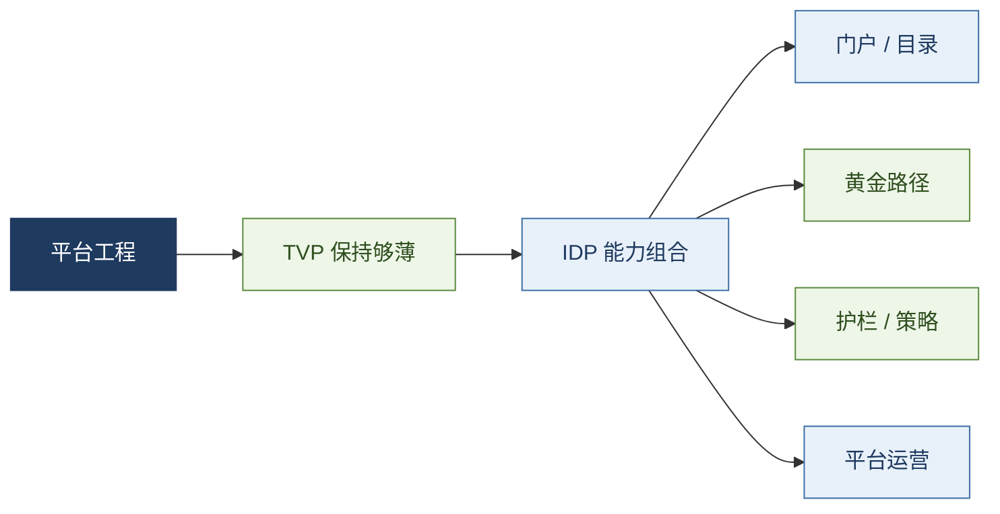
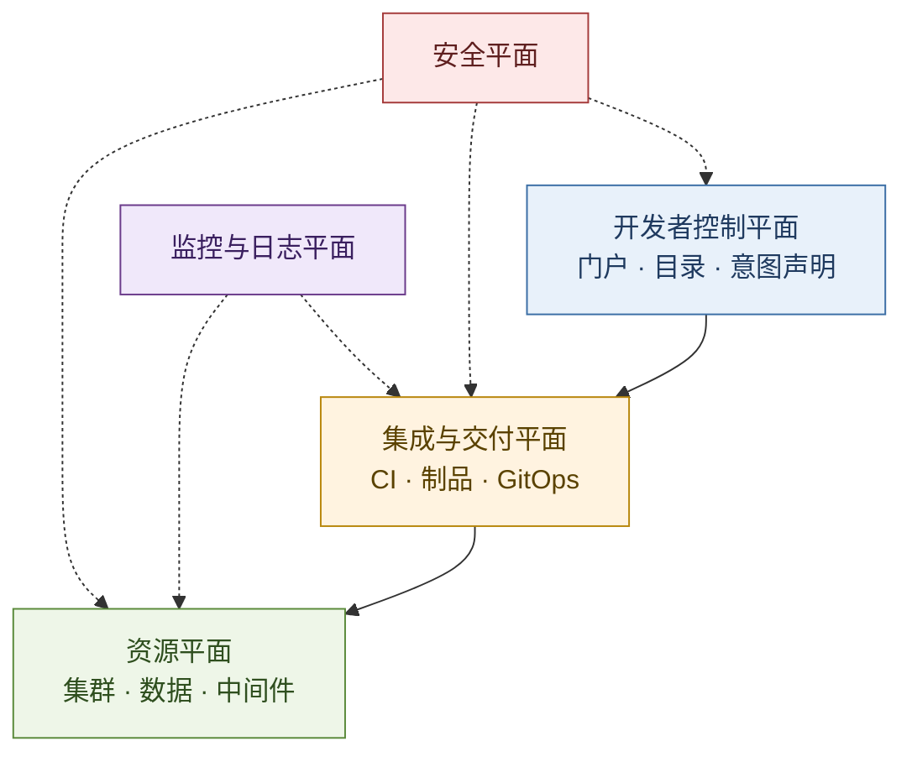

# 平台工程与 IDP：把复杂度产品化

> [21](./21-service-architecture-evolution.md) §8.1 指出：后微服务把治理交给平台之后，若仍是「文档 + 工单 + 裸集群」，负担只是换科室。  
> **本文是该展望的专论：** 平台工程如何把云原生工具链沉淀为**内部开发者平台（IDP）**，用自助、黄金路径与护栏，把外在认知负荷从业务团队移走。

**结论：**

> **平台工程不是又一代通信协议，也不是 DevOps 换皮。**  
> 它是规模化之后的组织解：把基础设施与交付专长集中，经自助接口对外暴露；开发者走**黄金路径（paved road）**完成常规交付，平台团队以**产品**方式运营 **最薄可行平台（TVP）**。  
> 主价值是降低流对齐团队的**外在认知负荷**（Team Topologies）；成功度量是采用率与交付结果，不是平台 uptime。  
> **强制管控项，不强制「必须用平台」**——让安全路径最好走，而不是唯一合法走法。  
> K8s 是地基，不是完整 IDP；门户是入口，不是平台本身。

> **与行业水位对照：**  
> **对齐** — CNCF Platforms 白皮书 / 成熟度模型、Team Topologies（TVP、X-as-a-Service）、Gartner「平台即产品 + paved road」、麦肯锡五平面（PlatformCon 2023）。  
> **补强于本文** — 成熟度五维独立演进、TVP 持续变薄、强制控制而非强制采用、交互模式演进。  
> **不作** — 不把某一厂商工具栈写成唯一标准；不把「智能体 IDP」写成已统一生产范式。

**20-architecture 位置：** 本文是 [21](./21-service-architecture-evolution.md) §8.1 的专论（编号 21a）；[23](./23-kubernetes-control-plane-doctrine.md) 写编排控制面；本文写**平台产品层**。代理 / VIP 入口见 [28a](./28a-haproxy-nginx-envoy-treatise.md)，与服务通信 [28](./28-http-rpc-microservice-communication-treatise.md) 同族，不挂在 21 下。

## 摘要

DevOps 解决协作与自动化；多团队云原生之后，外在认知负荷重新上升。平台工程通过 **TVP + IDP** 把交付能力产品化：自助、黄金路径、护栏与持续运营。正文对齐 CNCF / Team Topologies / Gartner，并综合 IBM、Red Hat、Google Cloud、灵雀云与五平面参考架构：术语 → 问题 → 定义 → 关系 → 时机 → 架构 → 工具族 → 组织 → 护栏 → 度量与成熟度 → 落地 → 复杂度去向 → 展望。[^cncf-platforms][^cncf-maturity][^ibm-pe][^rh-tools][^gcp-vs-devops][^gcp-pe][^alauda-pe][^mckinsey-planes]

**关键词：** 平台工程；IDP；TVP；黄金路径；认知负荷；CNCF 成熟度；平台即产品；Team Topologies；自服务；护栏

---

## 目录

1. [读法与术语](#1-读法与术语)
2. [问题：DevOps 规模化后的摩擦](#2-问题devops-规模化后的摩擦)
3. [定义：平台工程 · IDP · 黄金路径 · TVP](#3-定义平台工程--idp--黄金路径--tvp)
4. [关系：与 DevOps / SRE / 容器平台](#4-关系与-devops--sre--容器平台)
5. [时机：何时该建平台团队](#5-时机何时该建平台团队)
6. [架构：五平面与能力层](#6-架构五平面与能力层)
7. [工具族：按能力归类，不按品牌堆砌](#7-工具族按能力归类不按品牌堆砌)
8. [组织：用户、交互模式与平台即产品](#8-组织用户交互模式与平台即产品)
9. [自服务与护栏](#9-自服务与护栏)
10. [度量与成熟度](#10-度量与成熟度)
11. [落地：顺序、反模式与 30/60/90](#11-落地顺序反模式与-306090)
12. [与全文暗线：复杂度去了哪里](#12-与全文暗线复杂度去了哪里)
13. [展望：智能辅助，而非口号取代](#13-展望智能辅助而非口号取代)
14. [参考文献](#14-参考文献)

---

## 1. 读法与术语

| 术语 | 一句话 |
| ---- | ------ |
| **平台工程（Platform Engineering）** | 设计、构建并运营内部开发者平台的学科与实践；把交付与基础设施能力产品化。[^ibm-pe][^gcp-pe] |
| **IDP（Internal Developer Platform）** | 平台团队交付的**能力组合**：自助 API / 工具 / 服务 / 知识 / 支持，供内部开发者构建、部署与运行应用。[^ibm-pe][^rh-tools] |
| **开发者门户（Developer Portal）** | 常作 IDP 的**前端入口**（目录、文档、脚手架）；门户 ≠ 平台全部。[^rh-tools][^gcp-pe] |
| **黄金路径（Golden Path / Paved Road）** | 常规任务的推荐模板与自动化：默认安全、可观测、可回滚；覆盖多数用例，允许受控例外。[^gcp-pe][^alauda-pe] |
| **TVP（Thinnest Viable Platform）** | Team Topologies / CNCF：在「足够加速交付」与「保持平台够薄」之间平衡；持续用托管与商品化能力替换自研，避免平台发胖。[^cncf-platforms][^cncf-tvp] |
| **下移（Shift Down）** | 把运维与基础设施复杂度从应用开发者转移到平台团队 / IDP；与「左移」互补。[^gcp-pe] |
| **平台即产品（Platform as a Product）** | 开发者是内部客户；平台有路线图、反馈、采用率与满意度，而非只做工单队列。[^alauda-pe][^gartner-pe] |

**边界：**

| 本文提供 | 本文不提供 |
| -------- | ---------- |
| 概念因果、架构骨架、选型与落地顺序 | 某一云厂商的产品选型手册 |
| 工具**能力族**对照 | 逐工具安装教程 |
| 与 [21](./21-service-architecture-evolution.md) 复杂度转移的衔接 | 替代微服务数据模式（仍见 21 §4.4） |

---

## 2. 问题：DevOps 规模化后的摩擦

DevOps 拉近开发与运维，强调协作、共享责任与自动化。在小团队里，「你构建、你运行」可行；工程师规模到数百、工具栈变为仓库 + 流水线 + 镜像 + K8s + 配置 + 观测 + 安全扫描时，每个业务队都要独自精通整箱工具——**外在认知负荷**压过业务交付。[^gcp-vs-devops][^cndevops-idp]

典型症状：

1. **认知过载** — 开发者大量时间花在基础设施与工具集成，而非特性。  
2. **做法不一致** — 各队安全基线、部署方式、命名与观测接入各异，支撑与审计困难。  
3. **供给缓慢** — 测试 / 预发环境靠工单，数天才能就绪，生命周期出现瓶颈。[^gcp-vs-devops]

平台工程的回答：**不是退回集中式运维包办一切**，而是把专长集中，经自助接口规模化复制——让安全的路径成为最轻松的路径。[^alauda-pe]

> **与 [21](./21-service-architecture-evolution.md) 对齐：** 后微服务把横切下沉到 K8s / Mesh 之后，残余痛点正是「每个业务队消化全套云原生工具链」。平台工程是把这批复杂度再转移给**平台产品**。

---

## 3. 定义：平台工程 · IDP · 黄金路径 · TVP

### 3.1 平台工程

CNCF：平台工程是把内部平台当作产品来提供的实践——投资于人员、流程、策略与技术，以驱动业务结果；平台提供获取与使用能力的**一致体验**，但不必自行实现一切底层（可叠托管与第三方）。[^cncf-platforms]

厂商口径与之同构：IBM 强调标准化工具、自动化与一致环境，核心交付物是 IDP；[^ibm-pe] Google 强调为团队提供黄金路径；[^gcp-pe] Red Hat 强调在安全与可观测前提下的自助。[^rh-tools]

Gartner 补充一句常被忽略的话：**标准化本身不是平台工程的显式目标**；目标是交付比「各队自建」更好的自助体验。[^gartner-dx]

### 3.2 IDP

IDP 不是单一可采购的「盒子」，而是面向内部开发者的**能力组合**：服务目录、应用模板、环境申请、流水线、部署、观测、权限、文档与支持入口。[^alauda-pe][^ibm-pe] 成熟后还可提供**场景组合**（例如「标准 Web 服务」「数据作业」一整条模板），而不仅是单个工具入口。[^cncf-platforms]

> **门户 vs 平台：** 门户可作统一入口与软件目录；平台还包含应用平台层、资源供给、策略与运营机制。只有门户、没有标准化底层路径，只是把混乱换了外壳。[^rh-tools][^alauda-pe]

知名开源门户底座之一是 **Backstage**（Spotify → CNCF）；企业发行版常在其上提供受支持的集成（如 Red Hat Developer Hub）。[^rh-tools]

### 3.3 黄金路径

黄金路径 = 高频任务的模板 + 默认配置 + 安全基线 + 发布策略 + 观测接入 + 文档。应自助可达、文档完备；与开发者共创，而非平台单方颁布。[^gcp-pe]

> **Gartner 原则：** 强制的是安全 / 架构 / 合规**控制**；平台采用应靠「paved road 更好用」吸引，并允许团队选择自合规或走黄金路径——**不要把平台用成唯一合法工具且无替代选项**。[^gartner-pe]

### 3.4 TVP：最薄可行平台

MVP 避免一上来过大；**TVP** 更进一步：平台长大后持续**变薄**——删无用能力、提高抽象、用托管 / 商品化替换自研，把平台队精力留在对本组织真正差异化的体验与胶水上。[^cncf-platforms][^cncf-tvp]

> **经验法则：** 极简起点可以是「一页标准作业 + 链接到托管能力」；完整 IDP 是演进结果，不是第一周交付物。[^cncf-platforms]

---

## 4. 关系：与 DevOps / SRE / 容器平台

| 概念 | 主问题 | 与平台工程 |
| ---- | ------ | ---------- |
| **DevOps** | 文化与协作：缩短从构想到客户价值的周期 | DevOps 是「为何」；平台工程是规模化下的「如何」——把实践编码进黄金路径。[^gcp-vs-devops] |
| **SRE** | 可靠性、错误预算、运维工程化 | 原则可嵌入黄金路径（探针、SLO、回滚）；SRE 与平台常协作，角色不完全等同。[^ibm-pe][^gcp-pe] |
| **容器 / K8s 平台** | 运行时、编排、网络、存储 | **地基**。平台工程还包含目录、模板、文档、支持、反馈与产品运营。[^alauda-pe][^rh-tools] |
| **DevSecOps / 左移** | 安全与质量前移到生命周期早期 | 与**下移**互补：检查前移到流水线；复杂度下沉到 IDP。[^gcp-pe] |

> **一句话：** 平台工程不取代 DevOps；它解决 DevOps 在多团队、多栈、多环境下的**可复制性**。[^alauda-pe]

---

## 5. 时机：何时该建平台团队

Google Cloud 的判据：**不是先看编制人数，而是看摩擦成本**——当应用开发者花在基础设施上的时间与心力，超过建设并维护平台的投资时，就该认真考虑 IDP。[^gcp-vs-devops]

| 阶段 | 信号 | 建议 |
| ---- | ---- | ---- |
| **简单自动化即可** | 应用简单，团队能自行管理基础需求 | 强化 DevOps 文化与轻量 CI/CD；可用「文档型 TVP」 |
| **平台成为明确选择** | 认知过载、做法不一致、环境供给过慢 | 建平台队，先做 1～2 条黄金路径（TVP），再扩门户 |
| **过早大门户 / 过厚平台** | 底层未标准化就做大 UI，或自研一切托管已有能力 | 先顺高频路径；能买则买，自研只留差异化胶水 |

Gartner 预测：到 **2026** 年约 **80%** 大型软件工程组织将建立平台工程团队（2022 约 45%）——说明方向主流，不说明每家同一天开工，更不说明都应冲到成熟度最高档。[^gartner-pe] CNCF 亦提醒：**盲目追最高成熟度昂贵且可能有害**，应按当前与目标态定向投资。[^cncf-maturity]

编制经验区间（行业二次汇总，宜本地校准）：专职平台常见约占工程编制约 **2%–6%**（大约 1 名平台工程师支撑十余到数十名开发）——过薄则工单化，过厚则发胖。[^pe-ratio]

---

## 6. 架构：五平面与能力层

McKinsey 团队在 **PlatformCon 2023** 分享的 IDP 参考架构，把数百个真实平台收敛为**五平面**；随后 Humanitec / platformengineering.org 等据此给出 AWS / GCP / Azure 样例。原则是：开发者声明意图，平台翻译资源并套基线——**控制意图与供给实现分离**。[^mckinsey-planes][^pe-refarch]

| 平面 | 职责 | 典型能力 |
| ---- | ---- | -------- |
| **开发者控制平面** | 交互与意图：门户、目录、负载规格、Git | Backstage / 门户、Workload Spec（如 Score）、VCS |
| **集成与交付平面** | 构建、制品、配置生成、部署调和 | CI、镜像仓库、编排器、CD / GitOps |
| **资源平面** | 运行时与依赖资源的创建 / 更新 / 删除 | K8s、数据库、存储、DNS、队列（IaC / Crossplane 等） |
| **监控与日志平面** | 指标、日志、追踪（亦可含 FinOps 可见性） | OpenTelemetry、Prometheus、Grafana 等 |
| **安全平面** | 身份、密钥、策略、供应链 | SSO/OIDC、Vault、OPA/Kyverno、签名与 SBOM |

> **纪律：** 若开发者必须先学会写完整套 Terraform / Helm 才能部署新服务，IDP 在体验上尚未成立。提供分层默认 + 逃生舱；安全能力宜**织入各平面**，而不仅是旁路检查清单。[^mckinsey-planes][^pe-refarch]

五平面是**分类骨架**，不是必须五层齐装满员才叫平台。TVP 阶段往往先打通「控制 + 交付 + 最薄资源/安全默认」。

---

## 7. 工具族：按能力归类，不按品牌堆砌

Red Hat 等厂商按能力列举工具；选型时宜先定能力，再定实现。[^rh-tools]

| 能力族 | 要解决的问题 | 常见开源 / 实践方向（示例） |
| ------ | ------------ | --------------------------- |
| **开发者门户 / 目录** | 服务发现、owner、文档、脚手架 | Backstage 及发行版 |
| **CI/CD** | 构建、测试、部署自动化 | Jenkins、Tekton、Argo CD、Flux 等 |
| **IaC / 资源供给** | 环境一致、可重复供给 | Terraform、Ansible、Crossplane、云厂商 IaC |
| **容器与编排** | 打包一致、规模调度 | OCI 容器、Kubernetes / OpenShift 等 |
| **可观测** | 健康、根因、预测 | Prometheus、OpenTelemetry、Grafana、Jaeger 等 |
| **安全与合规** | 左移检查、密钥、签名、策略 | 流水线扫描、Vault、Sigstore、策略引擎、K8s 安全 |

成熟落地中常见「门户 + GitOps CD + 资源抽象」组合（如 Backstage + Argo CD + Crossplane），但**不是唯一宗教**；小团队可用更薄的门户与托管流水线。[^cndevops-idp][^rh-tools]

Google Cloud 等公有云则强调：用托管构建、GKE、可观测套件等作为 IDP 积木，平台队专注黄金路径与胶水，而非重复造轮子。[^gcp-pe][^gcp-vs-devops]

---

## 8. 组织：用户、交互模式与平台即产品

### 8.1 服务谁

| 用户 | 诉求 | 平台交付物 |
| ---- | ---- | ---------- |
| **开发（流对齐）** | 快速创建、发布、定位问题 | 模板、流水线、日志 / 追踪入口 |
| **运维 / SRE** | 稳定、容量、应急 | 运行标准、告警、回滚 |
| **安全** | 策略、权限、审计 | 准入、RBAC、操作记录 |
| **管理** | 投入产出与交付状态 | 目录、平台指标、满意度 |[^alauda-pe]

### 8.2 Team Topologies 交互模式

平台队是一等团队类型；与流对齐团队的交互宜演进，而不是永远「结对救火」或永远「工单」：[^team-topologies-21]

| 模式 | 何时 | 含义 |
| ---- | ---- | ---- |
| **协作（Collaboration）** | 新能力、新路径探索期 | 平台与业务队一起摸清需求，认知负荷短期上升 |
| **X-as-a-Service** | 路径稳定后的默认态 | 业务队自助消费平台；平台提供清晰 API / SLA |
| **促进（Facilitating）** | 赋能、迁移、例外辅导 | 平台帮团队提升自服务能力，而非长期代运维 |

主价值始终是降低流对齐团队的**外在认知负荷**。

### 8.3 平台即产品

- 设平台产品负责人；路线图优先「多数人的痛点」，而非每个长尾。[^gartner-pe]  
- 持续用户研究与反馈；Gartner 调查口径：与消费者紧密互动、易用自助的平台队，交付结果显著更好。[^gartner-dx]  
- 归属可在效能 / 基础架构 / 云原生下，但须覆盖完整应用生命周期体验——**把原 DevOps 工具链团队改名，却不改产品问责，是常见失败**。[^gartner-dx]

---

## 9. 自服务与护栏

| | 自服务 | 护栏 |
| - | ------ | ---- |
| **目的** | 减少工单与等待 | 防止风险放大 |
| **例子** | 建测试环境、看日志、触发构建、申请灰度 | 配额、健康检查默认、基础镜像规则、密钥、网络暴露限制、生产高危审批与审计 |
| **失衡** | 无护栏 → 影子系统与事故 | 无自服务 → 平台变审批瓶颈 |

> **行业表述：** 强制核心控制（安全 / 合规）；平台路径靠更好用赢得采用，并允许自合规或组合能力——模块化，而非铁板一块。[^gartner-pe]  
> 高频低风险默认开放；高风险动作策略 + 审批 + 审计，边界在操作前可见。[^alauda-pe]

安全「左移」：流水线检查、密钥、供应链（SBOM、签名）固化进路径；调查中常把「内建安全合规」列为平台对业务结果的高感知收益之一。[^rh-tools][^gartner-dx]

---

## 10. 度量与成熟度

### 10.1 结果指标

不要用「平台 uptime」单独定义成功——没人用的高可用平台，比没有平台更糟。

| 框架 | 关注 | 代表性信号 |
| ---- | ---- | ---------- |
| **DORA** | 软件交付效能 | 部署频率、变更前置时间、变更失败率、恢复时间 |
| **SPACE** | 开发者生产力多维 | 满意度、绩效、活跃、协作、效率 / 心流 |
| **平台专属** | IDP 产品健康 | 首部署时间、模板覆盖率、自助率、工单量趋势、黄金路径遵循率、平台 NPS |

另可跟踪：失败后可自助定位比例、回滚与变更失败、安全策略命中与豁免闭环。[^alauda-pe]

> **诊断：** 黄金路径遵循率下降 → 路径腐化或覆盖不足，优先修路径，而不是再加门户插件。

### 10.2 CNCF 成熟度模型（五维独立演进）

CNCF Platforms WG 成熟度模型按五方面、各四档评估，**不必齐步拉满**：[^cncf-maturity]

| 方面 | 在问什么 |
| ---- | -------- |
| **投资（Investment）** | 是否有专责编制、预算与管理层背书 |
| **采用（Adoption）** | 用户是否自愿、广泛使用，而非纸面平台 |
| **接口（Interfaces）** | 自助 API / UI / 文档是否一致、可组合 |
| **运营（Operations）** | 平台自身的可靠性、支持与演进机制 |
| **度量（Measurement）** | 是否用结果与体验数据驱动路线图 |

档次大意：临时 / 可运营 / 可扩展 / 优化。例如接口已较成熟、投资仍早期，完全正常；也可先做成本可见性等「易证明 ROI」的能力，换取继续投资的授权。[^cncf-maturity]

---

## 11. 落地：顺序、反模式与 30/60/90

### 11.1 起步三问（先于大门户）

1. 新建一个服务要多久？经过多少系统与人工审批？  
2. 生产发布失败后，开发者能否自助看到版本、日志、事件与回滚入口？  
3. 安全与运维要求是否已进模板和流水线，而非事后检查？[^alauda-pe]

### 11.2 建议节奏（TVP 优先）

| 阶段 | 焦点 |
| ---- | ---- |
| **0–30 天** | 选最痛手工路径；为 2～3 个意愿团队做**一条**黄金路径；记下 NPS / 首部署基线；能托管则不自研 |
| **30–60 天** | 扩展 2～3 条路径；策略即代码；度量自助率与工单；设平台 PM / 路线图；评估门户是否已有必要 |
| **60–90 天** | 可观测 / 安全织入路径；按 CNCF 五维自评缺口；试点只读智能辅助；复盘是否该变薄（TVP） |

### 11.3 反模式（红旗）

| 反模式 | 表现 | 行业对照 |
| ------ | ---- | -------- |
| **改名不改制** | DevOps 工具队改称平台队，仍无产品问责 | Gartner 常见坑[^gartner-dx] |
| **Build it and they will come** | 不访谈用户，堆功能等采用 | 同上 |
| **强制唯一工具、无替代** | 取消自合规与逃生舱，催生影子平台 | Gartner：强制控制而非强制采用[^gartner-pe] |
| **工单队列队** | 每请求人工处理 | 非 X-as-a-Service |
| **抽象优先 / 过厚平台** | 未验证痛点先自研大框架；拒绝托管 | 违反 TVP[^cncf-tvp] |
| **只做大门户** | 底层未标准化 | 换壳混乱 |
| **金路径腐化** | 模板不回灌 | 须预留 20–30% 维护容量 |
| **用 uptime 代替采用率** | 自嗨式平台 | CNCF / 产品思维 |

---

## 12. 与全文暗线：复杂度去了哪里

对照 [21](./21-service-architecture-evolution.md) 的中心论点：

| | 内容 |
| - | ---- |
| **移走** | 业务队消化全套云原生工具链与重复集成 |
| **换上** | 平台产品管理、黄金路径维护、SLO、团队交互（协作 → X-as-a-Service） |
| **仍不消失** | 领域边界、数据正确性（Saga / CQRS 等仍在应用架构，见 21 §4.4） |
| **失败形态** | 平台未产品化 → 复杂度只是换科室；或护栏缺失 → 自助放大事故 |

> **下移 ≠ 取消责任：** 开发者仍对业务服务的运行结果负责；平台降低的是外在机械复杂度，不是领域复杂度。

---

## 13. 展望：智能辅助，而非口号取代

Gartner 已将平台工程纳入技术成熟度曲线类研究，说明主题仍处**期望与实效拉扯**阶段——宜投 TVP 与采用率，忌按口号一次买齐。[^gartner-hype]

「智能体增强 IDP」方向（文档问答、可观测查询、受控脚手架 → 带闸门动作）值得试点，但须**信任阶梯**：只读 → 非生产低危 → 生产高危确认与审计；并治理「影子代理」绕过平台直连模型、硬编码密钥。[^cndevops-idp]

与 [21](./21-service-architecture-evolution.md) §8.4 一致：AI 参与运维搬运，复杂度转到模型可靠性与人机交接——**不取消**数据边界、护栏与 TVP 纪律。

---

## 14. 参考文献

[^cncf-platforms]: CNCF TAG App Delivery, *Platforms White Paper*（平台定义、能力、TVP）。<https://github.com/cncf/tag-app-delivery/blob/main/platforms-whitepaper/v1/index.md>  
[^cncf-maturity]: CNCF Platforms WG, “Announcing the Platform Engineering maturity model,” 20 Nov 2023（投资 / 采用 / 接口 / 运营 / 度量 × 四档）。<https://www.cncf.io/blog/2023/11/20/announcing-the-platform-engineering-maturity-model/>  
[^cncf-tvp]: CNCF, “Scaling Platform Building… Thinnest Viable Platform,” 18 Mar 2025。<https://www.cncf.io/blog/2025/03/18/scaling-platform-building-balancing-what-is-unique-to-your-org-and-common-across-teams/>；Glossary: TVP。<https://tag-app-delivery.cncf.io/wgs/platforms/glossary/>  
[^mckinsey-planes]: McKinsey 平台团队于 PlatformCon 2023 提出的 IDP 五平面参考架构；公开转述见 Platform Engineering 社区与 Humanitec 通讯。<https://platformengineering.org/blog/create-your-own-platform-engineering-reference-architectures>  
[^pe-refarch]: platformengineering.org / Humanitec 等基于五平面的 AWS·GCP·Azure 参考架构说明。<https://platformengineering.org/blog/new-reference-architectures-for-idps-on-aws-gcp-and-azure>  
[^ibm-pe]: IBM Think, “什么是平台工程？” <https://www.ibm.com/cn-zh/think/topics/platform-engineering>  
[^rh-tools]: Red Hat, “什么是平台工程工具？” <https://www.redhat.com/zh-cn/topics/platform-engineering/platform-engineering-tools>  
[^gcp-vs-devops]: Google Cloud, “比較平台工程與 DevOps” <https://cloud.google.com/discover/platform-engineering-vs-devops?hl=zh-TW>  
[^gcp-pe]: Google Cloud, “平台工程设计” <https://cloud.google.com/solutions/platform-engineering?hl=zh-CN>  
[^alauda-pe]: 灵雀云, “平台工程入门：DevOps到IDP的组织与平台演进” <https://www.alauda.cn/blog/840/>  
[^cndevops-idp]: My DevOps Work, “平台工程与 IDP 技术架构……”<https://cndevops.com/platform-engineering-idp-arch-20260921-20/>（智能体增强等展望的二次整理，宜与一手材料交叉验证）  
[^gartner-pe]: Gartner, Platform Engineering 话题页（含 2026≈80% 预测、paved road、强制控制而非强制采用等原则）。<https://www.gartner.com/en/infrastructure-and-it-operations-leaders/topics/platform-engineering>  
[^gartner-dx]: Gartner 公开摘要：平台即产品、易用自助、改名不改制 / build-it-they-will-come 等坑；参见其 Platform Engineering 相关领导力材料。  
[^gartner-hype]: Gartner, “Hype Cycle for Platform Engineering, 2025”（主题进入成熟度曲线研究，说明仍有泡沫与分化）。  
[^team-topologies-21]: Matthew Skelton, Manuel Pais, *Team Topologies*, IT Revolution, 2019；Fowler 摘要：<https://martinfowler.com/bliki/TeamTopologies.html>  
[^pe-ratio]: 平台编制占比的行业二次汇总常见约 2%–6%；落地须按流对齐团队数与认知负荷校准。参见本库 [31](../30-governance/31-platform-service-quality-case-study.md) 相关脚注与 CNCF 平台工程讨论。

### 延伸阅读

- [21](./21-service-architecture-evolution.md) §5–§8：后微服务 → 平台产品化 → 下一波  
- [23](./23-kubernetes-control-plane-doctrine.md)：K8s 作为地基  
- [41](../40-paradigm/41-ai-engineering-paradigm.md) / [42](../40-paradigm/42-agentic-sre-operations-playbook.md)：智能辅助运维  
- CNCF Platforms Glossary / Maturity Model PDF（以官网最新版为准）

**声明：** 本文对齐 CNCF / Team Topologies / Gartner 公开原则，并综合厂商材料；非某一产品实施手册。五平面与工具示例可替换；冲突时以你方约束与一手文档为准。展望不作时间表承诺。

---
