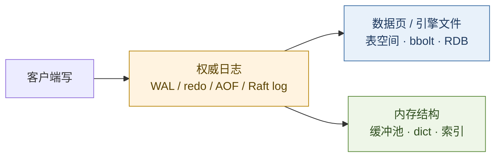
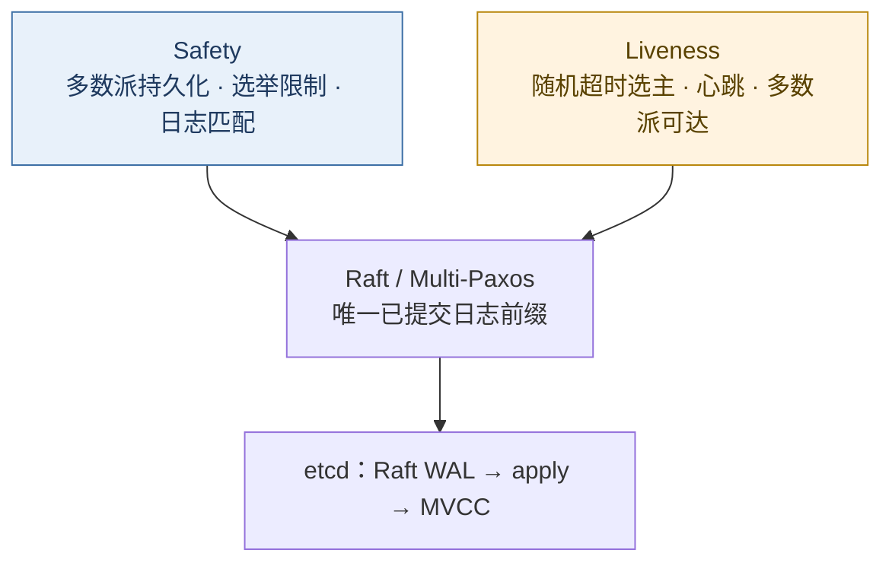
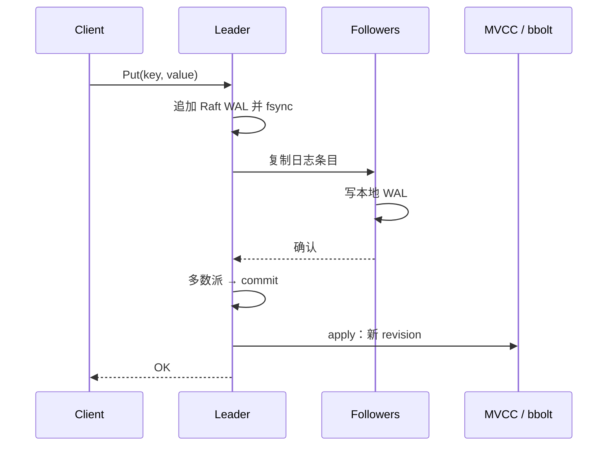

# 数据存储对照：WAL · MVCC · 从 RDBMS 到 etcd

> WAL 与 MVCC 是事务处理与并发控制的产业通识，并非 etcd 专有机制。在分布式 KV / 控制面场景下，etcd 以 Raft 与多版本 KV 将其落实为可运维实现。MySQL / PostgreSQL / Oracle、文档型 NoSQL、Redis 与 etcd 的分叉，首先在**目的与数据合同**，其次在引擎细节。
>
> 可与 [22](./22-distributed-consistency-treatise.md)（CAP / 共识）、[23](./23-kubernetes-control-plane-doctrine.md)（控制面与 etcd）、[29](./29-kafka-event-streaming-treatise.md)（日志即产品）对照。

先给一个直接答案：

> **WAL：变更先记入日志再改数据——日志是权威，数据页是派生。** **MVCC：更新生成新版本，读走快照，降低读写互斥。** 集群须将 WAL 收敛为唯一已提交前缀：按 Lamport，**Safety（不提交分叉结果）优先于 Liveness（多数派可达时可继续选主与提交）**；Paxos 与 Raft 落实该合同，etcd 采用 Raft。选型顺序：**工作负载合同 → 一致性级别 → 持久化与并发模型 → 运维面。**

**20-architecture 位置：** [22](./22-distributed-consistency-treatise.md) 论述跨节点取舍；本文论述**存储引擎如何落实耐久、并发，以及共识如何将 WAL 集群化**。

## 摘要

按「目的 → 原则 → 引擎 → 网络 → 共识」对照常见数据存储。两条同源思想贯穿全文：**Write-Ahead Logging** 与 **Multi-Version Concurrency Control**。将 WAL 提升为集群唯一真相须引入共识：§8 依 Leslie Lamport 的 **Safety / Liveness** 框架说明 Paxos 与 Raft，并衔接 etcd 写路径。PostgreSQL：数据页变更须在对应 WAL 刷入持久存储之后方可生效。[^pg-wal] etcd：多版本持久 KV + Raft，面向低频更新与可靠 watch。[^etcd-dm] InnoDB / Oracle 以 redo 与 undo 分工；PostgreSQL WAL 为 redo-only。[^pg-wal][^bytebase-wal] Redis 以内存为主、AOF/RDB 为辅；etcd 以 Raft WAL 为权威、bbolt 承载 MVCC。[^etcd-persist][^redis-persist]

**关键词：** WAL；MVCC；Safety；Liveness；Paxos；Raft；MySQL；PostgreSQL；Oracle；MongoDB；Redis；etcd；bbolt；revision

---

## 目录

- [摘要](#摘要)
1. [读法与边界](#1-读法与边界)
    - [1.1 术语](#11-术语)
    - [1.2 边界](#12-边界)
2. [目的与角色](#2-目的与角色)
3. [两条同源思想：WAL 与 MVCC](#3-两条同源思想wal-与-mvcc)
    - [3.1 WAL：预写日志](#31-wal预写日志)
    - [3.2 MVCC：多版本并发控制](#32-mvcc多版本并发控制)
    - [3.3 二者如何分工](#33-二者如何分工)
4. [设计原则对照](#4-设计原则对照)
5. [底层架构与持久化](#5-底层架构与持久化)
6. [并发与版本模型](#6-并发与版本模型)
7. [网络与复制模型](#7-网络与复制模型)
8. [共识：Safety · Liveness · Paxos · Raft](#8-共识safety--liveness--paxos--raft)
    - [8.1 两类特性](#81-两类特性)
    - [8.2 问题合同](#82-问题合同)
    - [8.3 Paxos](#83-paxos)
    - [8.4 Raft](#84-raft)
    - [8.5 对照与衔接](#85-对照与衔接)
9. [一次写入如何走完](#9-一次写入如何走完)
10. [选型启发式](#10-选型启发式)
11. [本章要点](#11-本章要点)
12. [参考文献](#12-参考文献)

---

## 1. 读法与边界

| 轴 | 问题 |
| -- | ---- |
| **目的** | 通用事务库、缓存、文档库，还是控制面协调存储？ |
| **耐久** | 谁是权威日志？崩溃后如何 REDO？ |
| **并发** | 锁、MVCC，还是单线程事件环？ |
| **一致** | 单机 ACID、主从复制，还是多数派共识？（§8） |

### 1.1 术语

| 术语 | 一句话 |
| ---- | ------ |
| **WAL** | 变更先追加至顺序日志并刷盘，再（或稍后）修改数据页；崩溃依日志重放恢复 |
| **redo / undo** | redo：向前重做已提交变更；undo：回滚或构造旧读视图 |
| **MVCC** | 多版本并存；读依据快照，写生成新版本，降低读写互斥 |
| **revision / SCN / LSN** | 全局或日志位置单调序号（etcd / Oracle / PostgreSQL） |
| **compaction / VACUUM / purge** | 回收不可见旧版本，防止存储无限膨胀 |
| **Raft 日志** | 共识层 WAL；多数派持久化后方可提交 |
| **Safety** | 安全性：坏事永不发生；已提交结果不可被另一合法结果推翻 |
| **Liveness** | 活性：好事终会发生；在合理条件下系统能继续达成新决定 |
| **多数派（quorum）** | 任意两次多数派必相交，故新决定可见旧决定 |

### 1.2 边界

1. **架构对照，非调参手册。** 参数与版本行为以官方文档为准。  
2. **NoSQL 以 MongoDB（WiredTiger）为代表**；宽表、图库另册。  
3. **不做绝对性能排名。** 吞吐随硬件、负载与一致性级别变化。  
4. **§8 给出共识机制要点**；CAP / FLP / ZAB 全景见 [22](./22-distributed-consistency-treatise.md)。

---

## 2. 目的与角色

| | **MySQL (InnoDB)** | **PostgreSQL** | **Oracle** | **MongoDB** | **Redis** | **etcd** |
| - | ------------------ | -------------- | ---------- | ----------- | --------- | -------- |
| **原初目的** | 通用 OLTP / Web 后端 | 对象—关系与扩展 SQL | 企业级 OLTP / 分析 | 文档模型与水平扩展 | 内存数据结构服务 | 可靠、可 watch 的协调型 KV |
| **今日主战场** | 业务库、互联网 OLTP | 复杂查询、扩展类型、逻辑复制 | 大型企业核心库 | 文档与灵活模式 | 缓存、会话、排行、限流 | K8s 控制面、服务发现、分布式锁 |
| **成功判据** | 事务正确、复制可用、运维成熟 | SQL 表达力、扩展生态、逻辑解码 | 高可用套件、合规与工具链 | 分片弹性、文档 API | 亚毫秒延迟、运维简单 | 强一致、watch、小数据量下稳定 |
| **不宜简化为** | 「仅能简单 CRUD」 | 「必然慢于 MySQL」 | 「因成本而过时」 | 「无事务」 | 「即数据库」 | 「通用业务库」 |

> **分工：** RDBMS 承载业务真相；MongoDB 承载文档形态弹性；Redis 承载热路径延迟；etcd 承载小而正确的集群元数据。

---

## 3. 两条同源思想：WAL 与 MVCC

### 3.1 WAL：预写日志

> **本质：修改先写入日志并落盘，再更新数据；日志为权威，数据页为派生。**

| 对应概念 | 说明 |
| -------- | ---- |
| InnoDB / Oracle redo | 崩溃 REDO |
| PostgreSQL WAL | REDO，并作为复制与 PITR 原料[^pg-wal] |
| Redis AOF | 命令流重放（粒度是命令，语义近 WAL）[^redis-persist] |
| 应用层流水表 | 「先记账再改余额」的同构纪律 |
| Kafka 分区日志 | 将 WAL **产品化**（见 [29](./29-kafka-event-streaming-treatise.md)） |

etcd 中：**Raft 复制的对象即该 WAL**——多数派节点各自刷盘确认后条目方可提交，再 apply 至 MVCC。[^etcd-persist][^raft]

### 3.2 MVCC：多版本并发控制

> **本质：更新产生新版本（或可还原的旧映像），读依据快照；以版本语义替代大部分读写互斥。**

| 对应概念 | 说明 |
| -------- | ---- |
| InnoDB / Oracle undo 链 | 当前行在数据页，旧版经 undo 回拼[^bytebase-wal] |
| PostgreSQL 堆元组 | 新元组入堆，旧元组待 VACUUM[^pg-mvcc] |
| 版本化历史（类 Git） | 每 key 可追溯；etcd 称 time travel[^etcd-dm] |
| CAS / 乐观并发 | 比较版本号后写入 |

etcd 维护全局单调 **revision**：每次原子变更 +1；默认读最新，亦可按 revision 读历史；watch 自指定 revision 订阅后续增量。[^etcd-dm]

### 3.3 二者如何分工

| | **WAL** | **MVCC** |
| - | ------- | -------- |
| **职责** | 耐久、可恢复；在 etcd 中亦为共识载体 | 并发读、历史、watch、乐观事务 |
| **地位** | 提交与恢复的基石 | 查询与并发语义的核心 |
| **代价** | fsync、日志量、复制带宽 | 版本膨胀 → 须 compaction / VACUUM / purge |

---

## 4. 设计原则对照

| # | 原则 | RDBMS（MySQL / PG / Oracle） | MongoDB | Redis | etcd |
| - | ---- | ---------------------------- | ------- | ----- | ---- |
| 1 | **耐久优先于就地改页** | WAL / redo | Journal + checkpoint | AOF/RDB 可选 | Raft WAL 先于 apply |
| 2 | **读写尽量不互斥** | MVCC（隔离级别可配） | 文档级并发 + WiredTiger | 单线程命令串行 | revision 快照；锁域极小 |
| 3 | **日志可外溢为复制** | 物理 / 逻辑复制消费 WAL 或 binlog | Oplog | 复制积压缓冲 | Raft 日志即复制单元 |
| 4 | **旧版本必须回收** | purge / VACUUM / undo 保留 | 引擎清理 | TTL / maxmemory 淘汰 | compact revision |
| 5 | **API 合同约束引擎** | SQL + 模式 | 文档 + 聚合 | 数据结构命令 | 扁平 KV + Txn / Watch |

---

## 5. 底层架构与持久化



| | **日志权威** | **数据落点** | **崩溃恢复** | **备注** |
| - | ------------ | ------------ | ------------ | -------- |
| **MySQL InnoDB** | redo；另有 binlog（复制 / PITR） | 表空间页 | redo REDO + undo 回滚未提交 | redo 与 binlog 经内部两阶段协调[^bytebase-wal] |
| **PostgreSQL** | WAL（redo-only） | 堆 / 索引页 | 自 checkpoint 向前 REDO | 无独立 undo；中止事务靠可见性[^pg-wal][^bytebase-wal] |
| **Oracle** | redo | 数据文件 | redo REDO；undo 服务回滚与一致读 | 长查询遇 undo 回收 → `ORA-01555`[^bytebase-wal] |
| **MongoDB** | WiredTiger journal | `.wt` 等 | journal 重放 + checkpoint | 副本集另有 oplog |
| **Redis** | AOF（可选）/ RDB | 内存为主 | AOF 重放或载入 RDB | 持久化策略决定丢数据窗口[^redis-persist] |
| **etcd** | Raft WAL（分段、追加） | bbolt（`member/snap/db`） | 重放 WAL → 恢复 Raft 状态 → apply | WAL 可含 snapshot 元数据[^etcd-persist] |

etcd：提案写入本地 WAL → Raft 复制 → 多数派确认后 commit → apply 更新 MVCC 并持久化至 bbolt。[^etcd-persist][^etcd-dm]

---

## 6. 并发与版本模型

| | **版本存放** | **读可见性** | **写冲突** | **回收** |
| - | ------------ | ------------ | ---------- | -------- |
| **InnoDB** | 当前行在聚簇索引；旧版在 undo 链 | Read View | 行锁、间隙锁等 | purge |
| **PostgreSQL** | 新旧元组同在堆上 | 事务快照（xmin/xmax） | 行级锁；SSI 可串行化 | VACUUM / autovacuum[^pg-mvcc] |
| **Oracle** | 当前行 + undo | SCN 一致读 | 行锁等 | undo 保留策略 |
| **MongoDB** | 引擎多版本 / 文档锁粒度 | 读关注级别 | 以文档级为主 | 引擎清理 |
| **Redis** | 单值覆盖（无历史 MVCC） | 当前内存值 | 单线程消除命令间竞态 | TTL / 淘汰 |
| **etcd** | 每变更一 revision；物理为 b+tree 增量 | 默认最新；可指定 revision | Txn 比较 version/revision（CAS） | compact[^etcd-dm] |

> **边界：** 同称 MVCC，InnoDB / Oracle 为「当前页 + undo 回拼」；PostgreSQL / etcd 更接近「追加新版本」。运维焦点随之不同：前者关注 undo 与长事务，后者关注堆膨胀 / revision 未 compact。

---

## 7. 网络与复制模型

| | **客户端协议** | **复制 / 集群** | **一致性默契** |
| - | -------------- | --------------- | -------------- |
| **MySQL** | MySQL 协议（连接态） | 源—副本（binlog）；Group Replication 等 | 常见异步 / 半同步；组复制近多数派 |
| **PostgreSQL** | 前端 / 后端协议 | 物理流复制（消费 WAL）；逻辑复制 | 同步级别可配；逻辑复制偏最终一致 |
| **Oracle** | Net / SQL\*Net | Data Guard、RAC 等 | 企业套件内多档 |
| **MongoDB** | 驱动协议 | Replica Set；可选分片 | 写关注 / 读关注可调 |
| **Redis** | RESP | 主从；Cluster 槽位分片 | 副本可滞后；Cluster 无跨槽事务 |
| **etcd** | gRPC（v3） | Raft 对等；多数派提交 | 线性一致读可配；控制面常要求强一致[^etcd-api] |

要点：

1. **RDBMS / MongoDB：** 会话型查询协议；复制多为日志外溢。  
2. **Redis：** 命令—应答；延迟优先；分片靠哈希槽，而非共识日志。  
3. **etcd：** 请求进入 Raft 状态机；**正确性绑定多数派持久化**，带宽与 fsync 为一等成本。

---

## 8. 共识：Safety · Liveness · Paxos · Raft

> 共识回答：**多节点如何对「下一条应执行的命令」达成唯一决定，且不得反悔。**  
> Lamport 将分布式性质分为 **Safety** 与 **Liveness**。[^lamport-paxos] 在崩溃—恢复、消息可丢失可乱序的模型下，Paxos 与 Raft 均优先保证 Safety，并以选举 / 超时换取 Liveness。

### 8.1 两类特性

| 特性 | 含义 | 违反后果 | 共识落点 |
| ---- | ---- | -------- | -------- |
| **Safety** | 坏事永不发生 | 同一槽位提交不同值 → 分叉状态 | 至多一个值 / 一条日志前缀被选定；已 commit 不可被另一合法前缀覆盖 |
| **Liveness** | 好事终会发生 | 长期无法选主或凑齐多数派 → 停写 | 多数派可达且超时机制生效时，能选出 Leader 并完成新决定 |

**FLP（1985）：** 完全异步且允许进程崩溃时，确定性算法无法同时保证 Safety 与必然终止的 Liveness。[^flp]

> **工程结论：Safety 由协议不变量保证（与时钟无关）；Liveness 依赖超时、随机化选举、部分同步等假设。** Raft 明确：计时不用于证明日志一致性。[^raft]

§3 的 WAL 解决单机耐久；将其收敛为**全员同一已提交前缀**须共识。etcd 采用 Raft，与 Multi-Paxos 同属复制状态机上的命令序列共识。

### 8.2 问题合同

| 工程现象 | 共识合同 |
| -------- | -------- |
| 双主并发写入 | 同一日志位置至多选定一条（Safety） |
| 主故障后无法接续 | 须能重新选主并继续提交（Liveness） |
| 「主已成功、副本未落盘」即确认 | **commit = 多数派已持久化** |
| 故障切换后历史分叉 | 合法恢复只能看见已提交前缀（选举限制 / 提案号规则） |

路径：客户端命令 → 追加共识日志 → 多数派确认 → 各节点按相同顺序 apply。etcd 的 apply 即更新 MVCC（§9）。

### 8.3 Paxos

依据 *Paxos Made Simple*：角色为 **Proposer / Acceptor / Learner**（可兼任）。[^lamport-paxos]

**Safety 目标：**

1. 仅被提议的值可被选定；  
2. **至多选定一个值**；  
3. 仅在选定后方可被学习。

**单值两阶段：**

```text
Phase 1  Prepare(n)   → 多数派承诺：不再接受编号 < n 的提案
Phase 2  Accept(n, v) → 多数派接受 v；若 Phase 1 已见旧值，v 须继承最高号已接受值
```

| 机制 | 作用 |
| ---- | ---- |
| **递增提案号 \(n\)** | 更高号提案可覆盖前序协商，但须继承已出现的值 |
| **多数派相交** | 任意两次 quorum 共享 Acceptor → 新一轮可见旧轮趋势 |
| **继承已接受值** | 值一旦接近或已经 chosen，更高号提案不得改选他值 |

**Liveness：** 多 Proposer 竞抬提案号可导致活锁。工程上收敛为 **distinguished proposer（Leader）**，稳态主要支付 Phase 2——即 Multi-Paxos 的常见形态。[^lamport-paxos]

> **要点：** 权威不来自「谁先到达」，而来自**更大提案号 + 多数派承诺 + 值继承**；进度靠减少并发提案者。

### 8.4 Raft

Raft（Ongaro / Ousterhout）与 Multi-Paxos **结果等价**，分解为选主、日志复制与安全规则，以便实现。[^raft]

| 子问题 | 机制 | Safety / Liveness |
| ------ | ---- | ----------------- |
| **Leader 选举** | 超时晋升 Candidate；随机超时降低分票；获多数票成为 Leader；term 单调 | Liveness 主路径；选举限制同时服务 Safety |
| **日志复制** | 仅 Leader 追加；`AppendEntries`；多数派持久化后 commit；`prevLogIndex/Term` 对齐 | commit 定义服务 Safety；心跳服务 Liveness |
| **安全规则** | 仅日志至少一样新的 Candidate 可获选票；Leader 只追加、不覆盖 | Safety：新 Leader 必含已提交条目 |

强 Leader 模型的工程含义：

1. **写路径集中于 Leader**——避免多点同时提案导致的活锁。  
2. **commit = 复制到多数派**——与 etcd `Put` 成功语义一致（§9）。  
3. **计时仅用于选主与失联探测**——条目是否生效只取决于 quorum 与 term / 日志匹配。[^raft]



### 8.5 对照与衔接

| | **Paxos（含 Multi-Paxos）** | **Raft** |
| - | --------------------------- | -------- |
| **问题抽象** | 单值共识 → 多槽位日志 | 复制日志共识 |
| **领导模型** | 可优化为 distinguished proposer | **强 Leader** |
| **Safety** | 提案号 + 值继承 + quorum | term + 日志新旧比较 + quorum |
| **Liveness** | 收敛至单一 Proposer | 随机超时选举 + 心跳 |
| **代表系统** | Chubby 等 Paxos 系 | etcd、Consul、TiKV 等 |
| **选用倾向** | 理论母体、形式化与存量变体 | 现代日志复制的默认实现 |

共同点：

1. 多数派不可达则不可 commit（偏 CP：宁可停写，不可分叉）。  
2. **Safety 优先于 Liveness**——分区时允许不可用，不允许分叉提交。  
3. **共识日志即分布式场景下的权威 WAL**；MVCC / 状态机位于 apply 之后。

CAP、FLP、ZAB 与选型光谱见 [22](./22-distributed-consistency-treatise.md)。

---

## 9. 一次写入如何走完

### 9.1 etcd（WAL × Raft × MVCC）



1. 客户端向 Leader 发送 `Put`。  
2. Leader 封装为 Raft 条目，写入并刷盘 WAL。  
3. 向 Follower 复制；各自写入 WAL 后应答。  
4. 多数派确认 → 标记提交。  
5. Apply：MVCC 生成新 revision，并写入 bbolt。  
6. 向客户端返回成功。

> **要点：** 多数派 WAL 落实 Safety；超时选主落实 Liveness；MVCC 在 apply 之后提供并发读、watch 与 CAS。

### 9.2 与 RDBMS / Redis 对照

| 步骤 | InnoDB / PG / Oracle | Redis | etcd |
| ---- | -------------------- | ----- | ---- |
| 先记什么 | redo / WAL | AOF（若启用） | Raft WAL |
| 何时算成功 | 事务提交策略（含 fsync 级别） | 由 AOF/复制配置决定 | **多数派 WAL** |
| 再改什么 | 缓冲池脏页 → 检查点刷数据文件 | 内存结构 | MVCC + bbolt |
| 副本如何跟随 | 复制日志 / WAL 流 | 异步传播命令 | Raft 日志 |

---

## 10. 选型启发式

| 场景 | 更常优先 | 原因 |
| ---- | -------- | ---- |
| 业务事务、复杂查询、强约束 | **PostgreSQL / MySQL / Oracle** | SQL + ACID；引擎成熟 |
| 文档模型、分片优先 | **MongoDB** | 灵活模式与水平扩展工具链 |
| 缓存、排行、限流、会话 | **Redis** | 内存延迟；不宜作为唯一真相库 |
| K8s / 服务发现 / 分布式配置与锁 | **etcd** | 强一致 + watch；数据量宜小 |
| 海量事件、多订阅 | **Kafka**（见 [29](./29-kafka-event-streaming-treatise.md)） | 日志即产品 |
| 同时需要 etcd 式 watch 与大体量业务数据 | **分库存** | 控制面与数据面分离 |

反模式：

1. **以 Redis 为唯一账本**——持久化与一致性合同不足时丢写入。  
2. **以 etcd 存储大体量业务数据**——违背低频、小体积设计点。[^etcd-dm]  
3. **将 MVCC 视为免维护**——不 compact / VACUUM / 管理 undo 必致膨胀。  
4. **以异步主从冒充实强一致**——见 [22](./22-distributed-consistency-treatise.md)。

---

## 11. 本章要点

1. WAL 与 MVCC 是产业通识；etcd 是其在 Raft KV 上的实现。  
2. **WAL 管耐久；共识将 WAL 收敛为集群唯一前缀；MVCC 管 apply 之后的并发与历史。**  
3. **Safety** 优先于 **Liveness**；FLP 表明纯异步下二者不可兼得。  
4. Paxos：提案号 + 多数派 + 值继承；Raft：强 Leader + 日志复制 + 选举限制——同一安全目标，不同工程分解。  
5. InnoDB / Oracle：redo + undo；PostgreSQL：WAL redo-only + 堆版本；etcd：Raft WAL + revision + bbolt。  
6. 选型先定**数据合同与一致性级别**，再比较引擎名称。

---

## 12. 参考文献

[^pg-wal]: PostgreSQL Global Development Group, *Write-Ahead Logging (WAL)*. https://www.postgresql.org/docs/current/wal-intro.html 。

[^pg-mvcc]: PostgreSQL Global Development Group, *Transaction Isolation*. https://www.postgresql.org/docs/current/transaction-iso.html 。

[^etcd-dm]: etcd Authors, *Data model*. https://etcd.io/docs/v3.7/learning/data_model/ 。

[^etcd-persist]: etcd Authors, *Persistent storage files*. https://etcd.io/docs/v3.7/learning/persistent-storage-files/ 。

[^etcd-api]: etcd Authors, *API guarantees*. https://etcd.io/docs/v3.7/learning/api_guarantees/ 。

[^raft]: D. Ongaro & J. Ousterhout, *In Search of an Understandable Consensus Algorithm (Raft)*, USENIX ATC, 2014. https://raft.github.io/raft.pdf 。

[^lamport-paxos]: Leslie Lamport, *Paxos Made Simple*, ACM SIGACT News, 2001. https://www.lamport.org/pubs/paxos-simple.pdf 。

[^flp]: M. Fischer, N. Lynch & M. Paterson, *Impossibility of Distributed Consensus with One Faulty Process*, JACM, 1985. https://groups.csail.mit.edu/tds/papers/Lynch/jacm85.pdf 。

[^redis-persist]: Redis Ltd., *Redis persistence*. https://redis.io/docs/latest/operate/oss_and_stack/management/persistence/ 。

[^bytebase-wal]: Bytebase, *What is Write Ahead Logging (WAL)*. https://www.bytebase.com/blog/write-ahead-logging/ 。

[^mysql-innodb]: Oracle MySQL, *InnoDB Redo Log*. https://dev.mysql.com/doc/refman/8.4/en/innodb-redo-log.html 。

[^oracle-undo]: Oracle, *Undo and Redo*. https://docs.oracle.com/en/database/oracle/oracle-database/19/cncpt/undo-and-redo.html 。

[^mongo-wt]: MongoDB, *WiredTiger Storage Engine*. https://www.mongodb.com/docs/manual/core/wiredtiger/ 。

**声明：** 本文为架构对照，非某一引擎的运维手册或性能排行。版本与默认配置以当期官方文档为准。一致性理论见 [22](./22-distributed-consistency-treatise.md)；控制面用法见 [23](./23-kubernetes-control-plane-doctrine.md)。
