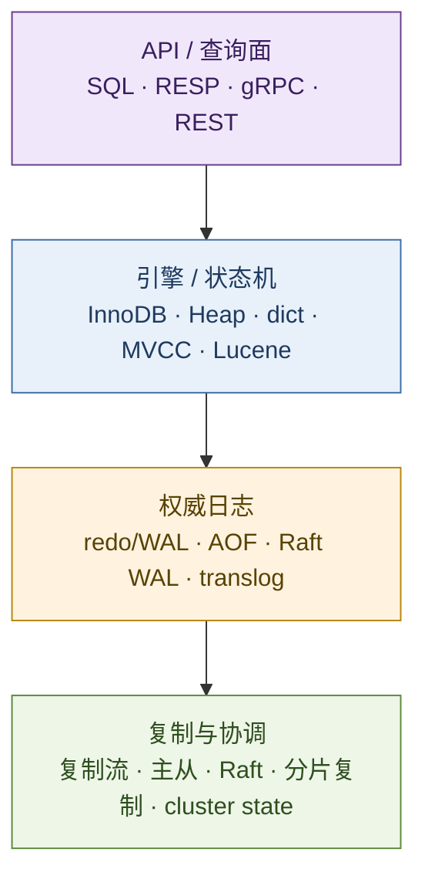
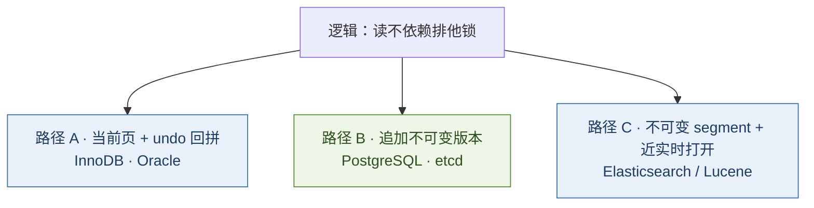
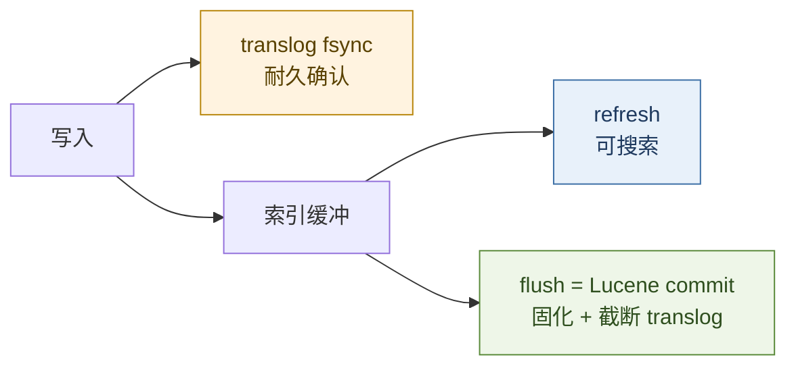
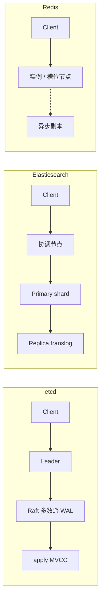
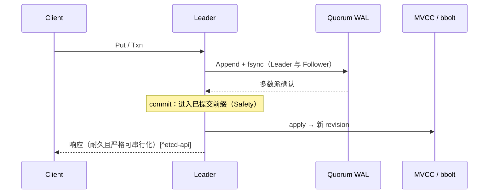
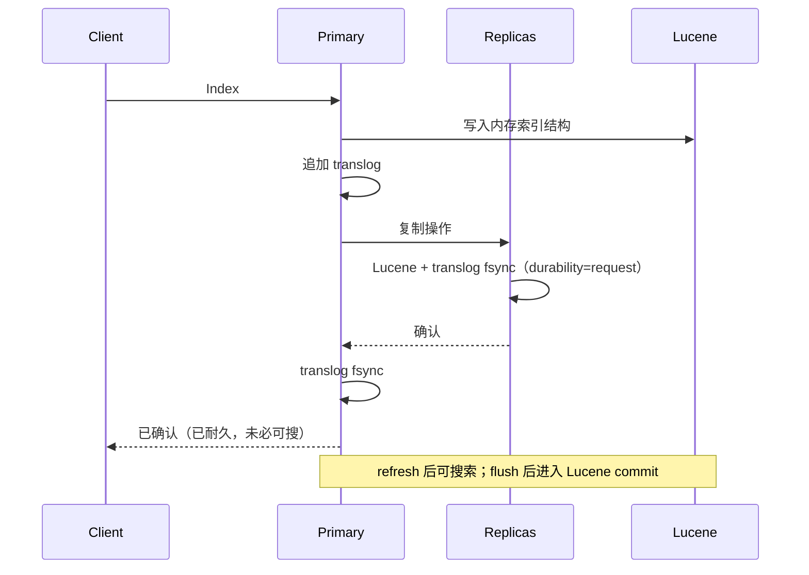

# 存储合同：WAL · MVCC · 共识日志

> 比较 RDBMS、Redis、etcd、Elasticsearch，应检验三条合同，而非停留于功能清单：  
> **① 耐久**——已确认写入在崩溃后能否恢复（WAL / STEAL · NO-FORCE）；  
> **② 并发与可见**——读写如何隔离，旧版本如何存放与回收（MVCC / segment）；  
> **③ 集群**——「写成功」绑定在哪一层的复制或多数派上（共识日志或分片复制）。  
> 产品差异是上述合同的取舍结果。
>
> 对照：[22](./22-distributed-consistency-treatise.md)（CAP / 共识）、[23](./23-kubernetes-control-plane-doctrine.md)（控制面与 etcd）、[29](./29-kafka-event-streaming-treatise.md)（日志即产品）。

直接答案：

> **选型看七维（目的 · 作用 · 功能 · 原则 · 架构 · 网络 · 优劣）；机制看三条合同。** WAL 是 STEAL / NO-FORCE 下的恢复纪律；[^haerder83][^aries] MVCC / segment 解决可见性；[^pg-mvcc] Raft 将提交提升为多数派日志。[^raft] **RDBMS** 承载业务真相，**Redis** 承载低延迟，**etcd** 承载控制面强顺序，**Elasticsearch** 承载检索。后两者的关键分叉：etcd 对每次写入做 Raft；Elasticsearch 以 translog 管分片耐久、以 refresh 管可搜索，多数派共识仅约束 cluster state。[^es-translog][^es-nrt][^es-cluster]

**20-architecture 位置：** [22](./22-distributed-consistency-treatise.md) 论跨节点一致性取舍；本文论存储引擎如何落实耐久与可见性，以及共识落在数据路径还是元数据路径。

## 摘要

Haerder & Reuter（1983）以 STEAL / FORCE 刻画缓冲策略；主流 OLTP 取 **STEAL + NO-FORCE**，故须 WAL，并具备 REDO / UNDO 安排。[^haerder83] ARIES 给出可实现的恢复框架。[^aries] PostgreSQL 采用 redo-only WAL，UNDO 交由堆版本。[^pg-wal] Redis 将耐久做成可配置策略。[^redis-persist] etcd 以 Raft WAL 定义 commit，以 revision 定义总序。[^etcd-dm] Elasticsearch 以 **translog** 充当分片 WAL，以 **flush** 完成 Lucene commit，以 **refresh** 提供近实时搜索；cluster state 经 master-eligible 多数派提交，文档写入不经该共识。[^es-translog][^es-cluster] 全文按「总览 → 原则 → 合同 → 血统与写路径 → 选型」展开。

**关键词：** WAL；STEAL；NO-FORCE；ARIES；MVCC；Raft；etcd；Redis；PostgreSQL；Elasticsearch；translog；refresh；flush

---

## 目录

- [摘要](#摘要)
1. [读法：合同与七维](#1-读法合同与七维)
2. [总览：目的 · 功能 · 架构 · 网络 · 优劣](#2-总览目的--功能--架构--网络--优劣)
    - [2.1 目的与作用](#21-目的与作用)
    - [2.2 功能合同](#22-功能合同)
    - [2.3 架构分层](#23-架构分层)
    - [2.4 网络模型](#24-网络模型)
    - [2.5 优劣](#25-优劣)
3. [设计原则](#3-设计原则)
4. [耐久合同：STEAL · NO-FORCE · WAL](#4-耐久合同steal--no-force--wal)
5. [并发合同：三条物理路径](#5-并发合同三条物理路径)
6. [四条工程血统](#6-四条工程血统)
7. [集群合同与网络路径](#7-集群合同与网络路径)
8. [写路径对照：etcd 与 Elasticsearch](#8-写路径对照etcd-与-elasticsearch)
9. [选型](#9-选型)
10. [本章要点](#10-本章要点)
11. [参考文献](#11-参考文献)

---

## 1. 读法：合同与七维

| 工具 | 用途 |
| ---- | ---- |
| **三条合同** | 解释实现成因与失败模式 |
| **七维对照** | 支撑选型与边界判断 |

| # | 合同 | 核心问题 | 失败形态 |
| - | ---- | -------- | -------- |
| ① | **耐久** | 已确认写入在崩溃后能否重现？ | 丢提交 |
| ② | **并发 / 可见** | 读写如何隔离？旧版本如何回收？ | 锁竞争、版本膨胀、近实时误解 |
| ③ | **集群** | 「写成功」绑定在哪一层的复制或多数派？ | 状态分叉、假强一致 |

| 维 | 问题 | 落点 |
| -- | ---- | ---- |
| **目的 / 作用** | 为何存在、承担哪段职责 | §2.1、§6 |
| **功能** | 对外能力与默认不保证项 | §2.2 |
| **设计原则** | 取舍时守住什么 | §3 |
| **架构 / 底层** | API · 引擎 · 日志 · 复制如何叠放 | §2.3、§4–§6 |
| **网络模型** | 客户端协议、写路径、元数据路径 | §2.4、§7 |
| **优劣** | 收益、代价、误用 | §2.5、§6、§9 |

1. 论证合同与因果，非调参手册或性能排行。  
2. InnoDB / Oracle 归入 ARIES 系；Elasticsearch 单列（可见性与耐久分离，共识仅约束元数据）。  
3. CAP / 协议形式化见 [22](./22-distributed-consistency-treatise.md)。

---

## 2. 总览：目的 · 功能 · 架构 · 网络 · 优劣

### 2.1 目的与作用

| 系统 | 目的 | 作用 |
| ---- | ---- | ---- |
| **MySQL / PostgreSQL / Oracle** | 通用事务型真相存储 | 业务数据面；强约束 OLTP |
| **Redis** | 内存数据结构服务 | 热路径缓存、会话、限流等可重建状态 |
| **etcd** | 小键空间上的可靠协调与 watch | 控制面元数据；服务发现、锁、Kubernetes 状态源 |
| **Elasticsearch** | 倒排检索与聚合分析 | 搜索与可观测数据面；通常位于业务库或日志管道之后 |

### 2.2 功能合同

| 系统 | 核心能力 | 默认不保证 |
| ---- | -------- | ---------- |
| **RDBMS** | SQL、ACID、隔离级别、约束与连接 | 跨地域线性一致（除非额外部署同步/共识方案） |
| **Redis** | 结构命令、可选持久化与复制、Cluster 分片 | 强一致账本语义；跨槽原子事务 |
| **etcd** | KV / Txn / Watch / Lease；严格可串行化；线性一致读可配[^etcd-api] | 高吞吐分析、复杂关系查询 |
| **Elasticsearch** | 倒排索引、聚合、近实时搜索、分片扩展[^es-nrt] | 多行 SQL 事务；逐文档线性一致；refresh 之前的搜索可见性 |

### 2.3 架构分层

| 系统 | 引擎 | 权威日志 | 派生持久化 |
| ---- | ---- | -------- | ---------- |
| **InnoDB** | 聚簇索引 + undo | redo（binlog 服务复制/PITR） | 表空间页 |
| **PostgreSQL** | 堆 + 索引（多版本元组） | WAL | 数据文件 |
| **Redis** | 内存结构 | AOF / RDB（策略可选） | 同左 |
| **etcd** | MVCC（revision） | **Raft WAL** | bbolt |
| **Elasticsearch** | Lucene segments | **translog** | Lucene commit（flush） |

### 2.4 网络模型

| 系统 | 客户端协议 | 数据写路径 | 元数据 / 协调 |
| ---- | ---------- | ---------- | ------------- |
| **RDBMS** | 专用会话协议 | 写入主库；可读副本 | WAL/binlog 复制（异步或半同步） |
| **Redis** | RESP | 直连实例；Cluster 按槽转发 | 主从复制；Gossip 维护槽位 |
| **etcd** | gRPC | **Leader → Raft 多数派** | 成员即 Raft 节点 |
| **Elasticsearch** | HTTP / REST | 定位 primary 写入；**不经 master 处理每条文档**[^es-cluster] | master-eligible 多数派提交 cluster state |

### 2.5 优劣

| 系统 | 优势 | 代价 |
| ---- | ---- | ---- |
| **RDBMS** | 事务与约束完整；工具链成熟 | 水平扩展与跨分片事务成本高；强同步复制有延迟 |
| **Redis** | 延迟低；数据结构丰富 | 默认可弱于账本合同；内存成本；Cluster 语义边界多 |
| **etcd** | 强顺序与 watch；控制面语义清晰 | 容量与写放大受限；多数派不可达则停写 |
| **Elasticsearch** | 检索与聚合强；分片易扩展 | 近实时与事务语义弱；分片/映射/merge 运维重 |

---

## 3. 设计原则

| # | 原则 | 含义 | 违反时 |
| - | ---- | ---- | ------ |
| 1 | **日志权威于数据页** | STEAL/NO-FORCE 下先使日志耐久，再刷数据页[^haerder83] | 崩溃后无法可靠 REDO/UNDO |
| 2 | **可见性与耐久解耦须显式** | ES：`refresh` ≠ `flush` ≠ 客户端确认；[^es-nrt][^es-translog] Redis：fsync 策略可选 | 将「读到 / 搜到」误认为「已提交」 |
| 3 | **隔离尽量不依赖长读锁** | MVCC、单线程命令串行、或不可变 segment | 读写互相阻塞，吞吐下降 |
| 4 | **旧版本必须可回收** | purge / VACUUM / compact / merge | 空间与性能持续恶化 |
| 5 | **共识仅用于不可分叉的一层** | etcd：逐写；ES：cluster state；缓存：通常不启用 | 用检索集群替代协调存储 |
| 6 | **先定 API 合同，再选引擎** | 先明确一致性与查询形态 | 先定品牌，再补语义缺口 |

---

## 4. 耐久合同：STEAL · NO-FORCE · WAL

### 4.1 缓冲策略决定日志形态

Haerder & Reuter 将缓冲管理归结为两个开关：[^haerder83]

| 策略 | 含义 | 恢复要求 |
| ---- | ---- | -------- |
| **STEAL** | 允许未提交事务的脏页换出到磁盘 | 崩溃时磁盘可能含未提交变更 → **须能 UNDO** |
| **NO-STEAL** | 脏页保留至事务结束 | UNDO 可简化；长事务易耗尽缓冲 |
| **FORCE** | 提交前强制刷齐该事务脏页 | 几乎不需 REDO；提交延迟与随机 I/O 代价高 |
| **NO-FORCE** | 提交只保证日志耐久，脏页稍后刷 | 已提交变更可能尚未落数据页 → **须能 REDO** |

工业 OLTP 主流取 **STEAL + NO-FORCE**：吞吐可接受，恢复变复杂。由此得到 WAL 纪律：

> **描述某页变更的日志记录，必须在该页写回磁盘之前进入稳定存储；事务提交确认之前，其提交记录必须已耐久。**[^haerder83][^aries]

顺序写日志、批量刷数据页，是该策略下的性能交换，而非「多写一份备份」。

### 4.2 ARIES：可实现的恢复框架

ARIES 在 STEAL / NO-FORCE 与细粒度锁下给出恢复算法：[^aries]

1. **Repeating history（Redo）**：按日志将系统推回崩溃前状态（含未提交变更在页上的效应）。  
2. **Logged Undo**：回滚未完成事务；undo 记补偿日志，使恢复可重入。  
3. **Analysis → Redo → Undo** 三趟扫描，配合脏页表与事务表限定工作集。

工程推论：

| 推论 | 含义 |
| ---- | ---- |
| **日志是权威** | 数据页可落后；恢复以日志为准 |
| **fsync 首先针对日志** | `innodb_flush_log_at_trx_commit`、PostgreSQL `synchronous_commit` 调节的即此合同 |
| **复制消费日志流** | 物理复制、binlog、逻辑解码，均为权威流的外溢 |

### 4.3 PostgreSQL：redo-only WAL

PostgreSQL：数据文件变更仅发生在描述该变更的 WAL 已刷入持久存储之后；崩溃后 **roll-forward（REDO）**。[^pg-wal]

关键分叉：**无独立 undo 日志**。UPDATE 写入新堆元组并保留旧元组；中止事务标记 aborted，旧写入对快照不可见——**ROLLBACK 成本与写入量解耦**。[^bytebase-wal] 代价转移至 **VACUUM**：不可见版本须后台回收，否则膨胀。

| | **InnoDB / Oracle（ARIES 系）** | **PostgreSQL** |
| - | ------------------------------- | -------------- |
| REDO | redo / WAL | WAL |
| UNDO | undo 段 / rollback segment | 无；依赖 MVCC 可见性 |
| 长事务回滚 | 可能较长（走 undo） | 标记中止即可 |
| 运维焦点 | undo 空间、长事务阻塞 purge | 膨胀、autovacuum、xid 冻结 |

二者均遵守「先日志、后数据页」；**UNDO 落在日志还是数据版本上**，决定运维面差异。

---

## 5. 并发合同：三条物理路径

### 5.1 多版本的动机

PostgreSQL：语句所见为某一时刻的数据快照；**读锁与写锁不互相冲突——读不阻塞写，写不阻塞读**。[^pg-mvcc]  
隔离从「读时加锁」转为「读时选版本」。

### 5.2 三条物理路径

| | **路径 A：undo 回拼** | **路径 B：追加版本** | **路径 C：segment 可见性** |
| - | --------------------- | -------------------- | -------------------------- |
| **当前数据** | 页上最新行 | 堆 / B+Tree 多版并存 | 多个不可变 Lucene segment |
| **旧版** | undo 链 | 旧元组 / 旧 revision | 旧 segment；更新多为删+增 |
| **读可见时机** | 快照 + undo 回拼 | 版本号 / xmin·xmax | **refresh** 打开新 segment 之后[^es-nrt] |
| **空间风险** | undo 膨胀 | VACUUM / compact | merge、软删、磁盘放大 |
| **代表** | InnoDB、Oracle | PostgreSQL、etcd | Elasticsearch |

路径 C **并非** RDBMS 意义的快照隔离 MVCC：默认搜索读的是最近一次 refresh 之后的近实时视图，与「已确认写入」可相差一个 refresh 周期（默认约 1s）。[^es-nrt] 乐观并发依赖 `_seq_no` / `_primary_term`（或外部版本号），而非全局 revision 总序。

### 5.3 etcd：revision 作为全局逻辑时钟

etcd 数据模型：[^etcd-dm]

1. 键空间扁平；每次**原子变更**产生全局 **revision**（初值 1，单调递增）。  
2. 逻辑上结构不可变：不覆盖，只生成新结构；旧 revision 可查询直至 **compaction**。  
3. 物理上：持久 B+Tree 仅存相对前一 revision 的 **delta**；内存 B-Tree 加速按 key 查询。

据此支撑 API 合同：KV 操作 **严格可串行化（strict serializability）**，总序由 revision 给出；默认可线性一致（经 Raft）；watch 按 revision 有序、不丢窗内事件。[^etcd-api]

> etcd 的 MVCC 以 **revision 充当集群逻辑时钟**，使 list/watch、Txn/CAS、历史读落在同一序上——这是 Kubernetes 控制面「声明式 + 持续收敛」的存储前提（见 [23](./23-kubernetes-control-plane-doctrine.md)）。

---

## 6. 四条工程血统

### 6.1 通用事务库：ARIES 系与 PostgreSQL 系

| 维度 | InnoDB / Oracle | PostgreSQL |
| ---- | --------------- | ---------- |
| 目的 / 作用 | 业务真相存储 | 业务真相存储；扩展 SQL / 逻辑解码 |
| 合同 ① | redo + undo（STEAL / NO-FORCE） | WAL redo-only + 堆版本 |
| 合同 ② | 路径 A | 路径 B |
| 网络 / 复制 | 会话连主；binlog / WAL 流复制 | 同左；同步级别可配 |
| 优势 | 约束与工具链完整 | 回滚轻；逻辑复制 / CDC 友好 |
| 代价 | undo、长事务与同步复制成本 | 膨胀与 VACUUM / xid 运维 |

MySQL：**InnoDB redo（崩溃恢复）与 binlog（复制 / PITR）** 经内部两阶段对齐——调节耐久须同时审视二者。[^bytebase-wal][^mysql-redo]

### 6.2 Redis：耐久作为可配置策略

Redis 持久化：[^redis-persist]

| 机制 | 合同强度 | 含义 |
| ---- | -------- | ---- |
| **RDB** | 点时刻快照 | `fork` + COW；快照间隔内写入可丢 |
| **AOF** | 命令日志重放 | `appendfsync`：always / everysec / no——**以丢失窗口换延迟** |
| **无持久化** | 纯缓存 | 进程退出即空 |

产品合同刻意不将每次写入绑定到多数派磁盘。以 Redis 作唯一账本，属合同误用，而非调优问题。

| | 说明 |
| - | ---- |
| **优势** | 亚毫秒延迟；结构命令表达力强；分片路径清晰 |
| **代价** | 耐久与一致性默认可弱；内存成本；跨槽事务缺失 |

### 6.3 etcd：小键空间、强合同的协调型 KV

定位：可靠存储**低频更新**数据，并提供可靠 watch；多版本服务历史窗口。[^etcd-dm]

| 层 | 组件 | 合同 |
| -- | ---- | ---- |
| 共识 | Raft WAL | 多数派持久化 = commit[^etcd-persist][^raft] |
| 状态机 | MVCC（revision） | 严格可串行化总序[^etcd-api] |
| 后端 | bbolt | apply 后持久化；非共识权威[^etcd-persist] |
| **优势** | 强顺序、watch、控制面语义清晰 | |
| **代价** | 容量与写放大受限；无多数派则停写（偏 CP） | |

适用边界：小键空间上的强顺序与 watch；不适合大体量分析。

### 6.4 Elasticsearch：translog · refresh · 元数据共识

Elasticsearch 建立在 Lucene 之上。Lucene **commit** 代价高，不宜在每次 index/delete 后执行；commit 点之间的变更在进程崩溃时会被 Lucene 丢弃。因此每个分片副本另写 **translog**：操作先进入 Lucene 索引结构，再写入 translog，**于确认客户端之前**完成；崩溃后尚未进入最近 Lucene commit 的已确认操作，自 translog 重放恢复。[^es-translog]

**合同 ①：三层时间语义须分离**

| 操作 | 行为 | 合同含义 |
| ---- | ---- | -------- |
| **index + translog fsync** | 默认 `index.translog.durability=request`：主分片与已分配副本均 fsync/commit translog 后，才向客户端返回成功[^es-translog] | **已确认 ≈ 已耐久**（相对副本集合） |
| **`durability=async`** | 按 `sync_interval` 后台 fsync | 与 Redis AOF everysec 同构：以丢失窗口换延迟 |
| **refresh** | 将内存缓冲写成新 segment 并打开，供搜索可见；默认约 1s 近实时[^es-nrt] | **可搜索 ≠ 已 Lucene commit** |
| **flush** | 执行 Lucene commit，并开启新的 translog generation[^es-translog][^es-flush] | 将权威从「translog + 未 commit 段」推进到「Lucene commit 点」 |

> Lucene segment 不可变且 commit 代价高 → 以 translog 充当 WAL（NO-FORCE）；搜索需高频可见新文档 → 以轻于 commit 的 **refresh** 打开 segment。将 refresh 视为「提交」，或将「搜不到」视为「丢数据」，均为合同错位。

**合同 ②：非 RDBMS MVCC**

- 更新/删除常体现为新文档 + 旧文档标记删除，由 merge 回收——接近追加不可变结构，但**不提供** etcd / PostgreSQL 式按全局逻辑时钟的任意历史快照读。  
- 并发控制为文档级乐观并发（`_seq_no` / `_primary_term`），冲突时重试——服务搜索更新率，而非控制面严格可串行化。  
- 搜索可见性由 refresh 边界决定，而非事务快照。[^es-nrt]

**合同 ③：共识约束元数据，不约束逐条文档**

官方架构：[^es-cluster]

1. **cluster state**（节点身份、索引映射、分片位置与同步集合等）由选举出的 master 变更；对 master-eligible 节点按 **voting configuration 多数派**提交后，再指令节点 apply——与「先提交、后应用」同构。  
2. **索引 / 删除 / 搜索等高吞吐 API 通常不与 master 交互**；数据路径为分片 primary → replica 复制。  
3. 多数派保护的是**集群真相**（拓扑与映射）；文档耐久默认绑定 **primary + 已分配 replica 的 translog**，而非集群范围内的单条 Raft 日志。

| | **etcd** | **Elasticsearch** |
| - | -------- | ----------------- |
| 共识覆盖 | 每一次 KV 写 | **cluster state**；文档写走分片复制 |
| 权威日志 | Raft WAL | 每副本 **translog**（+ Lucene commit） |
| 读合同 | 默认可线性一致 | 近实时搜索；可搜与已确认可分离 |
| 适合 | 小键空间协调 | 全文检索、日志/指标分析、文档检索 |

| | 说明 |
| - | ---- |
| **优势** | 倒排与聚合强；分片易扩展；契合日志与检索 |
| **代价** | 近实时与事务语义弱；分片/映射/merge 运维重；共识不覆盖逐文档写 |

适用边界：倒排与聚合，接受近实时；不作账本或协调存储。

---

## 7. 集群合同与网络路径

### 7.1 共识落点

| 类型 | 含义 | 代表 |
| ---- | ---- | ---- |
| **状态机多数派** | 每条命令进入同一已提交日志前缀 | etcd / Raft |
| **元数据多数派 + 数据复制** | 多数派只决定拓扑 / 映射；数据按主从复制 | Elasticsearch cluster state + shard replication[^es-cluster] |
| **可选复制** | 提交可不绑定多数派 | 异步主从 RDBMS、Redis 副本 |

异步主从下，「主已返回成功」**不蕴含**「多数派已持久化」。将半同步 / 异步复制称为「强一致」，或将「ES 绿集群」等同于「每条文档线性一致」，均属偷换合同 ③。

### 7.2 网络写路径

| | 写是否须经全局 Leader | 读是否可能落后于已确认写 |
| - | ---------------------- | ------------------------ |
| **etcd** | 是（Leader + 多数派） | 线性一致读：否；serializable 读：可 |
| **Elasticsearch** | 否（定位 primary；master 不处理文档写）[^es-cluster] | 是：未 refresh 则搜索不可见[^es-nrt] |
| **Redis** | 否（直连主或槽位主） | 副本异步时：是 |
| **RDBMS** | 通常写主 | 读库异步时：是 |

### 7.3 Safety 与 Liveness

| 性质 | 含义 | 存储后果 |
| ---- | ---- | -------- |
| **Safety** | 坏事永不发生 | 同一日志下标不能选定两个不同条目；已 commit 前缀不可被合法节点推翻 |
| **Liveness** | 好事终会发生 | 多数派可达时可选主并继续提交；纯异步模型下确定性算法无法单独保证（FLP）[^flp] |

工程分配：[^raft][^lamport-paxos]

- **Safety**：提案号 / term、多数派相交、值继承或选举限制、日志匹配——**与物理时钟无关**。  
- **Liveness**：超时、随机化选举、心跳——**可牺牲可用性，不可牺牲已提交真相**。

对 Elasticsearch：cluster state 发布遵循「先收集足够 master-eligible 确认再 commit，再令节点 apply」——Safety 落在元数据；数据面 Safety 依赖分片复制与 translog 策略，**弱于 etcd 的逐写 Raft**。[^es-cluster][^es-translog]

### 7.4 Paxos 与 Raft：同一提交合同，不同分解

| | **Paxos / Multi-Paxos** | **Raft** |
| - | ----------------------- | -------- |
| Safety | 递增提案号 + 多数派承诺 + 已接受值继承[^lamport-paxos] | term + 「日志至少一样新」方可当选 + 只追加复制[^raft] |
| Liveness | 收敛到 distinguished proposer | 强 Leader + 随机超时 |
| 与存储接口 | 槽位上的选定值序列 | 无空洞的复制日志 |
| 典型落地 | Chubby 等 | **etcd**、Consul、TiKV；ES cluster coordination 同属多数派提交族[^es-cluster] |

> **「写成功」绑定在哪一层的耐久与多数派上，决定系统是协调库、搜索库还是缓存。** etcd：成功 = Raft 已提交前缀；Elasticsearch 默认：成功 = primary + replica 的 translog 已 fsync，可搜索仍可能等待 refresh。

---

## 8. 写路径对照：etcd 与 Elasticsearch

### 8.1 etcd：commit 先于 apply

| 步骤 | 省略后果 |
| ---- | -------- |
| 先写 Raft WAL 再复制 | 无本地耐久则无法参与恢复 |
| 等多数派再 commit | 仅 Leader 成功 → 切换后丢失「已确认」写入 |
| commit 后再 apply | 先改 MVCC 再共识 → 节点间版本分叉 |
| 后台 compact | revision 窗口无限增长 |

### 8.2 Elasticsearch：耐久、可搜索、Lucene 固化

| 对照维 | etcd | Elasticsearch |
| ------ | ---- | ------------- |
| 权威日志 | Raft WAL（集群一份逻辑日志） | 每 shard 副本一份 translog |
| 「写成功」 | 多数派 Raft 提交 | 默认：primary + 已分配 replica 的 translog fsync[^es-translog] |
| 派生结构 | MVCC → bbolt | Lucene segments；flush = commit |
| 读可见 | 与写同一 revision 序（线性一致可读） | refresh 之后近实时可搜[^es-nrt] |
| 共识 | 每条写 | 仅 cluster state |

RDBMS / Redis 同构：权威仍是日志。Elasticsearch 额外引入「搜索可见性」时间线。Redis AOF `everysec` 与 ES `translog.durability=async` 同属削弱合同 ① 以换延迟。[^redis-persist][^es-translog]

---

## 9. 选型

先匹配 §2 目的与功能，再核对三条合同与网络路径，最后以优劣排除误用。

| 需求 | 合同 | 网络路径 | 落点 |
| ---- | ---- | -------- | ---- |
| 业务账本、约束、复杂查询 | ① 强 + ② SQL / MVCC | 写主；慎读异步库 | PostgreSQL / MySQL / Oracle |
| 热路径、可丢可重建 | ① 可弱 | 直连 / 槽位 | Redis |
| 控制面、锁、配置、Kubernetes | ①+③ 逐写强 + watch | 写经 Leader / 多数派 | etcd |
| 全文检索、日志分析 | 分片耐久 + 近实时 + 倒排 | 写 primary；搜索可经协调节点 | Elasticsearch |
| 海量事件多订阅 | 日志即产品 | 拉取分区 | Kafka（[29](./29-kafka-event-streaming-treatise.md)） |

反模式：

1. 以 Redis / Elasticsearch 作唯一账本。  
2. 以 etcd 存储大体量业务或检索语料。[^etcd-dm]  
3. 以 Elasticsearch 替代 etcd 做选主或强一致配置。  
4. 混淆 refresh 与数据丢失，或以 `durability=async` 当作强耐久。[^es-nrt][^es-translog]  
5. 将异步读当作线性一致；多版本而不回收。

---

## 10. 本章要点

1. **七维**（目的 / 作用 / 功能 / 原则 / 架构 / 网络 / 优劣）与**三条合同**正交：前者用于选型，后者解释机制。  
2. **STEAL + NO-FORCE ⇒ WAL**；可见性与耐久分离时须显式（ES refresh / Redis fsync）。  
3. **并发三路径：** undo 回拼、追加版本、Lucene segment + refresh。  
4. **网络分叉：** etcd 写绑定 Raft Leader；Elasticsearch 文档写绑定 primary，共识仅绑定 cluster state。  
5. **优劣即合同代价：** 强一致换停写，近实时换检索，弱耐久换延迟。  
6. **选型匹配合同与网络路径，而非品牌。**

---

## 11. 参考文献

[^haerder83]: T. Haerder & A. Reuter, *Principles of Transaction-Oriented Database Recovery*, ACM Computing Surveys, 15(4), 1983. https://dl.acm.org/doi/10.1145/289.291 。

[^aries]: C. Mohan et al., *ARIES: A Transaction Recovery Method Supporting Fine-Granularity Locking and Partial Rollbacks Using Write-Ahead Logging*, ACM TODS, 17(1), 1992. https://dl.acm.org/doi/10.1145/128765.128770 。

[^pg-wal]: PostgreSQL Global Development Group, *Write-Ahead Logging (WAL)*. https://www.postgresql.org/docs/current/wal-intro.html 。

[^pg-mvcc]: PostgreSQL Global Development Group, *Concurrency Control — Introduction*（MVCC）. https://www.postgresql.org/docs/current/mvcc-intro.html 。

[^etcd-dm]: etcd Authors, *Data model*. https://etcd.io/docs/v3.7/learning/data_model/ 。

[^etcd-persist]: etcd Authors, *Persistent storage files*. https://etcd.io/docs/v3.7/learning/persistent-storage-files/ 。

[^etcd-api]: etcd Authors, *API guarantees*（durability、strict serializability、linearizability、watch）. https://etcd.io/docs/v3.7/learning/api_guarantees/ 。

[^raft]: D. Ongaro & J. Ousterhout, *In Search of an Understandable Consensus Algorithm*, USENIX ATC, 2014. https://raft.github.io/raft.pdf 。

[^lamport-paxos]: Leslie Lamport, *Paxos Made Simple*, ACM SIGACT News, 2001. https://www.lamport.org/pubs/paxos-simple.pdf 。

[^flp]: M. Fischer, N. Lynch & M. Paterson, *Impossibility of Distributed Consensus with One Faulty Process*, JACM, 1985. https://groups.csail.mit.edu/tds/papers/Lynch/jacm85.pdf 。

[^redis-persist]: Redis Ltd., *Redis persistence*. https://redis.io/docs/latest/operate/oss_and_stack/management/persistence/ 。

[^bytebase-wal]: Bytebase, *What is Write Ahead Logging (WAL)*（InnoDB / Oracle / PostgreSQL redo·undo 分叉）. https://www.bytebase.com/blog/write-ahead-logging/ 。

[^mysql-redo]: Oracle MySQL, *InnoDB Redo Log*. https://dev.mysql.com/doc/refman/8.4/en/innodb-redo-log.html 。

[^es-translog]: Elastic, *Translog*（Lucene commit 与 translog；`index.translog.durability`）. https://www.elastic.co/guide/en/elasticsearch/reference/current/index-modules-translog.html 。

[^es-nrt]: Elastic, *Near real-time search*（refresh 与 segment）. https://www.elastic.co/guide/en/elasticsearch/reference/current/near-real-time.html 。

[^es-flush]: Elastic, *Flush API*（flush = 将 translog 操作固化进 Lucene）. https://www.elastic.co/docs/api/doc/elasticsearch/operation/operation-indices-flush 。

[^es-cluster]: Elastic, *Cluster state*（master 发布、多数派提交后再 apply；高吞吐 API 不经 master）. https://www.elastic.co/docs/deploy-manage/distributed-architecture/discovery-cluster-formation/cluster-state-overview ；*A new era for cluster coordination in Elasticsearch*. https://www.elastic.co/blog/a-new-era-for-cluster-coordination-in-elasticsearch 。

**声明：** 本文论证存储与共识的合同与因果，非调参手册。具体版本行为以当期官方文档为准。CAP 与协议全景见 [22](./22-distributed-consistency-treatise.md)；控制面用法见 [23](./23-kubernetes-control-plane-doctrine.md)。
