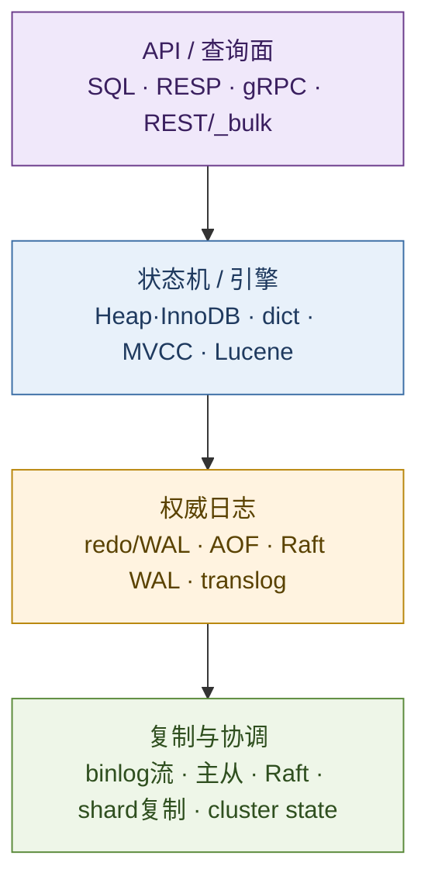
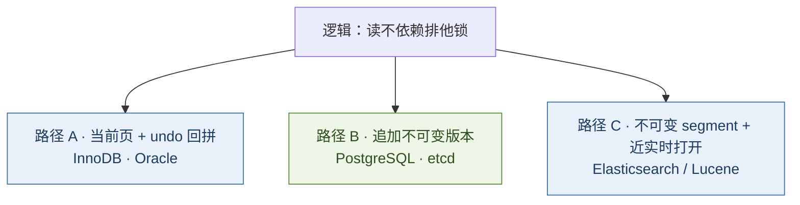
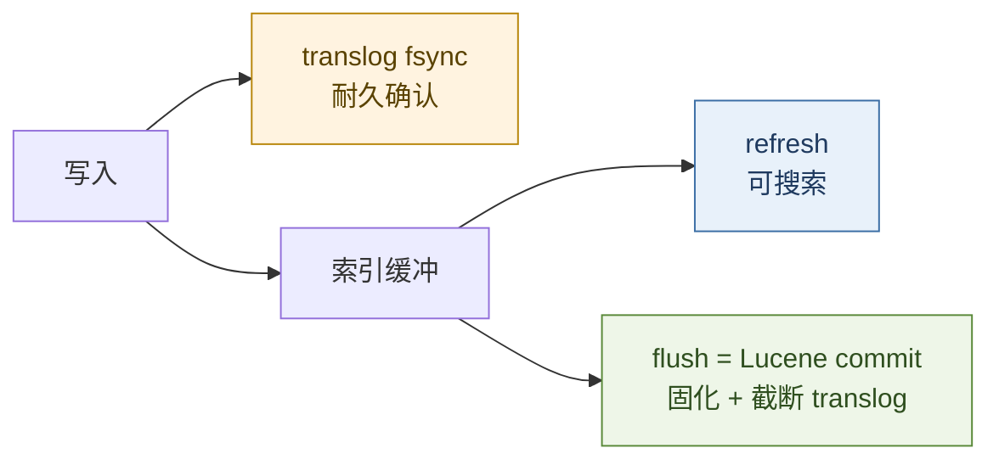
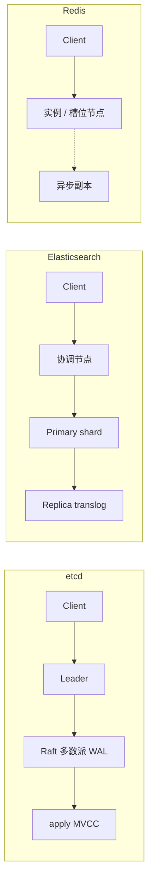
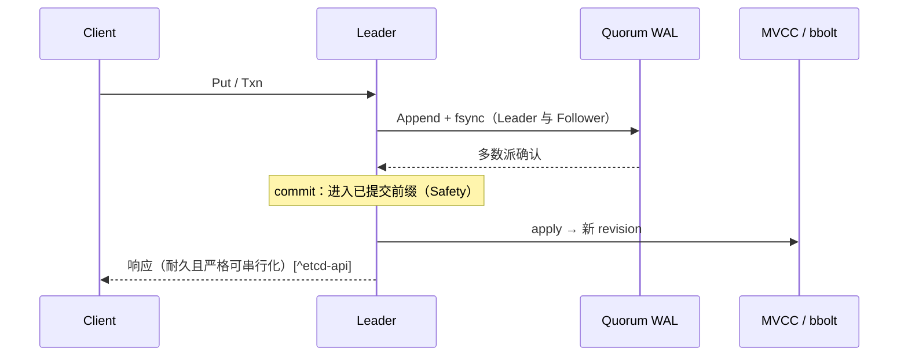
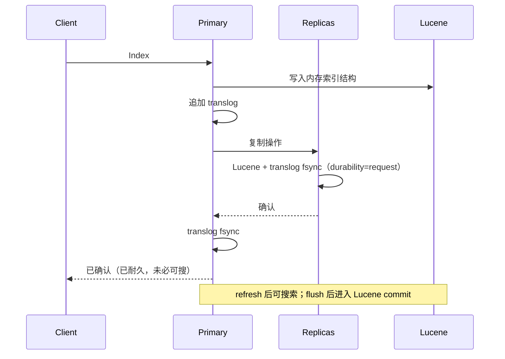

# 存储合同：WAL · MVCC · 共识日志

> 本题不是「六种数据库名词对照」，而是三条可检验的合同：  
> **① 耐久合同（WAL / STEAL·NO-FORCE）** → 崩溃后能否恢复；  
> **② 并发合同（MVCC 的物理形态）** → 读写如何互不阻塞、旧版本落在何处；  
> **③ 集群合同（共识日志 = 分布式 WAL）** → 多节点如何共享唯一已提交前缀。  
> etcd、InnoDB、PostgreSQL、Redis、Elasticsearch 的差异，是在这三条合同上的取舍，不是功能清单长短。
>
> 可与 [22](./22-distributed-consistency-treatise.md)（CAP / FLP / Paxos·Raft）、[23](./23-kubernetes-control-plane-doctrine.md)（控制面为何要 CP 存储）、[29](./29-kafka-event-streaming-treatise.md)（把日志做成产品）对照。

先给一个直接答案：

> **用七维选型，用三条合同解释。** WAL = STEAL/NO-FORCE 下的恢复纪律；[^haerder83][^aries] MVCC/segment = 可见性机制；[^pg-mvcc] Raft = 把提交升为多数派日志。[^raft] **RDBMS** 扛业务真相，**Redis** 扛延迟，**etcd** 扛控制面顺序，**ES** 扛检索——ES 将「已确认 / 可搜索 / Lucene 固化」拆开，共识只钉 cluster state。[^es-translog][^es-nrt][^es-cluster]

## 摘要

§2 用目的/功能/架构/网络/优劣总览四条血统；§3 立设计原则；§4–§5 深入耐久与并发合同；§6–§8 落到血统、网络路径与写路径。理论锚点：Haerder/Reuter 与 ARIES（STEAL/NO-FORCE⇒WAL）、[^haerder83][^aries] PostgreSQL redo-only、[^pg-wal] Redis 策略化耐久、[^redis-persist] etcd 逐写 Raft + revision、[^etcd-dm] ES 的 translog/refresh/flush 与「元数据共识 ≠ 文档共识」。[^es-translog][^es-cluster]

**关键词：** STEAL；NO-FORCE；WAL；ARIES；MVCC；translog；refresh；flush；Lucene；Elasticsearch；revision；Raft；etcd；Redis；PostgreSQL

---

## 目录

- [摘要](#摘要)
1. [读法：合同与七维](#1-读法合同与七维)
2. [总览：目的 · 功能 · 架构 · 网络 · 优劣](#2-总览目的--功能--架构--网络--优劣)
    - [2.1 目的与作用](#21-目的与作用)
    - [2.2 功能合同](#22-功能合同对外能力)
    - [2.3 架构分层](#23-架构分层底层叠法)
    - [2.4 网络模型](#24-网络模型一句话--路径)
    - [2.5 优劣](#25-优劣合同级非口号)
3. [设计原则](#3-设计原则)
4. [耐久合同：STEAL · NO-FORCE · WAL](#4-耐久合同steal--no-force--wal)
5. [并发合同：三条物理路径](#5-并发合同三条物理路径)
6. [四条工程血统](#6-四条工程血统)
7. [集群合同与网络路径](#7-集群合同与网络路径)
    - [7.1 共识用在哪一层](#71-共识用在哪一层)
    - [7.2 网络路径对照](#72-网络路径对照请求怎么走)
    - [7.3 Safety 与 Liveness](#73-safety-与-livenesslamport)
    - [7.4 Paxos 与 Raft](#74-paxos-与-raft同一提交合同不同分解)
8. [写路径对照：etcd 与 Elasticsearch](#8-写路径对照etcd-与-elasticsearch)
9. [选型](#9-选型)10. [本章要点](#10-本章要点)
11. [参考文献](#11-参考文献)

---

## 1. 读法：合同与七维

机制用三条合同检验；产品用七维对照。二者正交：合同解释「为什么这样实现」，七维回答「拿它做什么、长什么样、得失如何」。

| # | 合同 | 核心问题 | 失败形态 |
| - | ---- | -------- | -------- |
| ① | **耐久** | 已确认写崩溃后能否重现？ | 丢提交 |
| ② | **并发 / 可见** | 读写如何互不拖死？旧版谁回收？ | 锁风暴 / 膨胀 / 近实时误解 |
| ③ | **集群** | 「写成功」绑在哪一层多数派或复制上？ | 分叉 / 假强一致 |

| 维 | 要回答的问题 | 正文落点 |
| -- | ------------ | -------- |
| **目的** | 系统为何存在？ | §2、§6 |
| **作用** | 在架构里承担哪一段责任？ | §2 |
| **功能** | 对外提供哪些能力合同？ | §2 |
| **设计原则** | 取舍时守住什么？ | §3 |
| **架构 / 底层** | 控制面·数据面·日志·引擎如何叠？ | §2、§4–§6 |
| **网络模型** | 客户端协议、复制路径、共识是否经主节点？ | §2、§7 |
| **优劣** | 换来什么、付出什么、误用形态？ | §2、§6、§9 |

边界：论证因果与合同，非调参手册或 QPS 榜；CAP/协议全景见 [22](./22-distributed-consistency-treatise.md)。

---

## 2. 总览：目的 · 功能 · 架构 · 网络 · 优劣

### 2.1 目的与作用

| 系统 | **目的**（为何造） | **作用**（放在哪一层） |
| ---- | ----------------- | ---------------------- |
| **MySQL / PG / Oracle** | 通用事务真相库 | 业务数据面；强约束 OLTP |
| **Redis** | 内存数据结构的极低延迟访问 | 热路径缓存 / 会话 / 限流；可重建数据 |
| **etcd** | 小键空间上的可靠协调与 watch | 控制面元数据；服务发现、锁、K8s 真相源 |
| **Elasticsearch** | 倒排检索与聚合分析 | 搜索 / 可观测数据面；常接在业务库或日志管道之后 |

### 2.2 功能合同（对外能力）

| 系统 | 核心功能面 | 明确不保证（默认） |
| ---- | ---------- | ------------------ |
| **RDBMS** | SQL、ACID 事务、丰富隔离级别、约束与连接 | 跨地域线性一致（除非另购共识/同步套件） |
| **Redis** | 结构命令、可选持久化与复制、Cluster 分片 | 强一致事务账本；跨槽原子 |
| **etcd** | KV / Txn / Watch / Lease；严格可串行化；线性一致读可配[^etcd-api] | 大吞吐分析、复杂查询 |
| **ES** | 倒排索引、聚合、近实时搜索、分片扩展[^es-nrt] | 多行 SQL 事务；逐文档线性一致；refresh 前可搜 |

### 2.3 架构分层（底层叠法）

| 系统 | 引擎层 | 权威日志 | 派生持久化 |
| ---- | ------ | -------- | ---------- |
| **InnoDB** | 聚簇索引 + undo | redo（+ binlog 外溢） | 表空间页 |
| **PostgreSQL** | 堆 + 索引（多版本元组） | WAL | 数据文件 |
| **Redis** | 内存结构 | AOF / RDB（策略化） | 同左 |
| **etcd** | MVCC（revision） | **Raft WAL** | bbolt |
| **ES** | Lucene segments | **translog** | Lucene commit（flush） |

### 2.4 网络模型（一句话 + 路径）

| 系统 | 客户端协议 | 数据路径 | 协调 / 元数据路径 |
| ---- | ---------- | -------- | ----------------- |
| **RDBMS** | 专用会话协议 | 连主（或读写分离到副本） | 复制流（WAL/binlog）异步或半同步 |
| **Redis** | RESP | 直连实例；Cluster 按槽转发 | 主从复制；Gossip 传槽位 |
| **etcd** | gRPC | **写必须经 Leader → Raft 多数派** | 同伴即 Raft 成员 |
| **ES** | HTTP/REST（或兼容协议） | **协调节点定位 primary；不经 master 写每一条文档**[^es-cluster] | master 多数派提交 **cluster state** |

### 2.5 优劣（合同级，非口号）

| 系统 | **优** | **劣 / 代价** |
| ---- | ------ | ------------- |
| **RDBMS** | 约束与事务语义完整；生态与工具链成熟 | 水平扩展与跨分片事务贵；同步复制延迟 |
| **Redis** | 延迟极低；结构丰富；运维面相对简单 | 默认合同弱于账本；内存成本；Cluster 语义边界多 |
| **etcd** | 强顺序 + watch；控制面语义清晰 | 容量与写入放大受限；多数派不可达即停写 |
| **ES** | 检索/聚合能力强；分片水平扩展 | 近实时与事务弱；运维（分片、merge、映射）重；不宜当唯一真相 |

---

## 3. 设计原则

| # | 原则 | 内涵 | 反例 |
| - | ---- | ---- | ---- |
| 1 | **日志权威于数据页** | STEAL/NO-FORCE 下先耐久日志再刷页[^haerder83] | 只刷数据文件、无可靠日志 |
| 2 | **可见性与耐久解耦时必须显式** | ES：refresh ≠ flush ≠ 确认[^es-nrt][^es-translog]；Redis：fsync 策略可选 | 把「搜到/读到」当成「已提交」 |
| 3 | **隔离尽量不靠读锁** | MVCC / 单线程命令 / segment 不可变 | 长读锁打死写入 |
| 4 | **旧版本必须有回收者** | purge / VACUUM / compact / merge | 「开了多版本就完事」 |
| 5 | **共识用在付不起分叉的那一层** | etcd：逐写；ES：cluster state；缓存：常不用 | 用搜索集群替代协调库 |
| 6 | **API 合同决定引擎，而非相反** | 先定一致性与查询形态，再选库存 | 先上品牌再补语义 |

---

## 4. 耐久合同：STEAL · NO-FORCE · WAL

### 4.1 缓冲策略决定你需要什么日志

Haerder & Reuter 将缓冲管理压成两个开关：[^haerder83]

| 策略 | 含义 | 对恢复的要求 |
| ---- | ---- | ------------ |
| **STEAL** | 允许未提交事务的脏页被换出到磁盘 | 崩溃时磁盘可能含未提交变更 → **必须能 UNDO** |
| **NO-STEAL** | 脏页留在缓冲直到事务结束 | UNDO 可大幅简化，但长事务撑爆缓冲 |
| **FORCE** | 提交前强制刷齐该事务脏页 | 几乎不需 REDO，但提交延迟与随机 I/O 爆炸 |
| **NO-FORCE** | 提交只保证日志耐久，脏页稍后刷 | 崩溃时已提交变更可能未上数据页 → **必须能 REDO** |

工业 OLTP 的主流选择是 **STEAL + NO-FORCE**：吞吐可接受，恢复变复杂。于是出现 WAL 纪律：

> **描述某页变更的日志记录，必须在该页本身被写回磁盘之前进入稳定存储；事务提交确认之前，其提交记录必须已耐久。**[^haerder83][^aries]

顺序写一小段日志，换取稍后批量刷数据页——这是 WAL 的性能理由，不是「多备份」的运维口号。

### 4.2 ARIES：把纪律做成算法

ARIES 在 STEAL / NO-FORCE + 细粒度锁下给出可实现恢复：[^aries]

1. **Repeating history（Redo）**：重启时按日志把系统推回崩溃前状态（含未提交变更在页上的效应）。  
2. **Logged Undo**：回滚未完成事务，且 undo 本身记补偿日志，使恢复可重入。  
3. **Analysis → Redo → Undo** 三趟扫描，配合脏页表与事务表限定工作量。

对工程师的直接推论：

| 推论 | 含义 |
| ---- | ---- |
| **日志是权威** | 数据页可以落后；恢复以日志为准 |
| **fsync 的对象首先是日志** | `innodb_flush_log_at_trx_commit` / PostgreSQL `synchronous_commit` 调的是这条合同 |
| **复制吃的是日志外溢** | 物理复制、binlog、逻辑解码，都是把权威流送给别人 |

### 4.3 PostgreSQL 的岔路：redo-only WAL

PostgreSQL 官方定义：数据文件变更只能发生在描述该变更的 WAL 已刷入持久存储之后；崩溃后做 **roll-forward（REDO）**。[^pg-wal]

关键分叉：**没有独立 undo 日志**。UPDATE 写入新堆元组，旧元组保留；中止事务只需在提交日志中标记 aborted，旧写入对快照不可见——**ROLLBACK 成本与写入量解耦**。[^bytebase-wal] 代价转移到 **VACUUM**：不可见版本必须后台回收，否则膨胀。

| | **InnoDB / Oracle（ARIES 系）** | **PostgreSQL** |
| - | ------------------------------- | -------------- |
| REDO | redo / WAL | WAL |
| UNDO | undo 段 / rollback segment | 无；靠 MVCC 可见性 |
| 长事务回滚 | 可能很长（走 undo） | 标记中止即可 |
| 运维焦点 | undo 空间、长事务阻塞 purge | 膨胀、autovacuum、xid 冻结 |

二者都遵守「先日志后数据页」，但 **UNDO 责任放在日志里还是放在数据版本里**，决定了整个运维面。

---

## 5. 并发合同：三条物理路径

### 5.1 为何需要多版本

PostgreSQL 文档：语句看到的是某一时刻的数据快照；**读锁与写锁不互相冲突——读不阻塞写，写不阻塞读**。[^pg-mvcc]  
本质是把隔离从「读时加锁」挪到「读时选版本」。

### 5.2 物理实现：三条主路

| | **路径 A：undo 回拼** | **路径 B：追加版本** | **路径 C：segment 可见性** |
| - | --------------------- | -------------------- | -------------------------- |
| **当前数据** | 页上最新行 | 堆 / b+tree 多版并存 | 多个不可变 Lucene segment |
| **旧版** | undo 链 | 旧元组 / 旧 revision | 旧 segment；更新多为删+增 |
| **读何时看见** | 快照 + undo 回拼 | 版本号 / xmin·xmax | **refresh** 打开新 segment 之后[^es-nrt] |
| **空间风险** | undo 膨胀 | VACUUM / compact | merge、软删、磁盘放大 |
| **代表** | InnoDB、Oracle | PostgreSQL、etcd | Elasticsearch |

路径 C **不是** RDBMS 意义的快照隔离 MVCC：默认搜索读的是「最近一次 refresh 之后的近实时视图」，与「已确认写入」可以差一个 refresh 周期（默认约 1s 量级）。[^es-nrt] 乐观并发靠 `_seq_no` / `_primary_term`（或外部版本号），不是全局 revision 总序。

### 5.3 etcd：把版本做成全局逻辑时钟

etcd 数据模型：[^etcd-dm]

1. 键空间扁平；每次**原子变更**产生新的全局 **revision**（初值 1，单调递增）。  
2. 逻辑上结构不可变：不覆盖，只生成新结构；旧 revision 可查询直至 **compaction**。  
3. 物理上：持久 b+tree 只存相对前一 revision 的 **delta**；另有内存 btree 加速按 key 查询。

这直接支撑官方 API 合同：KV 操作 **严格可串行化（strict serializability）**，总序由 revision 给出；默认可线性一致（走 Raft）；watch 按 revision 有序、不丢窗内事件。[^etcd-api]

> **价值点：** etcd 的 MVCC 不是「顺便多存几个旧值」，而是 **用 revision 充当集群逻辑时钟**，让 list/watch、Txn/CAS、历史读落在同一序上——这也是 Kubernetes 控制面能「声明式 + 持续收敛」的存储前提（见 [23](./23-kubernetes-control-plane-doctrine.md)）。

---

## 6. 四条工程血统

### 6.1 通用事务库：ARIES 系与 PG 系

| 维度 | InnoDB / Oracle | PostgreSQL |
| ---- | --------------- | ---------- |
| 目的 / 作用 | 业务真相库 | 业务真相库 + 扩展 SQL / 逻辑解码 |
| 合同 ① | redo + undo（STEAL/NO-FORCE） | WAL redo-only + 堆版本 |
| 合同 ② | 路径 A | 路径 B |
| 网络 / 复制 | 会话连主；binlog/WAL 流复制 | 同左；同步级别可配 |
| **优** | 约束与工具链完整 | 回滚轻、逻辑复制/CDC 友好 |
| **劣** | undo/长事务与同步复制代价 | 膨胀与 VACUUM/xid 运维 |

MySQL：**InnoDB redo（崩溃）与 binlog（复制/PITR）** 经内部两阶段对齐——调耐久须两者一起看。[^bytebase-wal][^mysql-redo]

### 6.2 Redis：把耐久降级为策略旋钮

Redis 官方持久化：[^redis-persist]

| 机制 | 合同强度 | 含义 |
| ---- | -------- | ---- |
| **RDB** | 点时刻快照 | `fork` + COW；间隔内写入可丢 |
| **AOF** | 命令日志重放 | `appendfsync`：always / everysec / no——**用丢失窗口换延迟** |
| **无持久化** | 纯缓存 | 进程死即空 |

这不是「Redis 不懂 WAL」，而是**产品合同故意不把每次写入绑死在多数派磁盘上**。用 Redis 当唯一账本，是合同误用，不是调优问题。

| | 说明 |
| - | ---- |
| **优** | 亚毫秒延迟；结构命令表达力强；水平分片路径清晰 |
| **劣** | 耐久/一致默认可弱；内存成本；跨槽事务缺失 |

### 6.3 etcd：协调型 KV——小数据、强合同

官方定位：可靠存储**低频更新**数据，并提供可靠 watch；多版本适配历史窗口。[^etcd-dm]

| 层 | 组件 | 合同 |
| -- | ---- | ---- |
| 共识 | Raft WAL | 多数派持久化 = commit[^etcd-persist][^raft] |
| 状态机 | MVCC（revision） | 严格可串行化总序[^etcd-api] |
| 后端 | bbolt | apply 后持久化；非共识权威[^etcd-persist] |
| **优** | 强顺序、watch、控制面语义干净 | |
| **劣** | 容量与写放大受限；无多数派则停写（偏 CP） | |

**分判：** 要「小键空间强顺序 + watch」，不要「大表分析」。

### 6.4 Elasticsearch：搜索引擎合同——translog · refresh · 元数据共识

Elasticsearch 建立在 Lucene 之上。官方说明：Lucene **commit** 代价高，无法在每次 index/delete 后执行；commit 点之间的变更在进程崩溃时会被 Lucene 丢弃。因此每个分片副本另写 **translog**：操作先进入 Lucene 索引结构，再写入 translog，**在确认客户端之前**完成；崩溃后尚未进入最近 Lucene commit 的已确认操作，从 translog 重放恢复。[^es-translog]

**合同 ①：三层时间语义必须分开**

| 操作 | 做什么 | 合同含义 |
| ---- | ------ | -------- |
| **index + translog fsync** | 默认 `index.translog.durability=request`：主分片与已分配副本均 fsync/commit translog 后才向客户端成功[^es-translog] | **已确认 ≈ 已耐久**（相对副本集合） |
| **`durability=async`** | 按 `sync_interval` 后台 fsync | 与 Redis AOF everysec 同构：用丢失窗口换延迟 |
| **refresh** | 把内存缓冲写成新 segment 并打开，供搜索可见；默认可约 1s 近实时[^es-nrt] | **可搜索 ≠ 已 commit 到 Lucene** |
| **flush** | 执行 Lucene commit，并开启新的 translog generation[^es-translog][^es-flush] | 把权威从「translog + 未 commit 段」推进到「Lucene commit 点」 |

> **因果：** Lucene segment 不可变且 commit 贵 → 必须用 translog 充当 WAL（NO-FORCE 思想）；又因搜索要高频看见新文档 → 必须用比 commit 轻的 **refresh** 打开 segment。把 refresh 当成「提交」，或把「搜不到」当成「丢数据」，都是合同错位。

**合同 ②：不是 RDBMS MVCC**

- 更新/删除在引擎内常体现为新文档 + 旧文档标记删除，由 merge 回收——接近「追加不可变结构」，但**不提供** etcd/PG 那种按全局逻辑时钟的任意历史快照读。  
- 并发控制是文档级乐观并发（`_seq_no` / `_primary_term`），冲突时重试——服务搜索更新率，而非控制面严格可串行化。  
- 搜索可见性由 refresh 边界决定，不是由事务快照决定。[^es-nrt]

**合同 ③：共识在元数据，不在每一条文档**

官方架构：[^es-cluster]

1. **cluster state**（节点身份、索引映射、分片位置与同步集合等）由选举出的 master 变更；对 master-eligible 节点按 **voting configuration 多数派**提交后再指令节点 apply——与 Raft 式「先提交后应用」同构。  
2. **索引 / 删除 / 搜索等高吞吐 API 通常不与 master 交互**；数据路径是分片 primary → replica 复制。  
3. 因此：ES 用多数派保护的是**集群真相（谁主谁从、映射是什么）**；文档耐久默认绑在 **primary + 已分配 replica 的 translog**，而非「集群内所有节点的 Raft 日志」。

| | **etcd** | **Elasticsearch** |
| - | -------- | ----------------- |
| 共识覆盖 | 每一次 KV 写 | **cluster state**；文档写走分片复制 |
| 权威日志 | Raft WAL | 每副本 **translog**（+ Lucene commit） |
| 读合同 | 默认可线性一致 | 近实时搜索；可搜与已确认可分离 |
| 适合 | 小键空间协调 | 全文检索、日志/指标分析、文档检索 |

| | 说明 |
| - | ---- |
| **优** | 倒排/聚合强；分片扩展；日志与检索场景契合 |
| **劣** | 近实时与事务弱；分片/映射/merge 运维重；共识不覆盖逐文档写 |

**分判：** 要倒排与聚合，接受近实时；勿当账本或 etcd。

---

## 7. 集群合同与网络路径

### 7.1 共识用在哪一层

| 类型 | 含义 | 代表 |
| ---- | ---- | ---- |
| **状态机多数派** | 每条命令进入同一已提交日志前缀 | etcd / Raft |
| **元数据多数派 + 数据复制** | 多数派只决定拓扑/映射；数据按主副本复制 | Elasticsearch cluster state + shard replication[^es-cluster] |
| **可选复制** | 提交可不绑多数派 | 异步主从 RDBMS、Redis 副本 |

异步主从的「主已返回成功」**不蕴含**「多数持久化」。把半同步 / 异步复制说成「强一致」，或把「ES 绿集群」说成「每条文档线性一致」，都是偷换合同 ③。

### 7.2 网络路径对照（请求怎么走）

| | 写请求是否必须见「全局 Leader」 | 读是否可能落后于已确认写 |
| - | ------------------------------ | ------------------------ |
| **etcd** | 是（Leader + 多数派） | 线性一致读：否；serializable 读：可 |
| **ES** | 否（找 primary即可；master 不管文档写）[^es-cluster] | 是：未 refresh 则搜索不可见[^es-nrt] |
| **Redis** | 否（直连主或槽位主） | 副本异步时：是 |
| **RDBMS** | 通常写主 | 读库异步时：是 |

### 7.3 Safety 与 Liveness（Lamport）

| 性质 | 含义 | 存储后果 |
| ---- | ---- | -------- |
| **Safety** | 坏事永不发生 | 同一日志下标不能选定两个不同条目；已 commit 前缀不可被合法节点推翻 |
| **Liveness** | 好事终会发生 | 多数派可达时能选主并继续提交；纯异步下无法由确定性算法单独保证（FLP）[^flp] |

工程分配：[^raft][^lamport-paxos]

- **Safety** ← 提案号 / term、多数派相交、值继承或选举限制、日志匹配——**与时钟无关**。  
- **Liveness** ← 超时、随机化选举、心跳——**可牺牲可用性，不可牺牲已提交真相**。

对 ES：cluster state 发布遵循「先收集足够 master-eligible 确认再 commit，再令节点 apply」——Safety 落在元数据；数据面 Safety 依赖分片复制与 translog 策略，**强度弱于 etcd 的逐写 Raft**。[^es-cluster][^es-translog]

### 7.4 Paxos 与 Raft：同一提交合同，不同分解

| | **Paxos / Multi-Paxos** | **Raft** |
| - | ----------------------- | -------- |
| Safety 装置 | 递增提案号 + 多数派承诺 + 已接受值继承[^lamport-paxos] | term + 「日志至少一样新」才可当选 + 只追加复制[^raft] |
| Liveness 装置 | 收敛到 distinguished proposer | 强 Leader + 随机超时 |
| 与存储的接口 | 槽位上的选定值序列 | 无空洞的复制日志 |
| 典型落地 | Chubby 等 | **etcd**、Consul、TiKV；ES 的 **cluster coordination** 同属多数派提交族[^es-cluster] |

> **对存储路径唯一重要的句子：**  
> **「写成功」绑定在哪一层的耐久与多数派上，决定了系统是协调库、搜索库还是缓存。** etcd：成功 = Raft 已提交前缀；ES 默认：成功 = primary+replica translog 已 fsync，可搜索仍可能要等 refresh。

---

## 8. 写路径对照：etcd 与 Elasticsearch

### 8.1 etcd：commit 先于 apply

| 步骤 | 若不做会发生什么 |
| ---- | ---------------- |
| 先写 Raft WAL 再复制 | 无本地耐久则无法参与恢复 |
| 等多数派再 commit | 仅 Leader 成功 → 切换后丢「已确认」写入 |
| commit 后再 apply | 先改 MVCC 再共识 → 节点间版本分叉 |
| 后台 compact | revision 窗口无限涨 |

### 8.2 Elasticsearch：耐久、可搜索、Lucene 固化三阶段

| 对照维 | etcd | Elasticsearch |
| ------ | ---- | ------------- |
| 权威日志 | Raft WAL（集群一份逻辑日志） | 每 shard 副本一份 translog |
| 算「写成功」 | 多数派 Raft 提交 | 默认：primary + 已分配 replica 的 translog fsync[^es-translog] |
| 派生结构 | MVCC → bbolt | Lucene segments；flush = commit |
| 读可见 | 与写同一 revision 序（线性一致可读） | refresh 之后才近实时可搜[^es-nrt] |
| 共识 | 每条写 | 仅 cluster state |

RDBMS / Redis 对照（同构）：权威仍是日志；ES 多了一层「搜索可见性」时间线。Redis AOF `everysec` 与 ES `translog.durability=async` 同属削弱合同 ① 换延迟。[^redis-persist][^es-translog]

---

## 9. 选型

先匹配 §2 的目的/功能，再核对三条合同与网络路径，最后用优劣表排除误用。

| 需求 | 合同 | 网络暗示 | 更常落点 |
| ---- | ---- | -------- | -------- |
| 业务账本、约束、复杂查询 | ① 强 + ② SQL/MVCC | 写主；慎读异步库 | PostgreSQL / MySQL / Oracle |
| 热路径、可丢可重建 | ① 可弱 | 直连 / 槽位 | Redis |
| 控制面、锁、配置、K8s | ①+③ 逐写强 + watch | 写经 Leader/多数派 | etcd |
| 全文检索、日志分析 | 分片耐久 + 近实时 + 倒排 | 写 primary；搜可协调节点 | **Elasticsearch** |
| 海量事件多订阅 | 日志即产品 | 拉取分区 | Kafka（[29](./29-kafka-event-streaming-treatise.md)） |

反模式：

1. Redis / ES 当唯一账本。  
2. etcd 存大体量业务或检索语料。[^etcd-dm]  
3. ES 替代 etcd 做选主 / 强一致配置。  
4. 混淆 refresh 与丢数据，或 `durability=async` 当强耐久。[^es-nrt][^es-translog]  
5. 异步读当线性一致；多版本不回收。

---

## 10. 本章要点

1. **七维**（目的/作用/功能/原则/架构/网络/优劣）与**三条合同**正交：前者选型，后者解释机制。  
2. **STEAL + NO-FORCE ⇒ WAL**；可见性与耐久分离时必须显式（ES refresh / Redis fsync）。  
3. **并发三路径：** undo 回拼、追加版本、Lucene segment + refresh。  
4. **网络分叉：** etcd 写绑 Raft Leader；ES 文档写绑 primary，共识只绑 cluster state。  
5. **优劣是合同代价：** 强一致换停写，近实时换检索，弱耐久换延迟。  
6. **选型匹配合同与网络路径，不匹配品牌。**

---

## 11. 参考文献

[^haerder83]: T. Haerder & A. Reuter, *Principles of Transaction-Oriented Database Recovery*, ACM Computing Surveys, 15(4), 1983. https://dl.acm.org/doi/10.1145/289.291 。

[^aries]: C. Mohan et al., *ARIES: A Transaction Recovery Method Supporting Fine-Granularity Locking and Partial Rollbacks Using Write-Ahead Logging*, ACM TODS, 17(1), 1992. https://dl.acm.org/doi/10.1145/128765.128770 。

[^pg-wal]: PostgreSQL Global Development Group, *Write-Ahead Logging (WAL)*. https://www.postgresql.org/docs/current/wal-intro.html 。

[^pg-mvcc]: PostgreSQL Global Development Group, *Concurrency Control — Introduction*（MVCC）. https://www.postgresql.org/docs/current/mvcc-intro.html 。

[^etcd-dm]: etcd Authors, *Data model*. https://etcd.io/docs/v3.7/learning/data_model/ 。

[^etcd-persist]: etcd Authors, *Persistent storage files*. https://etcd.io/docs/v3.7/learning/persistent-storage-files/ 。

[^etcd-api]: etcd Authors, *API guarantees*（durability、strict serializability、linearizability、watch）. https://etcd.io/docs/v3.7/learning/api_guarantees/ 。

[^raft]: D. Ongaro & J. Ousterhout, *In Search of an Understandable Consensus Algorithm*, USENIX ATC, 2014. https://raft.github.io/raft.pdf 。

[^lamport-paxos]: Leslie Lamport, *Paxos Made Simple*, ACM SIGACT News, 2001. https://www.lamport.org/pubs/paxos-simple.pdf 。

[^flp]: M. Fischer, N. Lynch & M. Paterson, *Impossibility of Distributed Consensus with One Faulty Process*, JACM, 1985. https://groups.csail.mit.edu/tds/papers/Lynch/jacm85.pdf 。

[^redis-persist]: Redis Ltd., *Redis persistence*. https://redis.io/docs/latest/operate/oss_and_stack/management/persistence/ 。

[^bytebase-wal]: Bytebase, *What is Write Ahead Logging (WAL)*（InnoDB / Oracle / PostgreSQL redo·undo 分叉）. https://www.bytebase.com/blog/write-ahead-logging/ 。

[^mysql-redo]: Oracle MySQL, *InnoDB Redo Log*. https://dev.mysql.com/doc/refman/8.4/en/innodb-redo-log.html 。

[^es-translog]: Elastic, *Translog*（Lucene commit 与 translog；`index.translog.durability`）. https://www.elastic.co/guide/en/elasticsearch/reference/current/index-modules-translog.html 。

[^es-nrt]: Elastic, *Near real-time search*（refresh 与 segment）. https://www.elastic.co/guide/en/elasticsearch/reference/current/near-real-time.html 。

[^es-flush]: Elastic, *Flush API*（flush = 将 translog 操作固化进 Lucene）. https://www.elastic.co/docs/api/doc/elasticsearch/operation/operation-indices-flush 。

[^es-cluster]: Elastic, *Cluster state*（master 发布、多数派提交后再 apply；高吞吐 API 不经 master）. https://www.elastic.co/docs/deploy-manage/distributed-architecture/discovery-cluster-formation/cluster-state-overview ；*A new era for cluster coordination in Elasticsearch*. https://www.elastic.co/blog/a-new-era-for-cluster-coordination-in-elasticsearch 。

**声明：** 本文论证存储与共识的合同与因果，非调参手册。版本行为以当期官方文档为准。CAP / 协议全景见 [22](./22-distributed-consistency-treatise.md)；控制面用法见 [23](./23-kubernetes-control-plane-doctrine.md)。
