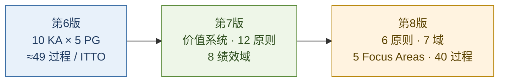
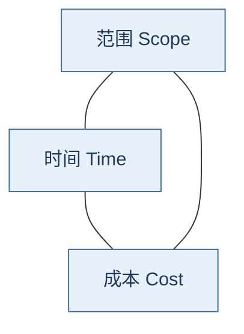
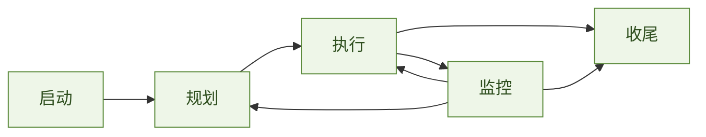
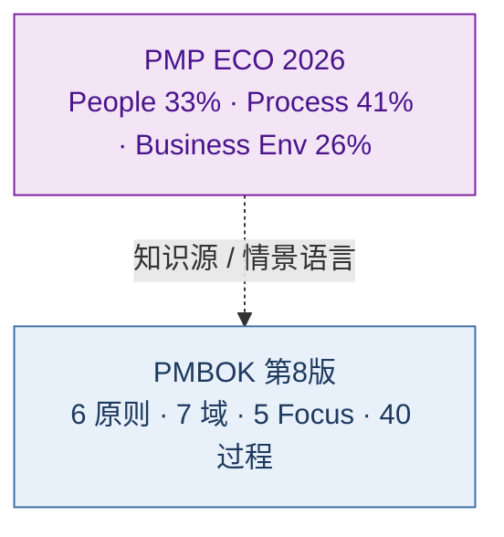
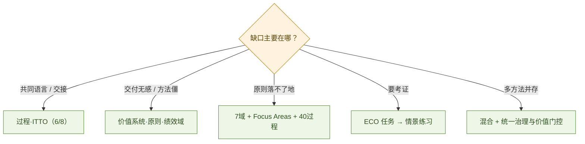

# 项目管理演进：从过程共同语言到价值交付

> PMI《PMBOK®指南》与《项目管理标准》从第 6 版（2017）到第 8 版（2025），不是章节加减，而是知识组织逻辑的三次校准：先立**过程共同语言**，再立**价值与原则**，再把**可执行过程**以非规定性方式嵌回绩效域。  
> 本文先立行业常识（**铁三角、五大过程组、十大知识领域**），再给可落地骨架：**三版核心结构对照**、**第 8 版 6 原则 / 7 绩效域 / 5 关注领域 / 40 过程全表**，以及 **PMP ECO 与 PMBOK 的关系**——后者是知识体系，前者是「考什么」。

**结论：**

> **项目管理的主线，正从「有没有按过程做完」转向「是否交付可感知的价值」。**  
> 第 6 版贡献过程与 **ITTO** 共同语言；第 7 版把项目放进**价值交付系统**，用 12 原则与 8 绩效域容纳预测 / 敏捷 / 混合；第 8 版精炼为 **6 原则、7 绩效域**，把原五大过程组改称 **5 个关注领域（Focus Areas）**，并将约 **40 个过程**嵌回——不是退回第 6 版，而是在原则骨架上补实践衔接。  
> **考 PMP 时：** 以 ECO 的 People / Process / Business Environment 任务为准；PMBOK 是主要知识源之一，但**不是**试卷目录。2026 年 ECO 加重商业环境（8%→26%），与第 8 版强化治理、财务、可持续、AI 同向。  
> 行业现实是 **fit-for-purpose 混合方法**上升；成功定义扩展为 **Value + Execution**。AI 可下沉事务，人类仍守目标对齐、治理护栏、伦理与多方共识。

**专业可靠水位（审阅摘要）：**

> 对项目经理、PMO、技术交付负责人、治理 / 审计相关人员：**可以依靠本文做术语对齐、版本对照、裁剪选型与最小治理设计**；公开结构口径（原则数、域、ECO 权重、成功公式）可引用。  
> **不可以**把本文当作 PMI 原书、组织级制度或考证裁决的替代件。页级 ITTO、合同与合规细节回原书 / 原制度。详见 §1.2–1.3。

**30-governance 位置：** [30](./30-cobit-it-governance-framework.md) 回答技术是否创造可验证经营结果；[31](./31-platform-service-quality-case-study.md) 写平台质量账本；本文写**项目如何被组织、评价与认证考察**。可与 [21](../20-architecture/21-service-architecture-evolution.md)、[21a](../20-architecture/21a-platform-engineering-idp-treatise.md)、[25](../20-architecture/25-architecture-thinking-cto-treatise.md) 对照。

## 摘要

先立行业常识：**铁三角**、**五大过程组**、**十大知识领域**、**三基准与关键工件**；再厘清《标准》与《指南》、**PMBOK 与 PMP ECO**；补全第 6–8 版组织逻辑、第 8 版定义转向与 **40 过程全表**。结合 Pulse、*Maximizing Project Success* 与 2026 PMP 权重变化给出行业前沿；末节讨论 AI 与「使命负责人」远期图景。文首给出**证据分级**，标明何者可引用、何者仅作索引。[^pmbok6][^pmbok7][^pmbok8][^pmp-eco-2026][^pulse2024][^success2024]

**关键词：** 铁三角；三基准；过程组；知识领域；PMBOK；PMP；ECO；价值交付；绩效域；ITTO；混合方法；项目成功；AI

---

## 目录

1. [读法与边界](#1-读法与边界)
2. [中心论点与三版一览](#2-中心论点与三版一览)
3. [两套坐标系：PMBOK 与 PMP ECO](#3-两套坐标系pmbok-与-pmp-eco)
4. [先分清：《标准》与《指南》](#4-先分清标准与指南)
5. [行业基础：铁三角、过程组、知识领域、三基准](#5-行业基础铁三角五大过程组十大知识领域)
6. [第 6 版：过程共同语言如何组织起来](#6-第-6-版过程共同语言如何组织起来)
7. [第 7 版：价值交付与绩效域](#7-第-7-版价值交付与绩效域)
8. [第 8 版：原则精炼、过程回嵌与最新变化（重点）](#8-第-8-版原则精炼过程回嵌与最新变化重点)
9. [知识结构如何迁徙：6 → 7 → 8](#9-知识结构如何迁徙6--7--8)
10. [行业前沿：混合、成功定义与 AI](#10-行业前沿混合成功定义与-ai)
11. [实践：如何裁剪使用](#11-实践如何裁剪使用)
12. [角色展望：事务下沉，使命上移](#12-角色展望事务下沉使命上移)
13. [与本库暗线](#13-与本库暗线)
14. [参考文献](#14-参考文献)

---

## 1. 读法与边界

### 1.1 建议阅读路径

| 读者 | 路径 |
| ---- | ---- |
| **入门 / 对齐共同语言** | §5 → §6 → §4 → §2 |
| **跟版本演进 / 第 8 版** | §2 → §7 → §8 → §9 |
| **备考 PMP** | §3 → §5 → §8.5–8.6 → §11（ECO 为主，PMBOK 为辅） |
| **裁剪落地** | §5.1 / §5.5 → §8.10 → §11 |

### 1.2 证据分级（能否「依靠」）

| 级别 | 本文中的内容 | 依靠方式 |
| ---- | ------------ | -------- |
| **A · 一手** | 第 8 版官方目录 / 产品页结构；ECO 2026 权重；Pulse / Success 报告中的公开数字 | 可直接引用作结构与口径依据 |
| **B · 交叉验证** | 40 过程中英文名、Focus Area 过程数、49→40 合并说明 | 以 PMI 原书为准；二手表仅作索引，冲突从原书 |
| **C · 教学整理** | 课堂对照文、港口案例、裁剪决策树 | 帮助理解，不作认证裁决依据 |
| **D · 思辨** | §12「使命负责人」远期叙事 | 能力启示，不作时间表或组织承诺 |

### 1.3 专业相关人员能否依靠？（按角色）

| 角色 | 可以依靠本文做什么 | 不要靠本文做什么 |
| ---- | ------------------ | ---------------- |
| **项目经理 / Scrum Master / 交付负责人** | 对齐术语；选预测/适应/混合；建最小治理与三基准；读懂第 8 版过程落点 | 替代本公司方法论、合同条款或完整 ITTO 作业指导书 |
| **PMO / 治理 / 项目组合人员** | 价值交付系统口径；成功 = Value + Execution；PMO/AI/采购附录定位；与 COBIT 价值问互参 | 替代组合优先级模型或组织级门控制度原文 |
| **技术负责人 / 架构 / 工程经理** | 用铁三角与变更语言和业务对话；混合裁剪（硬约束 vs 迭代）；平台化交付与项目裁剪同构 | 替代技术方案评审或架构决策记录 |
| **内控 / 审计 / 合规相关** | 变更唯一入口、基准、收尾与责任归属的检查点；ECO/商业环境加重的信号 | 替代审计程序或合规检查表 |
| **PMP 备考者** | ECO↔PMBOK 关系、权重、方法比例、第 8 版过程地图 | 替代官方 ECO、ATP 课程或模拟题 |

> **总判：** 对专业相关人员，本文达到 **「可共享的专业地图 + 可执行的裁剪入口」** 水位；达到 **「可引用的结构与公开口径」**（A 级），未达到 **「可替代 PMI 原书 / 组织制度」** 水位——后者本也不应被单篇文章替代。

| 轴 | 本文提供 | 本文不提供 |
| -- | -------- | ---------- |
| **行业基础** | 铁三角、过程组、知识领域、三基准、关键术语与工件（§5） | 替考题库、逐过程完整 ITTO 背诵表 |
| **知识体系** | 第 6–8 版可核验骨架、第 8 版 40 过程全表、原则与域的含义 | 代替官方全书译文 |
| **认证** | PMP ECO 三大域 / 任务权重 / 与 PMBOK 的映射关系 | 代替官方 ECO 原文或 ATP 课程 |
| **行业前沿** | Pulse / 成功研究 / 混合方法可核验口径 | 某一咨询公司的落地模板 |
| **展望** | AI 与角色变迁的**有边界**判断（§12 为 D 级，非正文主干） | 2076 年时间表式预言 |

> **易混纠正：** 部分图解文称第 8 版「仍保留 12 原则、8 绩效域」——与 PMI 第 8 版公开说明及官方目录不符。第 8 版为 **6 原则、7 绩效域**，并恢复演化后的过程指导。[^pmbok8][^pmbok8-toc][^pmbok-v8-infographic]

> **用语：** 中文 PMI 材料常用「相关方」；口语与旧译多用「干系人」。本文二者同义，英文统一为 **Stakeholders**。

---

## 2. 中心论点与三版一览

> **一句话：** 第 6 版立秩序（过程），第 7 版立目的（价值），第 8 版把目的与可执行实践重新焊牢。

| | 第 6 版（2017） | 第 7 版（2021） | 第 8 版（2025） |
| - | -------------- | -------------- | -------------- |
| **两主体顺序** | 《指南》→《标准》 | 《标准》→《指南》 | 《标准》→《指南》 |
| **《标准》主线** | 引论 + 五大过程组 | 价值交付系统 + **12** 原则 | 价值交付系统 + **6** 原则 + **项目生命周期** |
| **《指南》主线** | 十大知识领域 + 约 **49** 过程 / ITTO | **8** 个项目绩效域 + 裁剪 + 模型/方法/工件 | **7** 个绩效域（嵌入约 **40** 过程）+ 裁剪 + **输入输出 / 工具技术**专章 |
| **过程组表述** | 启动·规划·执行·监控·收尾 | 不再作为主书展开主轴 | 改称 **5 个关注领域（Focus Areas）** |
| **组织逻辑** | 过程 × 知识主题交叉 | 结果导向、方法包容 | 价值导向 + 实践衔接 |
| **新增附录侧重** | 《敏捷实践指南》同年另册 | 数字资源衔接（standards+） | **PMO / AI / 采购** 附录 |

---

## 3. 两套坐标系：PMBOK 与 PMP ECO

> **这是「框架有没有用」的第一道门：** 考什么、管什么、书上写什么，本来就不是同一张表。

### 3.1 关系一句话

| 文本 | 回答的问题 | 结构 |
| ---- | ---------- | ---- |
| **PMBOK® Guide + Standard** | 专业实践的共同知识与行为框架「怎样想、可以怎样做」 | 原则 · 绩效域 · 过程 / ITTO · 裁剪 |
| **PMP Examination Content Outline（ECO）** | 认证考试「考哪些工作任务」 | Domain → Task → Enabler |

PMI 在 2026 ECO 中明确：ECO 与 PMBOK **存在可感知差异**——ECO 由职位任务分析（JTA）界定「领导与指导项目者」的关键任务；PMBOK 提供原则、技术域与良好实践；考试是**情景题**，要求把概念与经验应用到岗位情境。[^pmp-eco-2026]

### 3.2 PMP ECO 三大域（2026）

| Domain | 权重（2026） | 相对此前 | 核心任务簇（摘要） |
| ------ | ------------ | -------- | ------------------ |
| **I. People** | **33%** | 42%→33% | 共同愿景、冲突、领导团队、干系人参与与期望、知识转移、沟通 |
| **II. Process** | **41%** | 50%→41% | 整合计划与交付方式、范围、价值交付、资源、采购、财务、质量、进度、状态评估、收尾 |
| **III. Business Environment** | **26%** | **8%→26%** | 治理、合规、变更、障碍与问题、风险、持续改进、组织变革、评估外部商业环境 |

方法覆盖（贯穿三域，不按域隔离）：约 **40% 预测型**，约 **60% 适应型 / 混合型**。[^pmp-eco-2026][^pmp-new-exam]

> **2026 考试信号：** 商业环境大幅加重；情景中强化 **AI、可持续、干系人参与**；成功口径对齐 *Maximizing Project Success*（价值值得投入，而不只铁三角）。[^pmp-new-exam][^success2024]

### 3.3 ECO 任务 ↔ 第 8 版绩效域（对照用，非官方一一映射）

| ECO 侧重点 | 更常落到的第 8 版域 |
| ---------- | ------------------- |
| People：愿景 / 干系人 / 沟通 | 利益相关方；资源（团队领导） |
| Process：范围 / 进度 / 财务 / 资源 / 质量 / 采购 / 收尾 | 范围、进度、财务、资源；治理（整合、质量保证、寻源、变更、收尾） |
| Business Environment：治理 / 合规 / 变更 / 风险 / 外部变化 | 治理、风险 |

**备考用法：** 以 ECO 任务清单驱动「会不会做」；用第 8 版过程与 ITTO 补「专业语言与检查项」；用第 7 版原则补「情景题里的价值判断」。勿背「ECO 三域 = 第 8 版七域」。

---

## 4. 先分清：《标准》与《指南》

日常口语常把整本书叫「PMBOK」。讨论版本差异时须分开：[^pmbok-struct]

| 文本 | 属性 | 作用 |
| ---- | ---- | ---- |
| **《项目管理标准》** | 含 ANSI 标准属性（第 8 版：ANSI/PMI 99-001-2025） | 共同遵循的原则与框架「应当怎样想」 |
| **《项目管理知识体系指南》** | 理解与应用的指南 | 如何开展管理实践「可以怎样做」 |

第 6 版《指南》在前，并不等于《指南》高于《标准》——书中已说明指南以标准为基础。第 7 版起将《标准》前置，更直接地先立原则，再谈实践。[^pmbok6][^pmbok7][^pmbok8]

---

## 5. 行业基础：铁三角、五大过程组、十大知识领域

> 版本演进再热闹，行业对话仍常回到铁三角、过程组、知识领域，以及把约束写死的**三基准**。不会它们，后面的绩效域 / 关注领域只是换皮名词。

### 5.1 铁三角（三重约束 / Triple Constraint）

**铁三角**指项目执行层最常用的三项相互牵制的约束：

| 顶点 | 英文常用说法 | 管的是 |
| ---- | ------------ | ------ |
| **范围（Scope）** | Scope / Performance | 做什么、做到什么程度（含功能与性能期望） |
| **时间（Time）** | Schedule | 何时完成（进度、里程碑、关键路径） |
| **成本（Cost）** | Budget / Cost | 花多少（估算、预算、储备） |

**核心命题：三者不能同时「更好」而不付出代价。**

- 范围扩大 → 通常要更多时间或成本（或质量下降）  
- 工期压缩 → 通常要加人加钱（赶工 / 快速跟进）或砍范围  
- 预算削减 → 通常要减范围或延工期  

**质量（Quality）** 常被画在三角形中心或作为第四约束：在既定范围下「做到多好」。行业说法不一——有人坚持经典三角，有人讲「范围–进度–成本–质量」四约束——共同点是：**约束之间存在权衡，变更必须显式决策，不能口头「都要最好」。**

| 铁三角回答 | 它**不**单独回答 |
| ---------- | ---------------- |
| 执行是否按约定交付（按时、按预算、按范围） | 交付是否值得、业务是否感知价值、可持续 / 伦理影响 |

> **与第 7–8 版关系：** 铁三角仍是 **Execution** 的常用尺子；*Maximizing Project Success* 与价值交付系统把它嵌进更大公式——**Success = Value + Execution**。不是扔掉铁三角，而是禁止「三角绿了就叫成功」。[^success2024]

**两个易混专业术语（必须分清）：**

| 术语 | 含义 | 问题本质 |
| ---- | ---- | -------- |
| **范围蔓延（Scope creep）** | 未走变更控制、未调基准，却持续扩大已承诺范围 | 失控；常毁进度与成本 |
| **镀金（Gold plating）** | 团队擅自增加「客户没要求但觉得更好」的功能 / 品质 | 同样失控；浪费资源，还可能引入风险 |

二者都与第 8 版「达到或超越价值 **≠** 认可镀金 / 蔓延」直接对立：多交付不等于多价值，除非经授权并重估三角。

**实践检查三问：**

1. 当前基准（范围 / 进度 / 成本）是否书面对齐、经授权？  
2. 任一角要动，另外两角与质量是否同步评估？  
3. 变更是否进入整合变更控制（第 8 版：Assess and Implement Changes），而不是私下加需求？

### 5.2 五大过程组（Process Groups）

过程组是对**项目管理活动的逻辑分类**，回答「这类管理活属于启动、规划、执行、监控还是收尾」。第 6 版作主轴；第 8 版改称 **关注领域（Focus Areas）**，含义一脉相承。[^pmbok6][^pmbok8]

| 过程组 | 英文 | 一句话 | 典型产出 / 动作 |
| ------ | ---- | ------ | ---------------- |
| **1. 启动** | Initiating | 正式授权，对齐「为什么做、谁负责」 | 项目章程、识别关键干系人、任命项目经理 |
| **2. 规划** | Planning | 决定「怎么做」并形成可对照的基准 | 项目管理计划、范围/进度/成本基准、各类子计划与登记册 |
| **3. 执行** | Executing | 按计划做功，消耗资源、产生可交付物 | 可交付成果、团队建设与领导、实施沟通与质量保证、实施风险应对 |
| **4. 监控** | Monitoring & Controlling | 对照基准测量，决定纠偏或变更 | 绩效报告、变更请求与批准、范围验收、风险监督 |
| **5. 收尾** | Closing | 正式结束项目或阶段 | 最终移交、行政收尾、经验教训、释放资源、关闭合同 |

**过程组之间的关系（必懂）：**

1. **不是瀑布五个阶段** — 一个项目阶段（如「设计」「施工」）内部，仍可反复出现启动→规划→执行→监控→收尾。  
2. **执行与监控并行** — 监控不是等执行全部做完才开始。  
3. **规划可滚动** — 详细程度可随阶段加深（滚动式规划）；适应型方法下规划更频繁、更薄。  
4. **过程数骨架** — 第 6 版：**启动 2、规划 24、执行 10、监控 12、收尾 1（合计 49）**；规划占一半以上。第 8 版关注领域：**2 / 19 / 8 / 10 / 1（合计 40）**。[^pmbok6][^pmbok8-glossary]

### 5.3 十大知识领域（Knowledge Areas）

知识领域按**专业管理主题**划分，回答「管哪些方面」。某一过程可同时属于一个知识领域 × 一个过程组（交叉矩阵是第 6 版记忆法的核心）。[^pmbok6]

| # | 知识领域 | 管什么 | 从业者要抓住的要点 |
| - | -------- | ------ | ------------------ |
| 1 | **整合管理** Integration | 把各计划与变更拧成一体 | 章程、项目管理计划、指导与管理项目工作、知识、监控、**整合变更控制**、收尾 |
| 2 | **范围管理** Scope | 做什么 / 不做什么 | 需求、范围说明书、**WBS**、确认范围、控制范围；防范围蔓延与镀金 |
| 3 | **进度管理** Schedule | 何时做完 | 活动定义与排序、历时估算、关键路径、进度基准与控制 |
| 4 | **成本管理** Cost | 花多少 | 估算、预算、**成本基准**、挣值等绩效测量与控制 |
| 5 | **质量管理** Quality | 做到多好 | 质量规划、管理质量（过程）、控制质量（可交付物）；「质量内建」 |
| 6 | **资源管理** Resource | 人与实物资源 | 估算与获取、团队建设 / 管理、控制资源 |
| 7 | **沟通管理** Communications | 信息谁在何时以何形式得到 | 沟通规划、管理沟通、监督沟通 |
| 8 | **风险管理** Risk | 不确定的威胁与机会 | 识别、定性 / 定量、应对、实施应对、监督；风险登记册 |
| 9 | **采购管理** Procurement | 外购什么、如何合同 | 自制/外购、招标与选型、合同管理、收尾采购 |
| 10 | **相关方管理** Stakeholder | 谁影响 / 被影响 | 识别、规划参与、管理参与、监督参与 |

**与铁三角的咬合：**

- 铁三角的三边，主要落在 **范围 / 进度 / 成本** 三个知识领域，并由 **整合** 统一变更。  
- **质量** 决定「范围内的绩效水平」。  
- **资源、沟通、风险、采购、相关方** 是让三角可执行、可协调、可承受不确定性的支撑域。

### 5.4 项目层级：组合 · 项目集 · 项目 · 运营

专业对话里常先分清「这一层在解什么问题」：[^pmbok8-toc]

| 层级 | 英文 | 关注点 |
| ---- | ---- | ------ |
| **项目组合** | Portfolio | 战略对齐与投资取舍：做哪些项目 / 项目集 |
| **项目集** | Program | 相关项目协调，获取单独管理得不到的收益 |
| **项目** | Project | 在独特情境中创造价值的临时性工作 |
| **运营** | Operations | 持续交付产品 / 服务；项目常向运营移交 |

项目可以独立存在，也可以从属于项目集或组合。价值交付系统把这些层级与运营连成一条「从战略到结果」的链——第 7–8 版《标准》的主画面。

### 5.5 三基准与关键工件（执行语言）

铁三角要「可测量」，必须落成**基准（Baseline）**：经批准的、只能通过正式变更修改的参照。

| 基准 | 通常包含 | 用来量什么 |
| ---- | -------- | ---------- |
| **范围基准** | 范围说明书 + WBS + WBS 词典（适应型亦可含用户故事 / 产品待办等范围结构） | 范围蔓延、验收边界 |
| **进度基准** | 经批准的进度模型 / 里程碑与日期 | 进度偏差、完工预测 |
| **成本基准** | 经批准的分时段预算（含**应急储备**，通常**不含管理储备**） | 成本偏差、完工尚需估算 |

**两类储备（专业对话高频）：**

| 储备 | 英文 | 谁用、保什么 | 与基准关系 |
| ---- | ---- | ------------ | ---------- |
| **应急储备** | Contingency reserve | 项目层；已知风险的「已知—未知」 | **计入**成本基准 |
| **管理储备** | Management reserve | 发起人 / 管理层；未知—未知或范围外变化 | **通常不计**入成本基准；动用常需另行批准 |

**WBS 要点：** 分解的是**可交付成果**（不是活动清单）；遵守 **100% 规则**——子项之和恰等于父项，不重不漏。第 8 版「Develop Scope Structure」在预测型下仍常用 WBS，在适应型下也可落到用户故事 / 产品待办等范围结构。[^pmbok6][^pmbok8-map]

**整合变更控制**（第 8 版：Assess and Implement Changes）是三基准的「唯一合法入口」：口头加需求、私下改工期，等于没有基准。

| 工件 | 作用 |
| ---- | ---- |
| **项目章程（Charter）** | 正式授权；点名发起人与项目经理；写明为何存在、权限边界 |
| **项目管理计划** | 整合各子计划与三基准；第 8 版强调计划之间必须**对齐** |
| **相关方登记册** | 谁有影响 / 利益、如何参与 |
| **风险登记册** | 威胁与机会、概率影响、应对与责任人 |
| **问题日志 / 假设日志** | 已发生的阻碍 vs 仍在依赖的假设 |
| **变更请求** | 几乎所有执行 / 监控过程都可能产生；必须进入变更决策 |

**挣值管理（EVM）**（可选但专业度高）：用 PV / EV / AC 把进度与成本偏差放在同一尺子上（如 SPI、CPI）。它服务铁三角的**执行度量**，不自动回答「价值是否值得」——后者仍要业务结果与相关方感知。[^pmbok6]

### 5.6 一张心智图：三角 × 过程组 × 知识领域

| 问题 | 用哪块语言 |
| ---- | ---------- |
| 能不能同时加范围、砍预算、赶工期？ | **铁三角** — 先谈权衡 |
| 权衡有没有写进可对照的参照？ | **三基准** + 变更控制 |
| 现在该授权、做计划、干活、量偏差还是收尾？ | **过程组 / 关注领域** |
| 偏差出在需求、关键路径、预算、供应商还是相关方？ | **知识领域**（第 8 版对应绩效域） |
| 缺什么输入、用什么工具、产出流去哪？ | **ITTO** |
| 这层是在选投资、协调项目集，还是交一个项目？ | **组合 / 项目集 / 项目 / 运营** |

> **版本提示：** 第 7 版主书弱化过程表，改讲原则与绩效域；第 8 版把过程嵌回七域。但课堂、工地与多数组织口语里，**铁三角 + 五大过程组 + 十大知识领域 + 三基准**仍是入门与跨组织对齐的最快共同语言——先会这套，再学 7/8 的「价值与域」升级。

---

## 6. 第 6 版：过程共同语言如何组织起来

### 6.1 三大构件与交叉结构

| 构件 | 数量 | 回答 |
| ---- | ---- | ---- |
| **知识领域** | 10 | 管哪些方面（见 §5.3） |
| **过程组** | 5 | 活动的逻辑分类（见 §5.2） |
| **过程** | ≈49 | 每个过程有 **ITTO** |

例如：「制定项目章程」= 整合管理 × 启动过程组。矩阵相交处的每一个过程，才是可检查的工作单元。[^pmbok6]

### 6.2 ITTO 为何仍有用

| 字母 | 含义 | 实践问题 |
| ---- | ---- | -------- |
| **I** Inputs | 开始前需要什么 | 缺章程、缺基准、缺登记册就开始执行？ |
| **TT** Tools & Techniques | 用什么方法做 | 估算用类比还是三点？风险用定性还是定量？ |
| **O** Outputs | 产出什么、流入何处 | 变更请求是否进入整合变更控制？ |

> **价值：** 给不同组织一套可交流、可检查、可积累经验的共同语言。

### 6.3 过程组 ≠ 项目阶段 ≠ 瀑布

第 6 版明确：**过程组不是项目阶段**。更不能把过程组直接等同于瀑布开发——管理过程分类与产品开发方法是不同维度。详见表述见 §5.2。[^pmbok6]

### 6.4 裁剪与敏捷并非第 7 版才出现

第 6 版已强调指南不可原样照搬，须按情境裁剪；各知识领域含裁剪及适应型环境讨论。同年 PMI 与 Agile Alliance 合作出版《敏捷实践指南》。第 7 版是继续强化，而非从零发明敏捷。[^pmbok6][^agile2017]

---

## 7. 第 7 版：价值交付与绩效域

### 7.1 组织逻辑重构

第 7 版《标准》以**价值交付系统（System for Value Delivery）**与 **12 项项目管理原则**为核心；《指南》设 8 个**项目绩效域**，并独立讨论裁剪与模型 / 方法 / 工件。[^pmbok7]

| 划分 | 依据 | 勿误解为 |
| ---- | ---- | -------- |
| 知识领域（第 6） | 专业管理主题 | — |
| 绩效域（第 7） | 有效实现结果所必需的相关活动及其相互作用 | 「知识领域换皮」 |

前言明确：项目应置于组织价值交付系统中理解；评价管理应关注是否促进**预期结果**，而不只是否遵循过程、形成计划或完成文档。[^pmbok7]

> **港口调度系统例子：** 按期上线是可交付成果；是否改善设备协同、减少等待、提高作业效率，才是价值问题。第 7 版强化的是从「交付了什么」追问「改变了什么」。

### 7.2 十二项原则（第 7 版全文骨架）

1. 做勤奋、尊重、关心的管家（Stewardship）  
2. 营造协作的项目团队环境  
3. 有效地与干系人互动  
4. 关注价值  
5. 识别、评估并响应系统交互  
6. 展现领导力行为  
7. 基于情境进行裁剪  
8. 将质量融入过程与可交付物  
9. 驾驭复杂性  
10. 优化风险应对  
11. 拥抱适应性与韧性  
12. 促成变革以实现预期未来状态  

原则**不规定动作清单**，规定「没有现成答案时朝哪边判断」。[^pmbok7][^pmbok7-principles]

### 7.3 八个项目绩效域（第 7 版）

| 绩效域 | 管什么 |
| ------ | ------ |
| **Stakeholders** | 干系人识别、分析、参与 |
| **Team** | 团队文化、领导、绩效 |
| **Development Approach & Life Cycle** | 预测 / 适应 / 混合与交付节奏 |
| **Planning** | 规划的组织、细化与持续协调 |
| **Project Work** | 过程运行、资源、学习与采购等日常运转 |
| **Delivery** | 范围与质量期望的兑现 |
| **Measurement** | 绩效评估与纠偏 |
| **Uncertainty** | 风险与不确定性 |

八域**并行、相互依赖**，不是瀑布八阶段。[^pmbok7][^pmbok7-domains]

### 7.4 原则化是为了容纳多种方法

背景包括软件向产品与服务渗透、云与 AI、新商业模式、组织与团队结构变化。不同项目需要不同开发与交付方法；单纯围绕既有过程展开难以覆盖多样性。[^pmbok7]

第 7 版以相对通用的原则覆盖预测型、适应型与混合型。**它不要求所有项目转向敏捷，也不宣告过程管理结束**——过程组与知识领域仍可使用；12 原则亦非「敏捷专属」。[^pmbok7-faq]

纸质主书不再完整展开第 6 版过程 / ITTO。2022 年 PMI 另出《过程组：实践指南》，系统保留五大过程组与 ITTO——勿因主书目录变薄就断言过程知识被放弃。[^process-groups]

---

## 8. 第 8 版：原则精炼、过程回嵌与最新变化（重点）

> 第 8 版（2025 年 11 月；ANSI/PMI 99-001-2025）是 PMI 所称「数据驱动与社区反馈」幅度最大的更新之一：保留第 7 版原则 + 绩效域地基，但**简化可行动**，并**以演化后的非规定性方式**重新引入过程指导；扩展 **AI、PMO、采购**。[^pmbok8][^pmi-pmbok-page]

### 8.1 官方「变化摘要」四条

据第 8 版目录 *Summary of Changes*：[^pmbok8-toc]

1. **更新关键术语与概念** — 项目 / 项目管理定义更明确进入「价值」  
2. **精炼原则** — 12 → **6**  
3. **过程组改称关注领域（Focus Areas）** — 避免被误解为「项目只走一遍」  
4. **更新绩效域** — 8 → **7**（治理、范围、进度、财务、利益相关方、资源、风险）

《指南》侧：各绩效域内嵌过程；另设**裁剪**章、**输入与输出**章、**工具与技术**章；附录含 **PMO、人工智能、采购、版本演进说明**。[^pmbok8-toc]

### 8.2 不是「回到第 6 版」

| 要素 | 第 8 版口径 |
| ---- | ----------- |
| **原则** | **6** 项（行为与判断取向） |
| **绩效域** | **7** 项；约 **40** 过程嵌入其中 |
| **关注领域** | 原五大过程组 → **5 Focus Areas**（正式过程 **或** 非正式实践 / 政策均可实现） |
| **ITTO** | 回嵌；输入输出、工具技术**集中成章**，过程内仍有图示 |
| **规定性** | **非规定性**——按情境裁剪，不是强制 40 步流水线 |

> **准确表述：** 把第 6 版较详细的过程 / ITTO，与第 7 版相互联系的绩效域结构结合起来。[^pmbok8][^pmbok-v8-wechat]

### 8.3 六项原则（第 8 版）——含义与 12→6 迁徙

| # | 原则（英 / 中） | 一句话用途 | 与第 7 版 12 原则的亲缘（示意） |
| - | --------------- | ---------- | -------------------------------- |
| 1 | **Adopt a holistic view** · 采纳整体视角 | 看战略、相关方、运行系统整体；局部最优可毁掉整体价值 | 偏承「系统交互」；复杂性等并入整体视角叙述 |
| 2 | **Focus on value** · 关注价值 | 成功看创造的价值，不只可交付物数量 | 直接承「关注价值」；价值定义更可计量（见 §8.7） |
| 3 | **Embed quality into processes and deliverables** · 将质量融入流程与可交付物 | 质量内建，而非终点检验 | 直接承「将质量融入…」；故质量不再单独成知识领域 |
| 4 | **Be an accountable leader** · 成为负责任的领导者 | 对决策与后果负责，并为团队创造可发挥条件 | 承「领导力行为」+ 与管家精神更紧的问责表述 |
| 5 | **Integrate sustainability within all project areas** · 在所有项目领域中融合可持续性 | **升格为独立原则**：环境 / 社会 / 经济影响进入决策 | 第 7 版已有环境与社会责任讨论；第 8 版首次单列为原则 |
| 6 | **Build an empowered culture** · 建立赋能型文化 | 团队对能力范围内的事主动决策，而非步步请示 | 承「协作团队环境」等，收束为文化与赋能 |

裁剪、风险优化、适应性与韧性、促成变革等第 7 版原则，多被**吸收进绩效域过程、裁剪章或原则正文**，而非简单删除。原则仍**不规定动作清单**，规定「没有现成答案时朝哪边判断」。[^pmbok8][^pmbok8-glossary][^pmbok8-evolve][^pmbok-v8-wechat]

### 8.4 五个关注领域（Focus Areas）与过程数

| Focus Area | 过程数 | 做什么 |
| ---------- | ------ | ------ |
| **Initiating** | **2** | 授权项目 / 阶段；识别关键干系人 |
| **Planning** | **19** | 几乎一半过程：决定如何兑现承诺 |
| **Executing** | **8** | 获取与领导团队、沟通、质量保证、产生可交付物 |
| **Monitoring and Controlling** | **10** | 与执行并行：对照基准、决定变更 |
| **Closing** | **1** | 移交、关账、终报、释放资源——最常被跳过的一个 |

改名原因：去掉「项目按组顺序只走一遍」的误解；关注领域可通过正式过程或非正式实践实现，以适配不同开发方法。[^pmbok8][^pmbok8-glossary]

### 8.5 七个绩效域 + 40 过程全表

过程计数：**治理 9 · 范围 6 · 进度 3 · 财务 4 · 利益相关方 7 · 资源 5 · 风险 6 = 40**。[^pmbok8-map]

#### A. 治理（Governance）· 9 — 授权、整合、寻源、执行、质量、知识、绩效、变更、收尾

| 过程 | Focus Area | 相对第 6 版（示意） |
| ---- | ---------- | ------------------- |
| Initiate Project or Phase | Initiating | ≈ Develop Project Charter（并覆盖阶段启动） |
| Integrate and Align Project Plans | Planning | ≈ Develop Project Management Plan（强调**对齐**） |
| Plan Sourcing Strategy | Planning | 采购从独立知识领域收束为寻源战略（细节见附录） |
| Manage Project Execution | Executing | ≈ Direct and Manage Project Work |
| Manage Quality Assurance | Executing | ≈ Manage Quality |
| Manage Project Knowledge | Executing | 保留 |
| Monitor and Control Project Performance | M&C | ≈ Monitor and Control Project Work |
| Assess and Implement Changes | M&C | ≈ Perform Integrated Change Control |
| Close Project or Phase | Closing | 保留 |

#### B. 范围（Scope）· 6

| 过程 | Focus Area | 备注 |
| ---- | ---------- | ---- |
| Plan Scope Management | Planning | |
| Elicit and Analyze Requirements | Planning | 原 Collect Requirements；名称强调**分析** |
| Define Scope | Planning | |
| Develop Scope Structure | Planning | 原 Create WBS；可含 **WBS / 用户故事 / 产品待办** |
| Monitor and Control Scope | M&C | |
| Validate Scope | M&C | 客户正式验收 |

#### C. 进度（Schedule）· 3

| 过程 | Focus Area | 备注 |
| ---- | ---------- | ---- |
| Plan Schedule Management | Planning | |
| Develop Schedule | Planning | **合并**原 Define / Sequence / Estimate Activity Durations 等 |
| Monitor and Control Schedule | M&C | |

#### D. 财务（Finance）· 4 — 从「成本」拓宽到资金与收入

| 过程 | Focus Area | 备注 |
| ---- | ---------- | ---- |
| Plan Financial Management | Planning | 含**资金策略（Funding strategy）** |
| Estimate Costs | Planning | |
| Develop Budget | Planning | ≈ Determine Budget |
| Monitor and Control Finances | M&C | 可含收入与成本预测 |

#### E. 利益相关方（Stakeholders）· 7 — 吸收沟通

| 过程 | Focus Area |
| ---- | ---------- |
| Identify Stakeholders | Initiating |
| Plan Stakeholder Engagement | Planning |
| Plan Communications Management | Planning |
| Manage Stakeholder Engagement | Executing |
| Manage Communications | Executing |
| Monitor Stakeholder Engagement | M&C |
| Monitor Communications | M&C |

#### F. 资源（Resources）· 5

| 过程 | Focus Area | 备注 |
| ---- | ---------- | ---- |
| Plan Resource Management | Planning | |
| Estimate Resources | Planning | 原 Estimate Activity Resources；按工作包估计 |
| Acquire Resources | Executing | |
| Lead the Team | Executing | **合并** Develop Team + Manage Team |
| Monitor and Control Resourcing | M&C | |

#### G. 风险（Risk）· 6

| 过程 | Focus Area | 备注 |
| ---- | ---------- | ---- |
| Plan Risk Management | Planning | |
| Identify Risks | Planning | 威胁与机会同入登记册 |
| Perform Risk Analysis | Planning | **合并**定性 + 定量 |
| Plan Risk Responses | Planning | |
| Implement Risk Responses | Executing | |
| Monitor Risks | M&C | |

### 8.6 49 → 40：合并逻辑（备考 / 实践都要懂）

| 合并 / 收束 | 含义 |
| ----------- | ---- |
| 进度多过程 → **Develop Schedule** | 定义、排序、历时估算收进「制定进度」 |
| 定性 + 定量风险 → **Perform Risk Analysis** | 分析一处完成，再谈应对 |
| Develop Team + Manage Team → **Lead the Team** | 领导与绩效一体 |
| 采购六过程族 → **Plan Sourcing Strategy** + 附录 | 主流程变薄，合同与索赔等进附录 |
| 质量 / 沟通 / 整合「独立成域」消失 | 质量升为原则 + 治理内质量保证；沟通进利益相关方；整合进治理 |

> **勿说「删了 9 个没用的过程」。** 划分、命名与归属都变了；许多能力换了座位，不是消失。[^pmbok-v8-wechat][^pmbok8-map]

### 8.7 定义层：价值进入「项目」本身（可引用口径）

公开对照中，第 8 版关键定义相对第 7 版的转向可概括为：[^pmbok8-defs][^pmbok8-evolve]

| 术语 | 第 7 版取向（摘要） | 第 8 版取向（摘要） |
| ---- | ------------------- | ------------------- |
| **Project** | 创造独特产品、服务或成果的临时性努力 | **在独特情境中、旨在创造价值的临时性举措**（独特情境可来自目标、环境、方法、相关方等） |
| **Project management** | 应用知识、技能、工具与技术以满足项目要求 | 应用同上，以**达到或超越预期价值**；并明确**不认可镀金或范围蔓延** |
| **Value** | 某物的价值、重要性或有用性（相关方感知可不同） | **财务与非财务收益相对于投入的超出部分**（问「投资之后还剩什么」） |

这与 *Maximizing Project Success* 同向：在进度、预算、范围等执行指标之外，考察结果与相关方感知的价值是否值得投入。[^success2024]

> **边界：** 价值导向 ≠ 允许镀金或范围蔓延；须通过授权、治理与变更决策落实。中文转述以 PMI 原书英文定义为准。

### 8.8 生命周期与开发方法（标准中单列）

第 8 版《标准》单列**项目生命周期**：阶段、开发方法（预测 / 适应 / 混合）、选择考量（可交付物 / 项目 / 组织）、交付节奏，再接到五个关注领域。第 7 版把「开发方法与生命周期」做成绩效域；第 8 版把它抬回标准层主结构，与绩效域内的过程裁剪衔接。[^pmbok8-toc]

| 方法 | 适用信号（示意） | 管理侧重点 |
| ---- | ---------------- | ---------- |
| **预测型（Predictive）** | 需求稳定、变更代价高、合规 / 安全门槛高 | 早期详细规划、强基准、关口控制 |
| **适应型（Adaptive）** | 需求易变、需快速学习、可增量交付 | 短迭代、待办优先级、频繁验收 |
| **混合型（Hybrid）** | 一部份稳定、一部份不确定（如土建 + 软件） | **分工作包选型** + 统一治理与价值门控 |

选型看三类因素：**可交付物特性、项目约束、组织能力与治理要求**——不是「敏捷更先进」的价值判断。Focus Areas 可用正式过程或非正式实践实现，正是为了让同一套关注领域容纳三种方法。[^pmbok8-toc][^pulse2024]

### 8.9 附录三件套：PMO · AI · 采购

| 附录 | 为何重要 |
| ---- | -------- |
| **X2 PMO** | 价值主张、客户中心、类型 / 模型 / 成熟度——PMO 从「文档警察」转向价值与赋能 |
| **X3 Artificial Intelligence** | 采纳策略、用例、**负责任使用与伦理**——与 2026 PMP 情景同向 |
| **X4 Procurement** | 自制 / 外购、寻源、招标、选择、合同类型、新兴合同趋势、索赔与伦理 |

主书把采购「收」进治理寻源，附录把深度实践「放」回来——读第 8 版不可只看七域目录。[^pmbok8-toc][^pmi-pmbok-page]

### 8.10 裁剪（Tailoring）仍是独立章

裁剪对象包括：生命周期与开发方法、过程、参与方式；步骤包括选定初始方法 → 为组织裁剪 → 为项目裁剪 → 持续改进；并含绩效域裁剪与诊断。第 8 版过程是**菜单**，不是强制清单。[^pmbok8-toc]

---

## 9. 知识结构如何迁徙：6 → 7 → 8

| 第 6 知识领域 | 第 7 更近的绩效域（示意） | 第 8 落点 |
| ------------- | ------------------------- | --------- |
| 整合 | Project Work / Measurement / Planning | **治理**（章程、整合计划、执行、变更、收尾、知识、绩效） |
| 范围 | Delivery / Planning | **范围** |
| 进度 | Planning / Delivery | **进度** |
| 成本 | Planning / Measurement | **财务**（拓宽至资金 / 收入） |
| 质量 | Delivery / Measurement | **原则「质量内建」** + 治理内质量保证 |
| 资源 | Team / Project Work | **资源**（含 Lead the Team） |
| 沟通 | Stakeholders / Project Work | **利益相关方** |
| 风险 | Uncertainty | **风险** |
| 采购 | Project Work | **治理 · Plan Sourcing Strategy** + 采购附录 |
| 相关方 | Stakeholders | **利益相关方** |

第 7 版「Team / Development Approach / Planning / Project Work / Delivery / Measurement」等横向能力，在第 8 版被**重组进更可映射到日常管理主题的七域**，同时用关注领域保留「何时做」的时间逻辑。

---

## 10. 行业前沿：混合、成功定义与 AI

### 10.1 混合方法成为 fit-for-purpose 主流趋势

PMI Pulse of the Profession：受访者报告总是或经常使用**混合方法**的比例，约从 **2020 年 20%** 升至 **2023 年 31.5%**（约 +57%）；同期预测型下降、敏捷变化相对平缓。[^pulse2024]

> **含义：** 组织需要通用原则 + 可裁剪过程与工具——这正是第 7 版加强方法包容、第 8 版加强实践衔接所回应的现实。混合没有单一配方；在方法与支持匹配时，预测 / 敏捷 / 混合的绩效可比。[^pulse2024][^hybrid-blog]

### 10.2 成功 = 价值 + 执行

*Maximizing Project Success*：

> **Project Success = Value + Execution**

四点：管理利益相关方对价值的感知；对价值而不只对执行负责；随需求 / 技术 / 目标变化重估参数；把项目放进更广业务与社会影响中。[^success2024]

与第 7–8 版价值交付系统、2026 PMP 加重商业环境同向；亦与本库 [30](./30-cobit-it-governance-framework.md) 互证。

### 10.3 AI：辅助已至，技能与责任未齐

生成式 AI 已覆盖纪要、干系人更新、风险看板、资源规划等；同时实用 AI 技能在项目专业人士中仍偏稀缺——**工具扩散快于能力扩散**。第 8 版附录与 2026 考试情景都强调：数据质量、人类监督、干系人参与与责任归属。[^pmbok8][^pmp-new-exam][^pulse2025-ai]

---

## 11. 实践：如何裁剪使用

### 11.1 按缺口选镜头

不要问「该用第几版」，问「当前缺口在哪一层」：

| 若痛点是… | 优先借用 |
| --------- | -------- |
| 缺少共同语言、检查清单、过程交接不清 | 第 6 版过程组 / 知识领域 / ITTO，或《过程组：实践指南》；对照第 8 版 40 过程新名 |
| 三角常绿但业务无感、方法僵化 | 第 7 版价值系统、原则、绩效域与裁剪章；重写成功定义 |
| 有原则口号但落不到治理 / 财务 / 风险动作 | 第 8 版 7 绩效域 + 关注领域 + 过程 / ITTO |
| 基准形同虚设、私下加需求 | §5.5 三基准 + Assess and Implement Changes |
| 备考 PMP | **ECO 任务清单为主**；第 8 版补过程语言；原则补价值判断；约 40/60 预测 vs 适应·混合 |
| 土木与软件混部、预测与迭代并存 | 硬约束工作用基准控制；不确定工作用迭代 + **同一治理与价值门控** |

### 11.2 最小可行治理清单（可直接用）

新开一个中等复杂度项目时，至少对齐下列项（预测 / 混合均可裁剪深度，不可整表缺席）：

1. **章程** — 为何做、谁授权、项目经理权限、成功初步定义（含价值线索）  
2. **相关方** — 登记册 + 参与策略；关键决策人不缺席  
3. **三基准** — 范围 / 进度 / 成本（或适应型等价物：待办优先级 + 节奏 + 预算信封）  
4. **变更入口** — 唯一变更路径；禁止口头范围  
5. **风险** — 登记册活着；高风险有责任人与触发条件  
6. **交付与验收** — 谁验收、按什么标准；质量内建点写清  
7. **收尾** — 移交、关账、经验教训、释放资源（最常被跳过）

### 11.3 假设场景（港口改扩建 + 智能化）

1. **过程镜头** — 用治理域开章程与整合计划；范围 / 进度 / 财务建基准；风险与相关方贯穿；采购走寻源战略 + 合同附录。  
2. **价值镜头** — 追问设施与数字系统能否改善运行；团队与相关方是否具备促成结果的条件。  
3. **混合裁剪** — 土建 / 设备强基准；调度软件迭代试运行；变更一律进 **Assess and Implement Changes**；成功同时看铁三角与作业效率 / 等待时间等价值指标。

---

## 12. 角色展望：事务下沉，使命上移

> **本节证据级别：D（思辨）。** 不进入专业裁决或制度设计依据；仅作能力方向提示。正文主干止于 §11。

公开「50 年后项目管理」类叙事，常把传统「排计划、盯进度、写周报」岗位消解，换成 **Mission Owner（使命负责人）**：设定目标与价值指标、划定 AI 智能体权限与红线、裁决伦理与重大风险；执行、调度、仿真、文档多由智能体完成。[^pm-future-wechat]

宜拆成**可核验近景**与**思辨远景**：

| 时间尺度 | 较稳妥的判断 | 过度断言 |
| -------- | ------------ | -------- |
| **现在** | PM 管人与流程，工具辅助；铁三角仍是常用执行约束 | 「PM 已过时」 |
| **约 10 年** | 事务性工作加速下沉；人类侧重价值验证、AI 风险与合规 | 「全面自主项目无需人类」 |
| **远期想象** | 人机混合、多维价值（商业 / 生态 / 伦理 / 韧性）、PMO 转向智能治理中枢 | 把科幻时间表写成必然 |

**人类仍难外包的能力：**

1. **目标对齐与价值取舍**  
2. **边界治理与伦理裁决**  
3. **跨主体博弈与共识**  
4. **复杂系统认知**（耦合、反馈、级联风险）[^pm-future-wechat]

这与第 8 版强化治理、财务、可持续性、AI 附录，以及 2026 PMP 加重商业环境——同向。

> **职业启示：** 核心竞争力从「会排计划」转向系统思维、价值判断、复杂风险、伦理权衡与多方共识。

---

## 13. 与本库暗线

| 本库文 | 衔接点 |
| ------ | ------ |
| [21](../20-architecture/21-service-architecture-evolution.md) | 架构代际也是复杂度转移；项目成功要从交付追问价值 |
| [21a](../20-architecture/21a-platform-engineering-idp-treatise.md) | 平台工程把交付路径产品化；项目裁剪与黄金路径同构 |
| [30](./30-cobit-it-governance-framework.md) | 治理问价值 / 风险 / 资源；与「Value + Execution」互证 |
| [25](../20-architecture/25-architecture-thinking-cto-treatise.md) | 架构与项目决策都靠价值思维 |
| [41](../40-paradigm/41-ai-engineering-paradigm.md) / [42](../40-paradigm/42-agentic-sre-operations-playbook.md) | 个人 / Agent 变快后，组织与项目治理如何承接 |

> **收束：** 好的项目管理框架，像好的架构演进一样——不消灭复杂度，而是把当下最痛的那一类（沟通混乱、方法僵化、或价值失焦）移到更合适的承担结构上；**有过程表才谈得上裁剪，有原则才谈得上在无现成答案时如何判断。**

---

## 14. 参考文献

[^pmbok6]: Project Management Institute, *A Guide to the Project Management Body of Knowledge (PMBOK® Guide)*, 6th ed., 2017.  
[^pmbok7]: Project Management Institute, *A Guide to the Project Management Body of Knowledge (PMBOK® Guide) and The Standard for Project Management*, 7th ed., 2021.  
[^pmbok8]: Project Management Institute, *PMBOK® Guide*—Eighth Edition and The Standard for Project Management（2025 年 11 月；ANSI/PMI 99-001-2025）。官方介绍：<https://www.pmi.org/standards/pmbok>  
[^pmbok8-toc]: PMI, *PMBOK® Guide*—Eighth Edition Table of Contents（Summary of Changes；标准第 3–4 章原则与生命周期；指南第 2–5 章绩效域 / 裁剪 / 输入输出 / 工具技术；附录 X2–X5）。<https://www.pmi.org/-/media/pmi/documents/public/pdf/publications/pmbok-guide-eighth-edition_table-of-contents.pdf>  
[^pmi-pmbok-page]: PMI, “PMBOK® Guide” 产品页（6 原则、7 绩效域、AI / PMO / 采购扩展、非规定性过程回嵌）。  
[^pmbok8-glossary]: 第 8 版术语二次整理（原则释义、域过程数、Focus Area 过程数），例如 <https://projecttogetheroffice.com/project-management-glossary/>（以 PMI 原书交叉验证）。  
[^pmbok8-map]: 第 8 版 40 过程按绩效域全表，例如 <https://pmexams.com/pmbok-8/the-40-processes/full-process-map/>、<https://www.brainbok.com/guide/pm-processes-8>（以 PMI 原书为准）。  
[^pmbok8-defs]: 第 7→8 版 Project / Project management / Value 定义对照的公开整理，例如 Funda Tabak, “PMBOK 7 vs 8”；与 NTT DATA / PMI 演进材料交叉（以原书英文为准）。  
[^pmbok8-evolve]: Kelly Heuer / NTT DATA, “The Evolution of the PMBOK® Guide: Introducing the 8th Edition”（原则精简、Focus Areas 回嵌、定义转向、社区反馈中对过程组回嵌的呼声等）。  
[^pmbok-struct]: PMI 对《标准》与《指南》关系的说明，见各版前言 / FAQs。  
[^pmbok7-faq]: PMI, *PMBOK® Guide—Seventh Edition FAQs*.  
[^pmbok7-principles]: 第 7 版 12 原则列表（公开二次整理与原书一致）。  
[^pmbok7-domains]: PMI, Project Performance Domains 概述材料。<https://www.pmi.org/-/media/pmi/documents/public/pdf/pmbok-standards/pmbok-project-performance-domains.pdf>  
[^agile2017]: PMI & Agile Alliance, *Agile Practice Guide*, 2017.  
[^process-groups]: PMI, *Process Groups: A Practice Guide*, 2022.  
[^pmp-eco-2026]: PMI, *Project Management Professional (PMP)® Examination Content Outline*（July 2026 Update）：People 33% / Process 41% / Business Environment 26%；约 40% 预测、60% 适应·混合；明确 ECO 与 PMBOK 差异。<https://www.pmi.org/-/media/pmi/documents/public/pdf/certifications/new-pmp-examination-content-outline-2026.pdf>  
[^pmp-new-exam]: PMI, “What’s new in the updated PMP® exam?”（AI / 可持续 / 干系人；价值与业务影响；域权重变化）。<https://www.pmi.org/certifications/project-management-pmp/new-exam>  
[^pulse2024]: PMI, *Pulse of the Profession® 2024*（混合方法约 20%→31.5%）。  
[^hybrid-blog]: PMI, “The Hybrid Era: Project Management Embraces the Fit-for-Purpose Approach,” 2025.  
[^success2024]: PMI, *Maximizing Project Success*, 2024.<https://www.pmi.org/learning/thought-leadership/project-success>  
[^pulse2025-ai]: 对 Pulse / AI 技能缺口的公开二次整理；落地时以 PMI 当期报告原文为准。  
[^pmbok-v8-wechat]: 婧Jing, “PMBOK从第6版到第8版，变了些啥~,” 微信公众号（目录与原则 / 绩效域对照的课堂整理）。<https://mp.weixin.qq.com/s/Xt-dIohIRIkZf6T3CzTZYA>  
[^pmbok-v8-infographic]: “图解《PMBOK®指南》（第8版）…”（图解传播文；其中「仍保留12原则/8域」等表述与第8版官方口径冲突，本文不采）。<https://mp.weixin.qq.com/s/bIXRq0DBmjDCIdEdh_GhCg>  
[^pm-future-wechat]: “50年后（2076年）的项目管理是什么样子的？”（远期思辨，非预测承诺）。<https://mp.weixin.qq.com/s/sS5ZtjIp3AKQHH-Vk5Eotg>

### 延伸阅读

- PMI *Beyond Agility* / *The Future of Project Work*  
- PMI Authorized PMP Exam Prep / Study Hall（备考资源，非本文范围）  
- [30](./30-cobit-it-governance-framework.md) / [21](../20-architecture/21-service-architecture-evolution.md) / [21a](../20-architecture/21a-platform-engineering-idp-treatise.md)

**声明：** 本文是版本逻辑、过程骨架与认证坐标系的对照地图（证据分级见 §1.2），不是 PMI 官方译文或考证辅导材料。第 8 版页级 ITTO 与措辞以纸质 / 电子版原文为准；二手过程表与图解传播文若与官网 / 原书冲突，从官网与原书。远期角色叙事仅作能力启示，不作时间表承诺。

---
