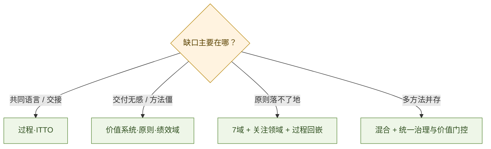

# 项目管理演进：从过程共同语言到价值交付

> PMI《PMBOK®指南》与《项目管理标准》从第 6 版（2017）到第 8 版（2025），不是简单「章节加减」，而是知识组织逻辑的三次校准：先立**过程共同语言**，再立**价值与原则**，再把**可执行过程**嵌回绩效域。  
> 本文综合公开版本研究与 PMI 行业报告，回答：变了什么、为何而变、当下如何裁剪使用；并对「AI 取代项目经理」类远期叙事给出有边界的判断。

**结论：**

> **项目管理的主线，正从「有没有按过程做完」转向「是否交付可感知的价值」。**  
> 第 6 版贡献可交流的过程与 ITTO 共同语言；第 7 版把项目放进**价值交付系统**，用原则与绩效域容纳预测 / 敏捷 / 混合；第 8 版保留价值导向，精炼原则、重构绩效域，并把过程与 ITTO **以非规定性方式**嵌回——不是退回第 6 版，而是在原则骨架上补实践衔接。  
> 行业现实是 **fit-for-purpose 混合方法**上升；成功定义扩展为 **Value + Execution**。AI 可下沉事务性工作，人类仍守目标对齐、治理护栏、伦理与多方共识。

**30-governance 位置：** [30](./30-cobit-it-governance-framework.md) 回答技术是否创造可验证经营结果；[31](./31-platform-service-quality-case-study.md) 写平台质量账本；本文写**项目如何被组织与评价**。可与 [21](../20-architecture/21-service-architecture-evolution.md)（价值与复杂度转移）、[21a](../20-architecture/21a-platform-engineering-idp-treatise.md)（平台化交付）、[25](../20-architecture/25-architecture-thinking-cto-treatise.md)（决策）对照。

## 摘要

以 PMI 官方第 8 版说明与第 6–8 版结构对照为主线：厘清《标准》与《指南》二分；说明第 6 版知识领域 × 过程组、第 7 版价值系统与 12 原则 / 8 绩效域、第 8 版 6 原则 / 7 绩效域 / 5 关注领域与过程回嵌。结合 Pulse of the Profession（混合方法 2020→2023 显著上升）与 *Maximizing Project Success*（成功 = 价值 + 执行）给出行业前沿。末节讨论 AI 与「使命负责人」远期图景：事务可下沉，价值与伦理不可外包。[^pmbok6][^pmbok7][^pmbok8][^pulse2024][^success2024]

**关键词：** PMBOK；价值交付系统；绩效域；原则；过程组；关注领域；ITTO；混合方法；裁剪；项目成功；AI

---

## 目录

1. [读法与边界](#1-读法与边界)
2. [中心论点与三版一览](#2-中心论点与三版一览)
3. [先分清：《标准》与《指南》](#3-先分清标准与指南)
4. [第 6 版：过程共同语言](#4-第-6-版过程共同语言)
5. [第 7 版：价值交付与绩效域](#5-第-7-版价值交付与绩效域)
6. [第 8 版：原则精炼与过程回嵌](#6-第-8-版原则精炼与过程回嵌)
7. [行业前沿：混合、成功定义与 AI](#7-行业前沿混合成功定义与-ai)
8. [实践：如何裁剪使用](#8-实践如何裁剪使用)
9. [角色展望：事务下沉，使命上移](#9-角色展望事务下沉使命上移)
10. [与本库暗线](#10-与本库暗线)
11. [参考文献](#11-参考文献)

---

## 1. 读法与边界

| 轴 | 本文提供 | 本文不提供 |
| -- | -------- | ---------- |
| **演进** | 第 6–8 版组织逻辑与关键术语对照 | 替考 PMP 的题库或逐过程背诵 |
| **行业** | Pulse / 成功研究可核验口径 | 某一咨询公司的落地模板 |
| **展望** | AI 与角色变迁的**有边界**判断 | 2076 年时间表式预言 |

> **易混纠正：** 部分图解文称第 8 版「仍保留 12 原则、8 绩效域」——与 PMI 第 8 版公开说明不符。第 8 版为 **6 原则、7 绩效域**，并恢复演化后的过程指导。[^pmbok8][^pmbok8-explain]

---

## 2. 中心论点与三版一览

> **一句话：** 第 6 版立秩序（过程），第 7 版立目的（价值），第 8 版把目的与可执行实践重新焊牢。

| | 第 6 版（2017） | 第 7 版（2021） | 第 8 版（2025） |
| - | -------------- | -------------- | -------------- |
| **两主体顺序** | 《指南》→《标准》 | 《标准》→《指南》 | 《标准》→《指南》 |
| **《标准》主线** | 引论 + 五大过程组 | 价值交付系统 + **12** 原则 | 价值交付系统 + **6** 原则 + 生命周期 |
| **《指南》主线** | 十大知识领域 + 约 49 过程 / ITTO | **8** 个项目绩效域 + 裁剪 + 模型/方法/工件 | **7** 个绩效域（嵌入约 40 过程）+ 输入输出 / 工具技术专章 |
| **过程组表述** | 启动·规划·执行·监控·收尾 | 不再作为主书展开主轴 | 改称 **5 个关注领域（Focus Areas）** |
| **组织逻辑** | 过程与知识主题交叉 | 结果导向、方法包容 | 价值导向 + 实践衔接 |

---

## 3. 先分清：《标准》与《指南》

日常口语常把整本书叫「PMBOK」。讨论版本差异时须分开：[^pmbok-struct]

| 文本 | 属性 | 作用 |
| ---- | ---- | ---- |
| **《项目管理标准》** | 含 ANSI 标准属性 | 共同遵循的原则与框架「应当怎样想」 |
| **《项目管理知识体系指南》** | 理解与应用的指南 | 如何开展管理实践「可以怎样做」 |

第 6 版《指南》在前，并不等于《指南》高于《标准》——书中已说明指南以标准为基础。第 7 版起将《标准》前置，更直接地先立原则，再谈实践。[^pmbok6][^pmbok7]

---

## 4. 第 6 版：过程共同语言

### 4.1 知识领域 × 过程组

第 6 版最广为人知的结构：

- **十大知识领域** — 管哪些方面（整合、范围、进度、成本、质量、资源、沟通、风险、采购、相关方等）  
- **五大过程组** — 管理活动的逻辑分类（启动、规划、执行、监控、收尾）  
- **约 49 个过程** — 每个过程有 **ITTO**（Inputs, Tools & Techniques, Outputs）

某一过程可同时属于某个知识领域与某个过程组，例如「制定项目章程」属整合管理 × 启动过程组。[^pmbok6]

> **价值：** 给不同组织、专业背景一套可交流、可检查、可积累经验的共同语言——需要什么信息、做什么工作、用什么工具、产出什么、如何流入下一步。

### 4.2 过程组 ≠ 项目阶段 ≠ 瀑布

第 6 版明确：**过程组不是项目阶段**。项目可按概念 / 设计 / 施工等划分阶段；阶段内部仍可反复出现启动—规划—执行—监控—收尾。更不能把过程组直接等同于瀑布开发——管理过程分类与产品开发方法是不同维度。[^pmbok6]

### 4.3 裁剪与敏捷并非第 7 版才出现

第 6 版已强调指南不可原样照搬，须按情境裁剪；各知识领域含裁剪及适应型环境讨论。同年 PMI 与 Agile Alliance 合作出版《敏捷实践指南》。第 7 版是继续强化，而非从零发明敏捷。[^pmbok6][^agile2017]

---

## 5. 第 7 版：价值交付与绩效域

### 5.1 组织逻辑重构

第 7 版《标准》以**价值交付系统**与 **12 项项目管理原则**为核心；《指南》设 8 个**项目绩效域**：干系人、团队、开发方法与生命周期、规划、项目工作、交付、测量、不确定性。[^pmbok7]

| 划分 | 依据 | 勿误解为 |
| ---- | ---- | -------- |
| 知识领域（第 6） | 专业管理主题 | — |
| 绩效域（第 7） | 有效实现结果所必需的相关活动及其相互作用 | 「知识领域换皮」 |

前言明确：项目应置于组织价值交付系统中理解；评价管理应关注是否促进**预期结果**，而不只是否遵循过程、形成计划或完成文档。[^pmbok7]

> **港口调度系统例子：** 按期上线是可交付成果；是否改善设备协同、减少等待、提高作业效率，才是价值问题。第 7 版强化的是从「交付了什么」追问「改变了什么」。

### 5.2 原则化是为了容纳多种方法

背景包括软件向产品与服务渗透、云与 AI、新商业模式、组织与团队结构变化。不同项目需要不同开发与交付方法；单纯围绕既有过程展开难以覆盖多样性。[^pmbok7]

第 7 版以相对通用的原则覆盖预测型、适应型与混合型。**它不要求所有项目转向敏捷，也不宣告过程管理结束**——过程组与知识领域仍可使用；12 原则亦非「敏捷专属」。[^pmbok7-faq]

纸质主书不再完整展开第 6 版过程 / ITTO，更多情境化内容衔接数字资源。2022 年 PMI 另出《过程组：实践指南》，系统保留五大过程组与 ITTO——勿因主书目录变薄就断言过程知识被放弃。[^process-groups]

---

## 6. 第 8 版：原则精炼与过程回嵌

### 6.1 不是「回到第 6 版」

第 8 版保留原则 + 绩效域骨架，并**重新引入演化后的过程指导**：[^pmbok8]

| 要素 | 第 8 版口径 |
| ---- | ----------- |
| **原则** | 精炼为 **6** 项 |
| **绩效域** | 重构为 **7** 项：治理、范围、进度、财务、利益相关方、资源、风险 |
| **关注领域** | 原五大过程组改称 **5 Focus Areas**（可通过正式过程或非正式实践 / 政策实现） |
| **过程** | 约 **40** 个过程嵌入绩效域；输入输出、工具与技术集中呈现 |

> **准确表述：** 把第 6 版较详细的过程 / ITTO，与第 7 版相互联系的绩效域结构结合起来——不是简单复辟旧目录。[^pmbok8][^pmbok8-explain]

7 个新绩效域与第 7 版 8 个绩效域**非一一对应**；规划 / 交付 / 测量等被重新组织，治理与财务位置更清晰。质量、沟通、采购不再独立成域（沟通多纳入利益相关方；治理含质量保证与采购寻源等相关内容，采购另有展开）。40 过程亦不宜理解为「49 减 9」的简单删减。[^pmbok-v8-wechat]

### 6.2 六项原则（第 8 版）

1. 采纳整体视角  
2. 关注价值  
3. 将质量融入流程与可交付物  
4. 成为负责任的领导者  
5. 在所有项目领域中融合可持续性  
6. 建立赋能型文化  

相对第 7 版 12 原则，系统交互与复杂性等被整合；可持续性获独立原则位置（环境与社会责任在第 7 版已有涉及，非首次出现）。[^pmbok8][^pmbok-v8-wechat]

### 6.3 定义层的价值转向

第 8 版对「项目 / 项目管理」的表述更明确强调：在独特情境中创造价值、达到或超越预期价值。这与 PMI *Maximizing Project Success* 一致——在进度、预算、范围等执行指标之外，考察结果与利益相关方感知的价值是否值得投入。[^success2024]

> **边界：** 价值导向 ≠ 允许镀金或范围蔓延；须通过授权、治理与变更决策落实。[^pmbok-v8-wechat]

《标准》引论讨论气候、资源、地缘、不平等与 AI 等背景；《指南》含人工智能等附录，讨论应用场景、采纳与负责任使用——拓宽管理责任，但不宜断言「整版重构仅由某一技术驱动」。[^pmbok8]

---

## 7. 行业前沿：混合、成功定义与 AI

### 7.1 混合方法成为 fit-for-purpose 主流趋势

PMI Pulse of the Profession（基于年度全球调查）：受访者报告总是或经常使用**混合方法**的比例，约从 **2020 年 20%** 升至 **2023 年 31.5%**（约 +57%）；同期预测型下降、敏捷变化相对平缓。[^pulse2024]

> **含义：** 组织需要通用原则 + 可裁剪过程与工具——这正是第 7 版加强方法包容、第 8 版加强实践衔接所回应的现实。混合没有单一配方，取决于成果类型、环境、团队与行业。在方法与支持匹配时，预测 / 敏捷 / 混合的绩效可比。[^pulse2024][^hybrid-blog]

### 7.2 成功 = 价值 + 执行

*Maximizing Project Success* 将项目成功重框为：

> **Project Success = Value + Execution**

四点含义：管理利益相关方对价值的感知；对价值而不只对执行负责；随需求 / 技术 / 目标变化重估参数；把项目放进更广业务与社会影响中。[^success2024]

这与第 7–8 版「价值交付系统」同向，也与本库 [30](./30-cobit-it-governance-framework.md)「技术是否创造可验证经营结果」可互证。

### 7.3 AI：辅助已至，技能缺口仍在

行业讨论中，生成式 AI 已覆盖会议纪要、干系人更新、风险看板、资源规划等；同时调查口径显示，具备良好实用 AI 技能的项目专业人士比例仍偏低（公开二次整理约两成量级）——**工具扩散快于能力扩散**。[^pulse2025-ai]

第 8 版将 AI 纳入正式讨论，方向是负责任使用：数据质量、人类监督、干系人参与与责任归属。[^pmbok8]

---

## 8. 实践：如何裁剪使用

不要问「该用第几版」，问「当前缺口在哪一层」：

| 若痛点是… | 优先借用 |
| --------- | -------- |
| 缺少共同语言、检查清单、过程交接不清 | 第 6 版过程组 / 知识领域 / ITTO，或《过程组：实践指南》 |
| 交付了但业务无感、方法僵化、裁剪不会做 | 第 7 版价值系统、原则、绩效域与裁剪章 |
| 有原则口号但落不到治理 / 财务 / 风险动作 | 第 8 版 7 绩效域 + 关注领域 + 过程 / ITTO 回嵌 |
| 土木与软件混部、预测与迭代并存 | 混合：硬约束工作用基准控制；不确定工作用迭代 + 共同治理与价值门控 |

**假设场景（港口改扩建 + 智能化）：**

1. **第 6 版镜头** — 梳理范围、进度、成本、风险、采购、相关方；追踪计划—决策—成果。  
2. **第 7 版镜头** — 追问设施与数字系统能否改善运行；团队与干系人是否具备促成结果的条件。  
3. **第 8 版镜头** — 落实治理、财务、资源安排；为不同工作包裁剪过程；土建 / 设备可强基准，调度软件可迭代试运行，仍在同一价值与治理下协调。[^pmbok-v8-wechat]

---

## 9. 角色展望：事务下沉，使命上移

公开「50 年后项目管理」类叙事，常把传统「排计划、盯进度、写周报」岗位消解，换成 **Mission Owner（使命负责人）**：设定目标与价值指标、划定 AI 智能体权限与红线、裁决伦理与重大风险；执行、调度、仿真、文档多由智能体完成。[^pm-future-wechat]

宜拆成**可核验近景**与**思辨远景**：

| 时间尺度 | 较稳妥的判断 | 过度断言 |
| -------- | ------------ | -------- |
| **现在** | PM 管人与流程，工具辅助；铁三角仍是常用执行约束 | 「PM 已过时」 |
| **约 10 年** | 事务性工作加速下沉；人类侧重价值验证、AI 风险与合规 | 「全面自主项目无需人类」 |
| **远期想象** | 人机混合、多维价值（商业 / 生态 / 伦理 / 韧性）、PMO 转向智能治理中枢 | 把科幻时间表写成必然 |

**人类仍难外包的能力（与近景一致）：**

1. **目标对齐与价值取舍** — AI 擅长实现目标，难自主判断目标该不该做。  
2. **边界治理与伦理裁决** — 护栏、审计、偏见与安全隐患。  
3. **跨主体博弈与共识** — 合同可起草，信任与价值观冲突仍靠人。  
4. **复杂系统认知** — 识别耦合、反馈与级联风险。[^pm-future-wechat]

行业差异（硬工程 / AI 数字系统 / 民生生态）会越来越集中在**价值判断与风险性质**，而非排期工具本身——这与第 8 版强化治理、财务、可持续性同向。

> **职业启示：** 核心竞争力从「会排计划」转向系统思维、价值判断、复杂风险、伦理权衡与多方共识；实体工程背景的优势是约束与风险直觉，短板常在 AI 治理与非货币价值评估。[^pm-future-wechat]

---

## 10. 与本库暗线

| 本库文 | 衔接点 |
| ------ | ------ |
| [21](../20-architecture/21-service-architecture-evolution.md) | 架构代际也是复杂度转移；项目成功要从交付追问价值 |
| [21a](../20-architecture/21a-platform-engineering-idp-treatise.md) | 平台工程把交付路径产品化；项目裁剪与黄金路径同构 |
| [30](./30-cobit-it-governance-framework.md) | 治理问价值 / 风险 / 资源；与项目「Value + Execution」互证 |
| [25](../20-architecture/25-architecture-thinking-cto-treatise.md) | 架构与项目决策都靠价值思维，而非多画一张图 |
| [41](../40-paradigm/41-ai-engineering-paradigm.md) / [42](../40-paradigm/42-agentic-sre-operations-playbook.md) | 个人 / Agent 变快后，组织与项目治理如何承接 |

> **收束：** 好的项目管理框架，像好的架构演进一样——不消灭复杂度，而是把当下最痛的那一类（沟通混乱、方法僵化、或价值失焦）移到更合适的承担结构上。

---

## 11. 参考文献

[^pmbok6]: Project Management Institute, *A Guide to the Project Management Body of Knowledge (PMBOK® Guide)*, 6th ed., 2017.  
[^pmbok7]: Project Management Institute, *A Guide to the Project Management Body of Knowledge (PMBOK® Guide) and The Standard for Project Management*, 7th ed., 2021.  
[^pmbok8]: Project Management Institute, *PMBOK® Guide*—Eighth Edition and The Standard for Project Management（2025 年 11 月；ANSI/PMI 99-001-2025）。官方介绍：<https://www.pmi.org/standards/pmbok>  
[^pmbok8-explain]: 第 8 版结构二次说明（6 原则、7 绩效域、5 关注领域），例如 <https://www.4pmti.com/learn/what-is-pmbok-8th-edition/>（以 PMI 官网为准交叉验证）。  
[^pmbok-struct]: PMI 对《标准》与《指南》关系的说明，见各版前言 / FAQs。  
[^pmbok7-faq]: PMI, *PMBOK® Guide—Seventh Edition FAQs*.  
[^agile2017]: PMI & Agile Alliance, *Agile Practice Guide*, 2017.  
[^process-groups]: PMI, *Process Groups: A Practice Guide*, 2022.  
[^pulse2024]: PMI, *Pulse of the Profession® 2024*（混合方法约 20%→31.5%）。<https://www.pmi.org/-/media/pmi/documents/public/pdf/learning/thought-leadership/pmi-pulse-of-the-profession-2024-report.pdf>  
[^hybrid-blog]: PMI, “The Hybrid Era: Project Management Embraces the Fit-for-Purpose Approach,” 2025.  
[^success2024]: PMI, *Maximizing Project Success*, 2024.<https://www.pmi.org/learning/thought-leadership/project-success>  
[^pulse2025-ai]: 对 Pulse 2025 / AI 技能缺口的公开二次整理（约两成具备良好实用 AI 技能）；落地时以 PMI 当期报告原文为准。  
[^pmbok-v8-wechat]: 婧Jing, “PMBOK从第6版到第8版，变了些啥~,” 微信公众号（目录与原则 / 绩效域对照的课堂整理）。<https://mp.weixin.qq.com/s/Xt-dIohIRIkZf6T3CzTZYA>  
[^pmbok-v8-infographic]: “图解《PMBOK®指南》（第8版）…”（图解传播文；其中「仍保留12原则/8域」等表述与第8版官方口径冲突，本文不采）。<https://mp.weixin.qq.com/s/bIXRq0DBmjDCIdEdh_GhCg>  
[^pm-future-wechat]: “50年后（2076年）的项目管理是什么样子的？”（远期思辨，非预测承诺）。<https://mp.weixin.qq.com/s/sS5ZtjIp3AKQHH-Vk5Eotg>

### 延伸阅读

- PMI *Beyond Agility* / *The Future of Project Work*  
- [30](./30-cobit-it-governance-framework.md) / [21](../20-architecture/21-service-architecture-evolution.md) / [21a](../20-architecture/21a-platform-engineering-idp-treatise.md)

**声明：** 本文是版本逻辑与行业口径的对照地图，不是 PMI 官方译文或考证辅导材料。第 8 版页级细节以纸质 / 电子版原文为准；图解传播文若与官网冲突，从官网。远期角色叙事仅作能力启示，不作时间表承诺。

---
